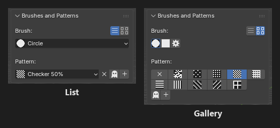
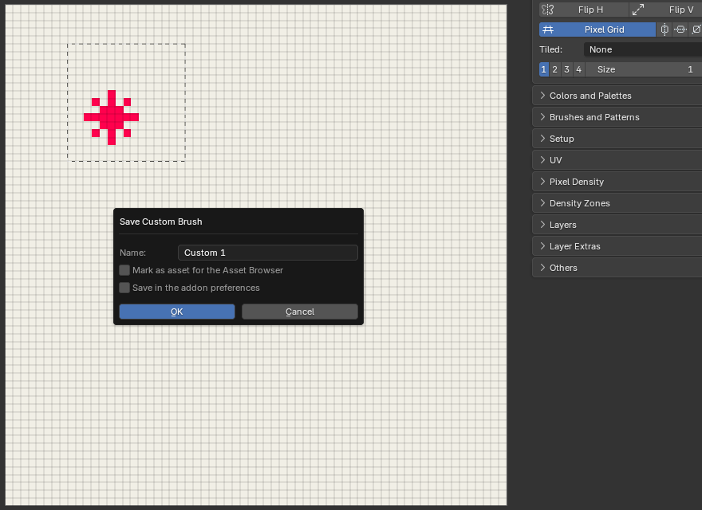
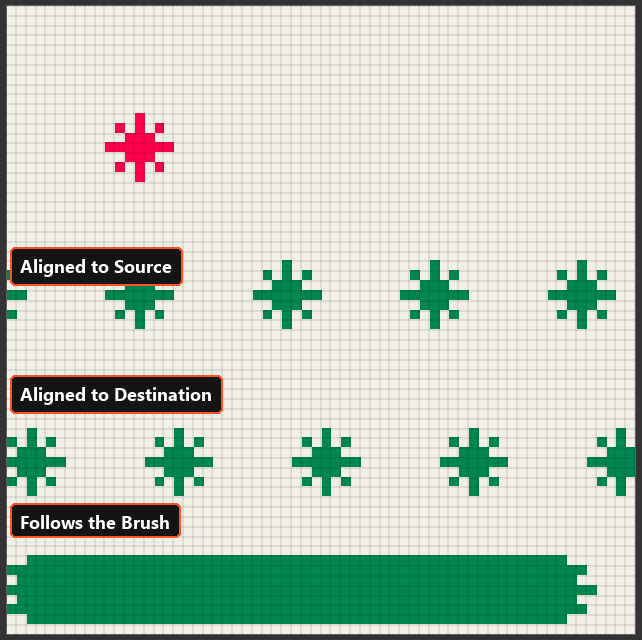
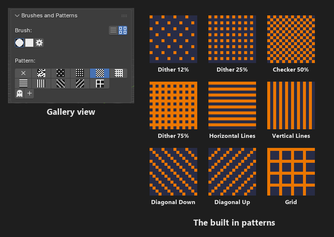
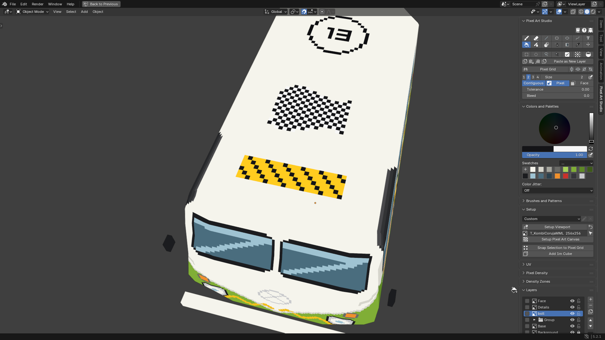
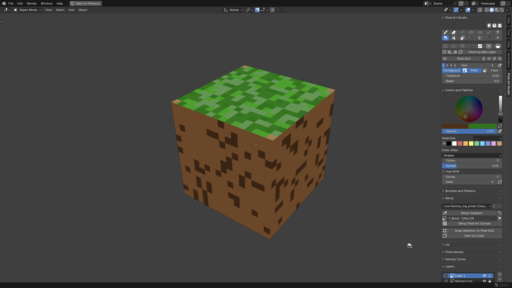
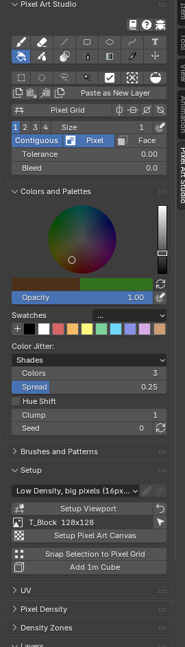

.. _brushes-and-patterns:

Brushes and Patterns
=========================================

The ``Brushes and Patterns`` panel is in the sidebar (:kbd:`N`) > ``Pixel Art Studio`` tab, right under ``Colors and Palettes``, in the 3D Viewport and in the Image Editor. **It's closed by default**, click its header to open it. The tools popup (:kbd:`D`) has it too.

* ``Brush:`` the footprint the paint is laid with.
* ``Pattern:`` the fill pattern the paint is laid through.
* The two buttons top right switch between ``List`` (dropdowns) and ``Gallery`` (grids of previews). One switch for the shapes, the custom brushes and the patterns.
* The Eraser keeps its own shape, custom brush and fill pattern, apart from the Brush's (:ref:`shared-tool-settings`).

The brush size is in the main panel, see :ref:`shared-tool-settings`.

Brush shapes
------------

* ``Circle`` (default): round footprint, identical to Aseprite's round brush (size 1 is one texel, size 2 a full 2x2).
* ``Square``: square footprint.
* ``Custom``: a footprint you saved from a selection (see below). Picking ``Custom`` brings back the custom brush you used last.

The shape stamps every Brush and Eraser dab, the outlines of the Line, the Rectangle, the Ellipse and the Path, and the dabs of Blur, Shading and Pixel Spray.

.. _custom-brushes:

Custom brushes
--------------

Make a brush out of anything you draw. Let's make one:

1. In the **Image Editor**, paint a small shape on the active layer.
2. Select it with the ``Marquee`` (:kbd:`Shift+Alt+M`). Empty space inside the selection is part of the brush, so it can put the shape off center or space out the repeats.
3. In ``Brushes and Patterns``, set the shape to ``Custom`` and click ``+`` (``Save Custom Brush``).
4. Give it a name, optionally tick ``Mark as asset for the Asset Browser`` and ``Save in the addon preferences``, and click ``OK``.

The new brush becomes the active one. Arm the Brush and paint with it, in the Image Editor or on the model.

* Custom brushes can only be **made** in the Image Editor. Painting with them works in both editors.
* A custom brush is a **shape**: it stamps in the current color, and the alpha of what you drew is kept (soft or semi transparent texels stamp that faint). A selection over nothing painted uses the selection's own shape.
* It paints at the size it was saved, the ``Size`` field doesn't scale it. Up to 64 x 64 texels.
* The buttons under the picker: ``X`` removes the brush from this file, the cog saves it in the add-on preferences, the asset icon marks it as an asset, and ``+`` saves a new one.
* The dropdown under the buttons says how the brush repeats while you drag (Aseprite's three alignments):

  * ``Aligned to Source`` (default): the brush repeats across the canvas from where it was cut, so its gaps stay gaps however you drag.
  * ``Aligned to Destination``: the brush repeats from where the stroke starts, the first dab is the brush exactly as drawn.
  * ``Follows the Brush``: the brush travels with the pointer, so a drag smears it into a continuous band.
  * Each brush is saved with its alignment, and picking it puts that alignment back.

Where custom brushes are saved:

* **In the .blend** (always): the brushes of that file.
* **In the add-on preferences** (the cog button, or the checkbox when saving): a new file gets every brush of that library (a file that already has brushes of its own keeps its own list). Manage them in ``Edit > Preferences > Add-ons > Pixel Art Studio`` > ``Presets`` > ``Custom Brushes``, where ``X`` removes a brush from the preferences (the files that have it keep it).
* **In the Asset Browser** (the asset button, or the checkbox when saving): as an image named ``PS Brush`` plus the brush's name, tagged ``Pixel Art Studio``.

.. note::
    Marking as an asset is one way only: appending that image into another file gives you the image, not a custom brush. Use the add-on preferences to carry brushes between files.

.. _fill-patterns:

Fill patterns
-------------

A pattern decides which of the **two colors** each painted texel takes: its set texels take the primary color, the gaps take the secondary color. The tool still decides which texels get paint (the way GraphicsGale does it). **Real dithering in one click**, on every drawing tool.

* ``No Pattern`` (default), ``Noise`` (below) and nine built in 4x4 patterns: ``Dither 12%``, ``Dither 25%``, ``Checker 50%``, ``Dither 75%``, ``Horizontal Lines``, ``Vertical Lines``, ``Diagonal Down``, ``Diagonal Up`` and ``Grid``. Your own patterns are listed after them.
* ``X`` beside the picker goes back to ``No Pattern``.
* ``Transparent`` (the ghost icon): leaves the gaps untouched instead of filling them with the secondary color, to **lay a pattern over art that is already there**.
* Patterns work with the **Brush, Eraser, Line, Rectangle, Ellipse, Path, Bucket and Pixel Spray** (the Gradient has its own dither).

  * The Eraser erases only through the set texels and never touches the gaps.
  * A shape filled with ``Secondary Color`` gets its gaps in the primary color (the two colors trade places).

* Patterns are **locked to the canvas pixel grid**, so overlapping strokes, a stroke and a bucket fill, or a moved layer all meet without a seam. On the model they're carried across UV seams, so **stripes keep their direction** even onto a neighbouring island that is turned in the texture.
* The brush preview shows the pattern texel by texel, in both colors, before you click.

Custom patterns
---------------

1. Paint a motif on the active layer (up to 16 x 16 texels).
2. Select it.
3. Click ``+`` beside the pattern picker (``Pattern from Selection``).
4. Give it a name, optionally tick ``Mark as asset for the Asset Browser`` and ``Save in the addon preferences``, and click ``OK``. It becomes the active pattern.

* Any paint inside the selection is a set texel (a pattern is on or off, the colors are ignored).
* The pattern keeps its place on the canvas, so a motif cut out of a drawn pattern **continues that pattern in step**.
* It works in both editors.
* Saving with the name of a pattern you already have replaces that pattern.
* While one of your own patterns is in use, three more buttons show: ``X`` deletes it from this file, the cog saves it in the add-on preferences, and the asset icon marks it as an asset (an image named ``PS Pattern`` plus the pattern's name).

In ``Edit > Preferences > Add-ons > Pixel Art Studio`` > ``Presets`` > ``Fill Patterns``:

* ``X`` on a built in pattern **hides it** from the menu and the gallery.
* ``X`` on a saved pattern removes it from the preferences (the files that use it keep it).
* ``Restore Default Patterns`` shows every built in pattern again and removes the patterns saved in the preferences (it asks first, and patterns saved inside a .blend are not touched).

.. _noise-pattern:

Noise pattern
-------------

``Noise`` is a pattern of its own: random texels in the two colors, **for grime, grass, speckles and rust**. It shows its own settings under the picker:

* ``Density``: how many texels take the primary color (the rest take the secondary color, or stay as they are with ``Transparent``).
* ``Clump``: ``1`` scatters single texels, higher values gather them into patches about that many texels wide (``Density`` stays the same share at every ``Clump``).
* ``Seed`` and the refresh button (``New Seed``): another seed scatters the texels another way.

The same seed always gives the same texels, so **painting over an area again doesn't change it**, and strokes and fills meet with no seam.

.. _color-jitter:

Color Jitter
------------

``Color Jitter`` varies the color texel by texel while you paint, for hand placed looking texture. It's in ``Colors and Palettes``, under the swatches, and works with the **Brush and the Bucket** (it's greyed out for the other tools).

* ``Off`` (default): paints the color as it is.
* ``Shades``: lighter and darker shades of the color, scattered.

  * ``Spread``: how far the lightest and the darkest shades are from the color.
  * ``Hue Shift``: lighter shades turn warmer and darker ones cooler, the way the Shading tool's ``Hue Shifting`` does.

* ``Swatches``: the swatches from the one you last clicked, scattered in place of the primary color (the ramp is drawn under it).
* ``Colors``: how many colors are scattered (2 to 8).
* ``Clump`` and ``Seed``: the same as the Noise pattern's, with their own values, so both can be on at once without lining up.

Like the Noise pattern, the scatter is fixed per texel: **repainting an area gives the same result**, and it works the same on the model and in the Image Editor. The brush preview shows the jittered texels.

.. tip::
    For a ``Swatches`` ramp, keep the colors of one ramp next to each other in your swatches (dark to light greens, for example) and click the first one. Clicking the last swatch leaves nothing to the right of it, and the panel says ``Click a swatch to start the ramp``.
