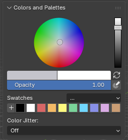
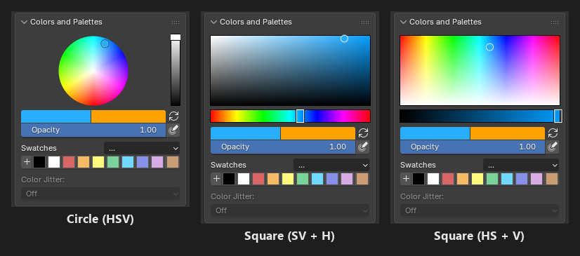
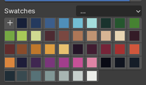

.. _colors-and-palettes:

Colors and Palettes
=========================================

The ``Colors and Palettes`` panel is in the sidebar (:kbd:`N`) > ``Pixel Art Studio`` tab, right under the main ``Pixel Art Studio`` panel, in the 3D Viewport and in the Image Editor (open by default). The tools popup (:kbd:`D`) has it too, without the color picker.

From top to bottom:

* The color picker (for the primary color).
* The primary and the secondary colors, and the swap button.
* ``Opacity`` (see :ref:`shared-tool-settings`).
* The swatches and the ``...`` palette menu.
* ``Color Jitter`` (see :ref:`color-jitter`).

**The hex you pick is exactly the hex that is painted**, byte for byte: in the color picker, in the swatches, from a Lospec palette and in the texture. No color management surprises.

Color picker
------------

Blender's own color picker, embedded in the panel, on the **primary color**.

* Its shape follows Blender's ``Preferences > Interface > Editors > Color Picker Type`` (``Circle (HSV)``, ``Square (SV + H)`` and so on).
* ``Show color picker`` in the add-on preferences (``General`` > ``Colors and Palettes``) hides it, the two colors and the swatches stay.

Primary and secondary colors
----------------------------

* **Primary color** (left, black by default): what the tools paint with.
* **Secondary color** (right, white by default): the gaps of a fill pattern, the ``Secondary Color`` fill of the Rectangle, the Ellipse and the Path, and the end color of the Gradient.
* Click either color for Blender's popup picker, with the ``Hex`` field and the alpha (a color with alpha below 1 paints that transparent).
* **Swap**: the refresh icon right of the two colors, or :kbd:`Alt+X` while a tool is armed (:kbd:`X` in ``Pixel Art Studio Only``).

Swatches
--------

* ``+`` adds the primary color as a swatch.
* Click a swatch to paint with it (the swatch of the current color is drawn pressed).
* :kbd:`Ctrl+click` a swatch removes it (right click > ``Remove Swatch`` too).
* ``Next Swatch`` (:kbd:`Alt+X` in ``Pixel Art Studio Only``, while a tool is armed) walks your swatches: the primary color becomes the next swatch, wrapping around at the end.
* The swatch you last clicked is where the ``Swatches`` ramp of ``Color Jitter`` and the ``Color Replace`` ramp of the Shading tool start.
* The swatches are saved in the .blend (per scene). A new file starts with a palette of ten colors.

Palettes
--------

The ``...`` button beside ``Swatches`` opens the palette menu:

* ``Lospec palettes...``: the Lospec palette library (below).
* ``Import Palette Image…``: reads the colors out of an image (``.png``, ``.jpg``, ``.bmp`` or ``.tga``). Every unique color becomes a swatch, in the order they appear (top row first, left to right), up to 256 colors. Fully transparent pixels are skipped.
* ``Save Palette``: saves the current swatches as a Blender palette inside the .blend (saving with an existing name overwrites it). It's a regular Blender palette, so Blender's own paint tools can use it too.
* ``Load Palette``: loads any Blender palette of this file into the swatches.
* ``Clear Swatches``: removes every swatch.

Importing, loading and Lospec palettes **replace** the swatches you have.

.. tip::
    Use a clean palette image for ``Import Palette Image…``, like the PNG palettes you can download from `Lospec <https://lospec.com/palette-list>`_. A photo or a JPG gives you hundreds of near duplicate colors.

.. warning::
    Swatches and palettes are not part of the undo history, :kbd:`Ctrl+Z` won't bring back a cleared or replaced palette. Use ``Save Palette`` before experimenting.

.. _lospec-palette-library:

Lospec palette library
----------------------

**500 palettes from** `Lospec <https://lospec.com/palette-list>`_ **ship with the add-on** (they open instantly and work offline), in Lospec's own ranking order: ``Resurrect 64``, ``Endesga 32``, ``Apollo``, ``Lospec500`` and so on, including classics like ``PICO-8``, ``Sweetie 16``, ``DawnBringer 16`` and ``Nintendo Gameboy (bgb)``.

.. video:: _static/videos/v2/colors-and-palettes-lospec.mp4
  :width: 100%

1. Open ``...`` > ``Lospec palettes...``.
2. Optionally filter by the number of colors: ``Any``, ``Max``, ``Min`` or ``Exact``, and the number beside it.
3. **Click a palette** (its name or any of its colors): it loads onto the swatches at once, so you see it applied to your model while you browse.
4. ``Close`` keeps the palette you clicked last, ``Cancel`` puts back the swatches you had before.

* To find a palette by name, click the small arrow under the list (Blender's list filter) and type part of its name, ``PICO`` for example. It searches the names only, not the authors.
* ``See more in Lospec`` opens the Lospec palette list in your web browser.

.. note::
    On Blender 3.6 and 4.0 the browser is Blender's plain dialog: narrower, with an ``OK`` button instead of ``Close`` and ``Cancel``. ``OK`` keeps the palette, and :kbd:`Esc` puts back the swatches you had before.
