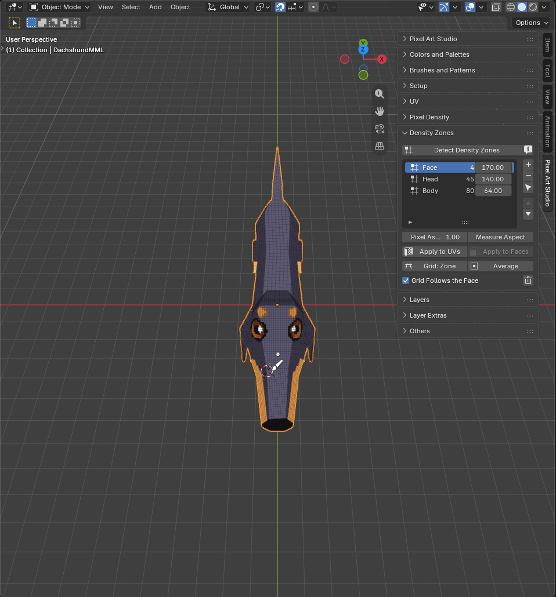
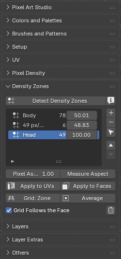
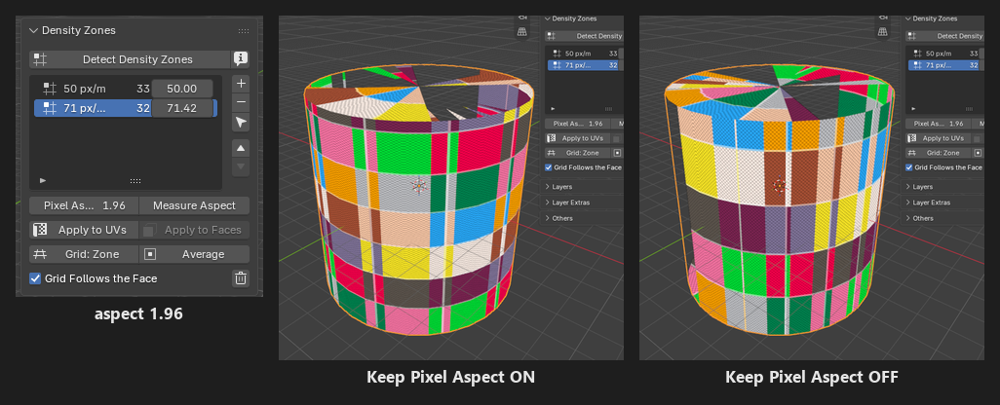
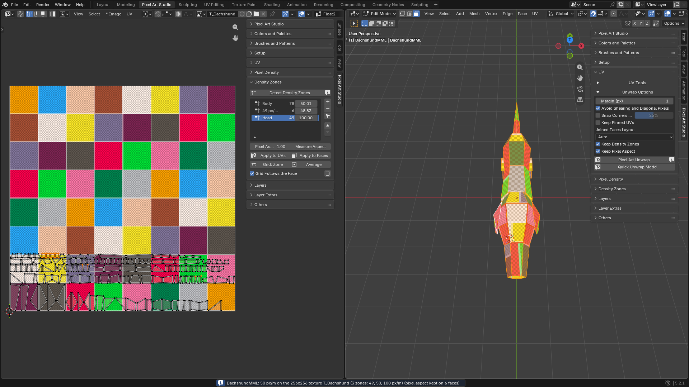

Density Zones
=========================================

Several pixel sizes on **one model** (a character's head drawn at twice the density of the legs, for example, which means smaller and more pixels for the head). A lot of classic PS1 era 3D pixel art was drawn like that.

Density zones are *optional* and advanced: a model with no zones works exactly the same, one pixel size everywhere (see :doc:`pixel-density`). **Painting never needs them**: an existing model with UVs and a texture only needs a tool (see :ref:`automatic-canvas`). Zones are for UV unwrapping a model drawn at several pixel sizes.

.. note::
    Once a model has zones, **Blender's grid follows the face under the brush** while you paint in the 3D Viewport (``Grid Follows the Face``, below). Want to keep your own grid? Don't detect zones, or untick ``Grid Follows the Face`` (or the preference ``Automatically configure grid and grid units``).

* **A zone** is a name, a density (px/m) and a pixel aspect (``1.0`` is square pixels). Every face of the model can be in one zone, or in none.
* **A face in no zone** uses the scene's density.
* **Zones count from two up**: with one zone (or none), the unwrap, ``Apply Texel Density`` and the canvas wizard use the scene's density for every face.
* **Zones are saved on the object**, they travel with the model.

The Density Zones panel
-----------------------

In the sidebar (:kbd:`N`), tab ``Pixel Art Studio``, panel ``Density Zones`` (closed by default), in the 3D Viewport and in the Image Editor (both act on the selected model).

Before the first ``Detect Density Zones`` the panel shows only that button. After it, top to bottom:

* ``Detect Density Zones``, and an info button whose tooltip sums the zones up (the average, the range, and the density the grid is following).
* **The zone list**, with ``+``, ``-``, select and the two arrows beside it.
* ``Pixel Aspect`` and ``Measure Aspect``, for the zone picked in the list.
* ``Apply to UVs`` and ``Apply to Faces``.
* ``Grid: Zone`` and ``Average``.
* ``Grid Follows the Face``, and the trash icon (``Clear Zones``).

Detect Density Zones
--------------------

Measures every UV island of the model against its texture and **groups the islands into zones** by density, then splits each zone by pixel aspect. One click reads an existing model (even a PS1 rip) and finds its pixel sizes for you.

* **The whole model**, whatever is selected.
* **It replaces every zone** the model had. Zones you edited by hand (renamed, retyped, made from a selection) make it ask first: ``Custom density zones, including custom names are going to be lost. Proceed?``
* **Zones are named by what they measured**: ``110 px/m``, or ``198 px/m, aspect 1.35`` when the pixels aren't square. Listed from the biggest pixels to the smallest.
* **The report**: how many zones, over how many islands, from which to which density, and the average.
* **The preset goes to** ``Custom`` (the density number stays the same).
* Faces with no UV area (collapsed UVs) stay in no zone.

:kbd:`F9` after the click:

* ``Grouping`` (``0.12``): how far apart two islands may measure and still be one zone, as a fraction of their density. Lower makes more zones, higher fewer.
* ``Aspect Grouping`` (``0.2``): the same, for the pixel aspect.

.. note::
    Zones are measured against the texture of the model's material. A model with no texture has nothing to measure its pixels against: give it a canvas first (see :doc:`setup-and-canvas`).

The zone list
-------------

* **A row**: the zone's name, how many faces it has, and its ``Density`` (px/m).

  * Double click the name to rename it (``Head``, ``Body``).
  * Double click ``Density`` to type a new one.

* ``+`` (``Zone from Selection``): a new zone out of the faces selected in Edit Mode, at the density they measure now. They leave the zone they were in.
* ``-`` (``Remove Density Zone``): its faces go to no zone. The UVs are left alone.
* **The arrow cursor** (``Select Zone Faces``): selects exactly the faces of the zone (it goes into Edit Mode if needed).
* **The two arrows**: move the zone up and down the list (every face keeps its zone).

.. note::
    Typing a new ``Density`` moves no UV by itself. It counts at the next ``Apply to UVs``, ``Apply to Faces``, ``Pixel Art Unwrap``, ``Quick Unwrap Model`` or ``Apply Texel Density``.

.. _pixel-aspect:

Pixel aspect
------------

Some models are drawn with pixels **taller than wide**, or the other way round (very often in PS1 rips). The pixel aspect is that shape: texels per meter up the face over texels per meter across it. ``1.0`` is square, and a model made for pixel art measures ``1.0``.

* ``Pixel Aspect``: the picked zone's aspect, measured by ``Detect Density Zones`` (or typed by you).
* ``Measure Aspect``: measures the aspect of **every zone** off the UVs it has now, **keeping its name and density** (for zones you made or renamed by hand). A zone whose islands disagree is split: the biggest part keeps the zone, each other part becomes a new zone at the end of the list (``Head, aspect 1.33``).

.. warning::
    Only ``Pixel Art Unwrap``, ``Quick Unwrap Model`` and ``Apply Texel Density`` (with ``Keep Pixel Aspect`` on) keep a zone's pixel aspect. ``Apply to UVs``, ``Apply to Faces`` and the canvas wizard keep the zone's density with square pixels.

Apply to UVs and Apply to Faces
-------------------------------

* ``Apply to UVs``: scales the UVs of the picked zone's faces to its density, island by island.
* ``Apply to Faces`` (Edit Mode): **gives the selected faces the picked zone** and scales their UV islands to its density. Handy while modeling: select, apply, keep going.

  * Faces joined with ``Keep UVs Together (Join)`` take the zone as a whole group, even if you selected only one of them.

.. warning::
    Neither one repacks, so a grown island can end up on top of another (``Apply to Faces`` warns when it does). Click ``Quick Unwrap Model`` (or ``Pixel Art Unwrap``) with ``Keep Density Zones`` on to pack them clean.

.. _grid-follows-the-face:

The grid that follows the face
------------------------------

``Grid Follows the Face`` (on, per model): while you paint in the 3D Viewport, **Blender's grid is resized and re-pointed on the fly** at the density of the face under the cursor, **to keep one grid square at the size of one pixel for that specific face**.

.. video:: _static/videos/v2/grid-follows-the-face.mp4
  :width: 100%

* **Any tool armed** in the 3D Viewport, with the pointer over the model. Put the tool away and the grid goes back to what it was.
* A face in no zone uses the model's average.
* The preference ``Automatically configure grid and grid units`` (``Edit > Preferences > Add-ons > Pixel Art Studio``, tab ``General``, box ``Density Zones``, on) turns it off for every model.
* The Image Editor's pixel grid is one texel per cell already, there's nothing to follow there.

Two buttons point the grid at one density by hand (to model a detail on a zone's grid, for example):

* ``Grid: Zone``: the picked zone's density.
* ``Average``: the model's average density.

Both set the scene's density to that number (the preset goes to ``Custom``) and run ``Setup Viewport``. Pick your preset again to go back.

.. warning::
    ``Setup Viewport`` puts the selected model on the scene's density, so after ``Grid: Zone`` or ``Average`` the faces in no zone can be scaled to the new number (the faces in a zone keep their zone, with ``Keep Density Zones`` on).

Clear Zones
-----------

The trash icon: removes every zone of the model (it asks first). The UVs stay as they are, and the faces go back to the scene's density at the next apply or unwrap.

Zones in the unwrap and the canvas
----------------------------------

``UV`` panel, ``Unwrap Options`` (both shown only when the model has two zones or more):

* ``Keep Density Zones`` (on): each face laid out at its zone's density, the faces in no zone at the scene's. ``Apply Texel Density`` and ``Setup Viewport`` follow it too.
* ``Keep Pixel Aspect`` (on, only when a zone isn't square): each face stretched by its zone's pixel aspect, **so a re-unwrap keeps the stretched pixels the original UVs had**. Off, every pixel comes out square.

* **A joined group** takes the zone that covers most of its area (one island can't hold two densities). A stack follows the face the others landed on.
* **The report** lists the zones: ``(2 zones: 50, 100 px/m)``.
* ``Fit Texture`` ignores zones: it picks one density to fill the texture.

In ``Setup Pixel Art Canvas`` (see :ref:`setup-pixel-art-canvas`), ``Keep Density Zones`` (on) puts each face on its zone's density, and the suggested ``Texture Size`` is measured with the zones.

How to
------

**Read an existing model**

1. Select the model, click ``Detect Density Zones`` and read the report.
2. Rename the zones (double click the names).
3. Arm a tool in the 3D Viewport and hover the model: the grid follows each part.

**Two pixel sizes on a new model**: see :doc:`tutorial-multiple-pixel-sizes`.

**Keep the stretched pixels of a ripped model through a re-unwrap**

1. ``Detect Density Zones`` (or ``Measure Aspect``, to keep your zone names).
2. Check the ``Pixel Aspect`` of the zones.
3. ``Unwrap Options``: ``Keep Density Zones`` and ``Keep Pixel Aspect`` on, then ``Quick Unwrap Model``.

Troubleshooting
---------------

* **Only** ``Detect Density Zones`` **is in the panel**: everything else shows after the first detect.
* ``Keep Density Zones`` **isn't in Unwrap Options**: the model has one zone or none.
* **The grid doesn't follow**: check ``Grid Follows the Face`` on the model, the preference ``Automatically configure grid and grid units``, and that a tool is armed in the 3D Viewport.
* ``has no UVs to measure`` or ``Nothing to measure on``: the model has no UVs, or all of them are collapsed. Unwrap it first.
* **Sorted or filtered the zone list** (Blender's list options, under the list): the arrows still move zones in their real order, so the rows can look like they didn't move. Turn the sort off.
* **Modifiers that change the number of faces** (``Subdivision Surface``, for example): the grid can follow the wrong face's zone, or the average.
