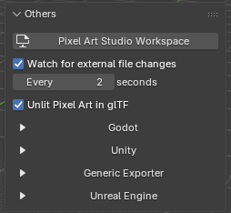
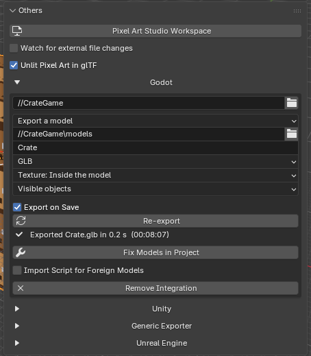
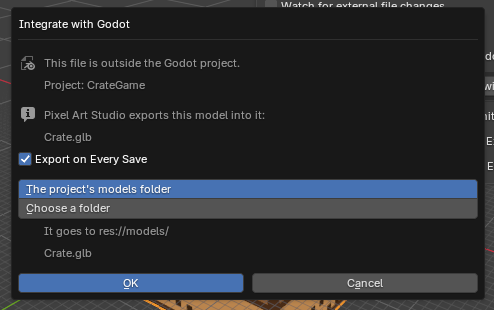
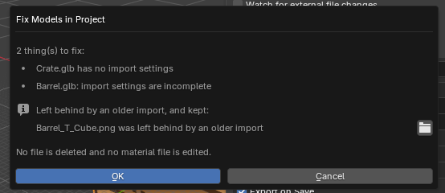
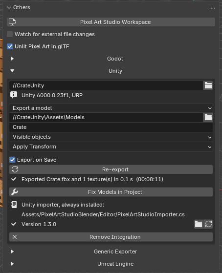
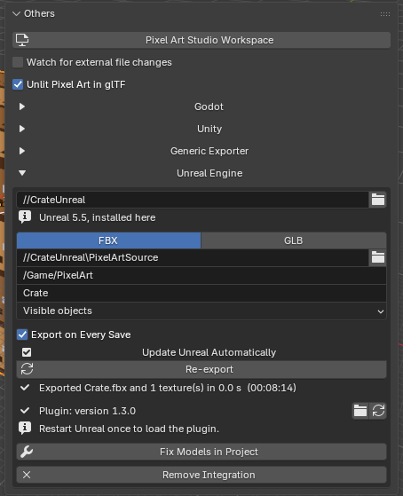
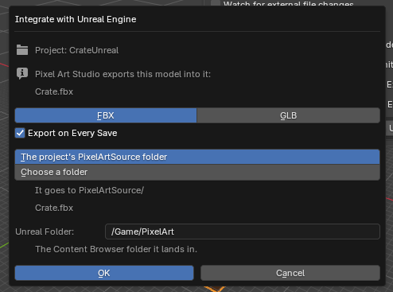
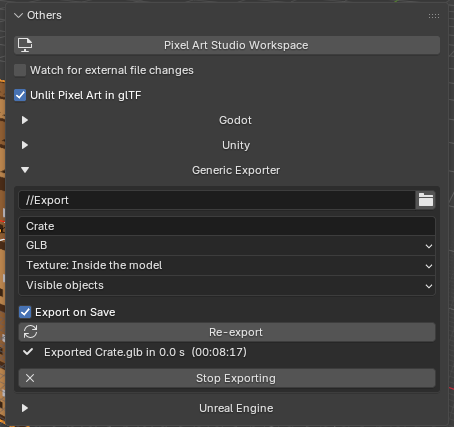
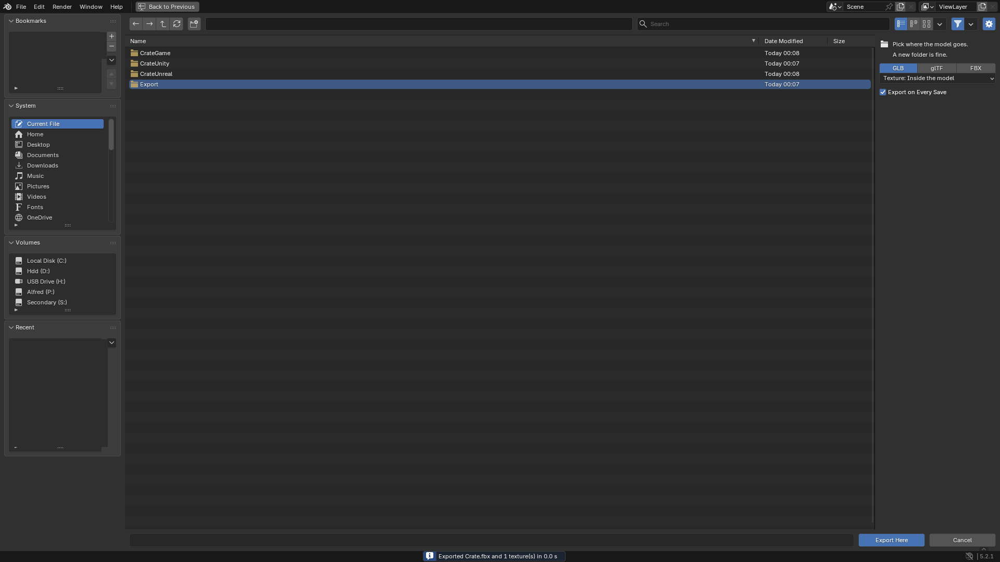

Game Engines
=========================================

Paint in Blender, press :kbd:`Ctrl+S` and the model is in your game engine, **unlit, with crisp pixels and hard edged transparency**: Godot, Unity and Unreal Engine get an integration each, and the ``Generic Exporter`` writes GLB, glTF or FBX into any folder for everything else. No export dialogs and no reimporting by hand.

Everything lives in the sidebar (:kbd:`N`), tab ``Pixel Art Studio``, panel ``Others`` (it's closed by default), in the 3D Viewport and in the Image Editor alike:

* ``Unlit Pixel Art in glTF`` (checkbox, on by default), above the engine sections.
* One section per integration: ``Godot``, ``Unity``, ``Generic Exporter`` and ``Unreal Engine``. Click a header to open it.

.. tip::
    First time? The :doc:`tutorial-game-engines` takes a painted model into Godot step by step, then shows what changes for Unity and Unreal.

.. _unlit-pixel-art-in-gltf:

Unlit Pixel Art in glTF
-----------------------

With ``Unlit Pixel Art in glTF`` on, **every glTF and GLB export from the file comes out as pixel art**, your own ``File > Export > glTF 2.0`` included:

* **Unlit**: the canvas shows the colors exactly as you painted them, with no lighting on top (the standard glTF unlit material, ``KHR_materials_unlit``).
* **Crisp pixels**: nearest filtering, so no blur up close and no mipmap blur far away.
* **Hard edged transparency**: only when the canvas really has transparent texels (cut at 50% alpha). A fully opaque canvas stays opaque.
* **Your own materials keep their shader**: a material of yours that samples a canvas (a ``Principled BSDF``, for example) stays lit, and only gets the crisp pixels and the hard edged transparency.
* Materials that don't use a canvas are not touched.

Godot reads all of that with no import script (nearest filter, unshaded, alpha scissor), and so does any engine or glTF viewer that supports unlit materials.

* Turn it off and the glTF exports from this file are Blender's own, untouched.
* It's saved in the .blend, per scene, and the ``Game Engines`` preferences never hide it.

.. note::
    A canvas material that could not be converted is exported the way Blender writes it, and an integration's last result line says ``The material <name> was left as it was``.

What every integration has in common
------------------------------------

* **Save the .blend first**: every integration starts from a saved file (an unsaved one answers ``Save the file first``).
* **Export on save**: once integrated, **every** :kbd:`Ctrl+S` **writes the model into the project**. The export runs after the save and never makes the save fail: a problem becomes one red line in the panel.
* ``Re-export`` (``Update Godot Files`` and ``Update Unity Files`` when the engine imports the .blend itself): writes now, without saving. Strokes you haven't saved yet go along.
* **The last result line** under the buttons: a check mark or a red error, what was written, how long it took and when (for example ``Exported Crate.glb in 0.1 s  (14:32:05)``).
* ``Export``: ``Visible objects`` (default) or ``Objects with a canvas``. Modifiers are applied, cameras and lights stay out.
* **Canvases are found at each export**: a canvas you add, rename or remove later needs no new setup.
* **The folder was deleted?** A refresh button shows up beside the red line: it makes the folder again at the same path and exports.
* **Nothing in your project is ever deleted** by any button, and a file is written in one go (the engine never imports a half written file).
* **Paths are relative to the .blend** when both are on the same drive, so a project and a .blend that move together keep working. A project on another drive works too.
* **Several at once**: one .blend can be integrated with Godot, Unity, Unreal and the ``Generic Exporter`` at the same time, one save serves all of them. Settings are per scene, so two scenes in one file can ship two models.
* **Undo**: finishing an integration, ``Remove Integration`` and ``Stop Exporting`` are one undo step each (:kbd:`Ctrl+Z` brings a removed integration back, the files already written stay).
* Only the canvas travels (the composite of your layers), never the layer images.

Godot
-----

Needs a **Godot 4** project (a Godot 3 project is refused). Godot can read your model in two ways, and where the .blend is saved decides which ones you get:

* **.blend outside the Godot project**: Pixel Art Studio exports a model into the project (``Export a model``).
* **.blend inside the Godot project**: you pick ``Godot imports this .blend`` (Godot opens the .blend itself) or ``Export a model``.

Integrate with Godot
~~~~~~~~~~~~~~~~~~~~

1. Save the .blend.
2. In ``Others`` > ``Godot``, click ``Integrate with Godot``.
3. In the file browser, go to your Godot project (the folder with ``project.godot`` in it, a subfolder is fine) and click ``Select Project``.
4. The ``Integrate with Godot`` dialog opens:

   * **.blend outside the project**: keep ``Export on Every Save`` ticked and pick where the model goes, ``The project's models folder`` (``res://models``, made if it's not there yet) or ``Choose a folder`` (a folder picker follows, and the folder has to be inside the project).
   * **.blend inside the project**: pick ``Godot imports this .blend`` or ``Export a model`` (the model goes to ``res://models``, and you can change the folder in the panel afterwards).

5. Click ``OK``. The first export runs right away.

Export a model
~~~~~~~~~~~~~~

The model arrives in Godot **nearest filtered, unshaded, with alpha scissor only when the canvas has holes**, and the texture uncompressed with no mipmaps. The settings in the panel:

* The folder and the file name (without the extension, the .blend's name by default).
* ``File Type``: ``GLB`` (default, one binary file) or ``glTF`` (a text file, easy to read and edit).
* ``Texture``:

  * ``Texture: Inside the model`` (default): the texture rides inside the model file, byte for byte, and no image file lands in the project.
  * ``Texture: Beside the model``: a PNG in a ``textures`` folder next to the model (what a canvas shared by several models wants).

* ``Export``: ``Visible objects`` or ``Objects with a canvas``.
* ``Import Script for Foreign Models`` (off by default): only needed for a model a teammate exported from a Blender without Pixel Art Studio.

Import settings you changed yourself in Godot (LODs, the root name and so on) are kept.

Godot imports this .blend
~~~~~~~~~~~~~~~~~~~~~~~~~

* Godot opens the .blend with the Blender set in **its own** editor settings (``Editor > Editor Settings > FileSystem > Import > Blender``). **That Blender must be able to open your file**: the same version you use, or newer.
* On every save Pixel Art Studio keeps Godot's import settings and the texture up to date, plus a small import script (always on for this way). It makes the material pixel art even when Godot's Blender has no Pixel Art Studio.
* The panel warns you when Godot can't open the file:

  * ``Godot has no Blender path set.``
  * ``Godot runs Blender X, which cannot open a file this Blender saves.``
  * Both come with ``Copy Blender Path``: it copies this Blender's path, to paste into Godot's editor settings.

The panel, once integrated
~~~~~~~~~~~~~~~~~~~~~~~~~~

* The project folder (red, with ``This folder is not there any more.``, when it's gone).
* The way Godot reads the model (``Godot imports this .blend`` or ``Export a model``), which you can switch any time, and that way's own settings.
* ``Export on Save`` (``Update on Save``), ``Re-export`` (``Update Godot Files``) and the last result line.
* ``Fix Models in Project`` (below).
* The import script row: its version, ``Show in File Manager`` (folder icon) and ``Sync Import Script`` (refresh icon). It turns red when the project holds an older script than this add-on ships.
* ``Remove Integration``: forgets the project. Nothing in the project is touched.

.. _fix-models-in-project:

Fix Models in Project
~~~~~~~~~~~~~~~~~~~~~

For models you imported **before** integrating, or by hand: it looks for the models Pixel Art Studio made that Godot is reading wrongly, lists what it found and fixes it on ``OK``.

* Models with no import settings or incomplete ones, a texture that is compressed or blurred, and a material extracted in Godot that wins over the model's own.
* Textures left behind by an older import are listed with a button to see them, and kept.
* No file is deleted and no material file is edited. With everything right it says ``Nothing to fix in the project``.

Unity
-----

Unity reads models through FBX, and Blender's FBX can't say "unlit" or "point filter" (the canvas material even arrives black). So every Unity integration puts **one small editor script** into your project, ``Assets/PixelArtStudioBlender/Editor/PixelArtStudioImporter.cs``, and that's what makes the models arrive as pixel art. Checked with Unity 2022.3 and Unity 6, on the built in render pipeline and on URP.

Integrate with Unity
~~~~~~~~~~~~~~~~~~~~

1. Save the .blend.
2. In ``Others`` > ``Unity``, click ``Integrate with Unity``.
3. Go to your Unity project (the folder with ``Assets`` and ``ProjectSettings`` in it, a subfolder is fine) and click ``Select Project``.
4. In the ``Integrate with Unity`` dialog:

   * **.blend outside** ``Assets``: keep ``Export on Every Save`` and pick ``The project's Models folder`` (``Assets/Models``) or ``Choose a folder`` (any folder inside ``Assets``).
   * **.blend inside** ``Assets``: pick ``Unity imports this .blend`` or ``Export a model``.

5. Click ``OK`` and switch to Unity: it compiles the script, then imports the model.

What you get in Unity
~~~~~~~~~~~~~~~~~~~~~

* Canvas textures: **point filter, no mipmaps, uncompressed**.
* Each canvas slot of the model gets an **unlit material** of its own (in ``Assets/PixelArtStudioBlender/Materials``), with **transparent texels cut out only when the canvas has them**.
* Your scenes and prefabs keep their references: Unity's IDs for the model and the textures never change across saves.
* Models and textures that don't come from Pixel Art Studio are left exactly as Unity made them, and so is a material you extracted or remapped to your own.
* Removing the script later leaves the models drawing right (the materials are ordinary assets).
* Several .blend files can feed the same project.

Export a model
~~~~~~~~~~~~~~

* Writes ``<name>.fbx`` and one PNG per canvas beside it (named after the canvas).
* The folder (inside ``Assets``), the file name and ``Export``.
* ``Transform``:

  * ``Apply Transform``: the model arrives upright, at scale 1. Blender marks this export option experimental, and it can break a rigged model.
  * ``Keep Armature Safe``: safe for a rigged model, it arrives turned -90 on X (the same way Unity's own .blend import gives it).
  * Picked for you the first time: ``Keep Armature Safe`` when the scene has an armature, ``Apply Transform`` otherwise.

Unity imports this .blend
~~~~~~~~~~~~~~~~~~~~~~~~~

* The .blend has to be inside ``Assets``. On every save Pixel Art Studio writes the canvas PNG beside it, with its import settings.
* Unity opens the .blend with the Blender your system opens .blend files with (on Windows, the ``Open with`` choice), and that Blender has to be able to open your file. On Windows the panel warns when it's too old: ``Unity opens .blend files with Blender X.Y.``

The panel, once integrated
~~~~~~~~~~~~~~~~~~~~~~~~~~

* The project folder, with the Unity version and render pipeline it found (for example ``Unity 2022.3.38f1, URP``).
* The way Unity reads the model, and that way's settings.
* ``Export on Save`` (``Update on Save``), ``Re-export`` (``Update Unity Files``) and the last result line.
* ``Fix Models in Project``: finds the textures Unity is importing wrongly (compressed, blurred or mipmapped) and an importer script that is missing or older, and fixes them on ``OK``. Materials you extracted by hand are listed and left alone.
* ``Unity importer, always installed``: the script's version, ``Show in File Manager`` and ``Sync Importer Script``.
* ``Remove Integration``: nothing in the Unity project is changed.

.. note::
    Transparent holes on a closed model: URP shows the inside of the far side through them (its material is double sided), the built in pipeline shows what's behind the model. Both are expected.

Unreal Engine
-------------

Unreal can't open a .blend, so this one is always an export: **FBX** (default, with the canvas as a PNG beside it) or **GLB** (the canvas inside it). A small Unreal plugin goes into your project (``Plugins/PixelArtStudioBlender``) and does the fixing inside Unreal. Checked with Unreal 4.27, 5.5 and 5.8.

Integrate with Unreal Engine
~~~~~~~~~~~~~~~~~~~~~~~~~~~~

1. Save the .blend.
2. In ``Others`` > ``Unreal Engine``, click ``Integrate with Unreal Engine``.
3. Go to your Unreal project (the folder with the ``.uproject``, or any folder inside it) and click ``Select Project``.
4. In the ``Integrate with Unreal Engine`` dialog:

   * ``Format``: ``FBX`` (every Unreal version imports it) or ``GLB`` (Unreal 4.27 needs its glTF importer, which the plugin turns on).
   * ``Export on Every Save``.
   * Where the model file goes: ``The project's PixelArtSource folder`` (default) or ``Choose a folder`` (in the project, outside ``Content``).
   * ``Unreal Folder``: the Content Browser folder the model is imported into (``/Game/PixelArt`` by default).

5. Click ``OK``, then **start (or restart) the Unreal editor once**, so it loads the plugin. The model shows up in ``/Game/PixelArt``.

.. note::
    Why outside ``Content``? Unreal imports everything in ``Content`` by itself and asks to reimport on every save. From outside, the plugin brings each save in with no prompt. ``Content``, ``Saved``, ``Plugins`` and Unreal's other own folders are refused, and so is a folder on another drive than the project.

What you get in Unreal
~~~~~~~~~~~~~~~~~~~~~~

* Canvas textures: **nearest filter, no mipmaps**, sharp at any distance.
* Each canvas slot of the model gets an **unlit material**, masked when the canvas has transparent texels and opaque otherwise.
* **Saves arrive in the open editor in a few seconds**, with no prompt (while ``Update Unreal Automatically`` is on).
* A slot you gave your own material is left alone, and so is every asset that doesn't come from Pixel Art Studio. Your ``.uproject`` and config files are never edited.
* Removing the plugin later leaves the models drawing right.
* In Unreal's ``Tools`` menu:

  * ``Fix Pixel Art Studio Models``: makes every model and texture Pixel Art Studio exported sharp and unlit again.
  * ``Update From Blender Automatically``: your own choice, over the project's.

The panel, once integrated
~~~~~~~~~~~~~~~~~~~~~~~~~~

* The project folder and the Unreal version it uses (``installed here`` or ``not installed here``).
* ``FBX`` | ``GLB``, the source folder, the ``Unreal Folder`` (it has to start with ``/Game/``, with no spaces, dots or symbols), the file name and ``Export``.
* ``Export on Every Save``.
* ``Update Unreal Automatically``: Unreal brings each save in a few seconds later, **for everyone on the project**. Off, reimport in Unreal by hand or restart the editor. Each person can still change it for themselves in Unreal's ``Tools`` menu.
* ``Re-export`` and the last result line.
* The plugin row: its version, ``Show in File Manager`` and ``Sync Unreal Plugin``. After an install or an update it says ``Restart Unreal once to load the plugin.``
* ``Fix Models in Project``: puts the plugin and this file's models into the project, and Unreal fixes them at its next start (or right away with ``Tools`` > ``Fix Pixel Art Studio Models``).
* ``Remove Integration``: the project keeps its models and the plugin.

Generic Exporter
----------------

For any other engine or tool: **GLB, glTF or FBX into a folder you pick, on every save**.

1. Save the .blend.
2. In ``Others`` > ``Generic Exporter``, click ``Export to a Folder``.
3. Pick a folder (a new one is fine). On the side of the file browser, pick the ``Format`` (``GLB``, ``glTF`` or ``FBX``), where the texture goes, and keep ``Export on Every Save`` ticked.
4. Click ``Export Here``. The first export runs right away, named after the .blend.

What lands in the folder:

.. list-table::
   :widths: 20 30 50
   :header-rows: 1

   * - Format
     - Texture
     - Files
   * - ``GLB``
     - ``Texture: Inside the model``
     - ``<name>.glb``
   * - ``GLB``
     - ``Texture: Beside the model``
     - ``<name>.glb`` and ``<canvas>.png``
   * - ``glTF``
     - ``Texture: Inside the model``
     - ``<name>.gltf`` (one file)
   * - ``glTF``
     - ``Texture: Beside the model``
     - ``<name>.gltf``, ``<name>.bin`` and ``<canvas>.png``
   * - ``FBX``
     - always beside
     - ``<name>.fbx`` and one ``<canvas>.png`` per canvas

* **GLB and glTF arrive unlit with crisp pixels** (:ref:`unlit-pixel-art-in-gltf`).
* **FBX can't carry unlit or nearest filtering**: the texture arrives, but the tool you import into has to be set to nearest (point) filtering itself.
* FBX also has ``Transform`` (``Apply Transform`` or ``Keep Armature Safe``, picked for you the first time, the same as Unity's).
* Switching the format leaves the old files in the folder.
* ``Stop Exporting``: stops exporting this scene, and the files already written stay where they are.

Game Engines preferences
------------------------

In ``Edit > Preferences > Add-ons > Pixel Art Studio > General``, box ``Game Engines``: ``Godot``, ``Unity``, ``Generic Exporter`` and ``Unreal Engine``, all on by default.

* **Off**: that section is hidden and nothing is written for it when you save.
* The .blend keeps its integration: tick it again and everything is back, with no new setup.
* ``Unlit Pixel Art in glTF`` is never hidden by them.

See :doc:`preferences` for every other option.
