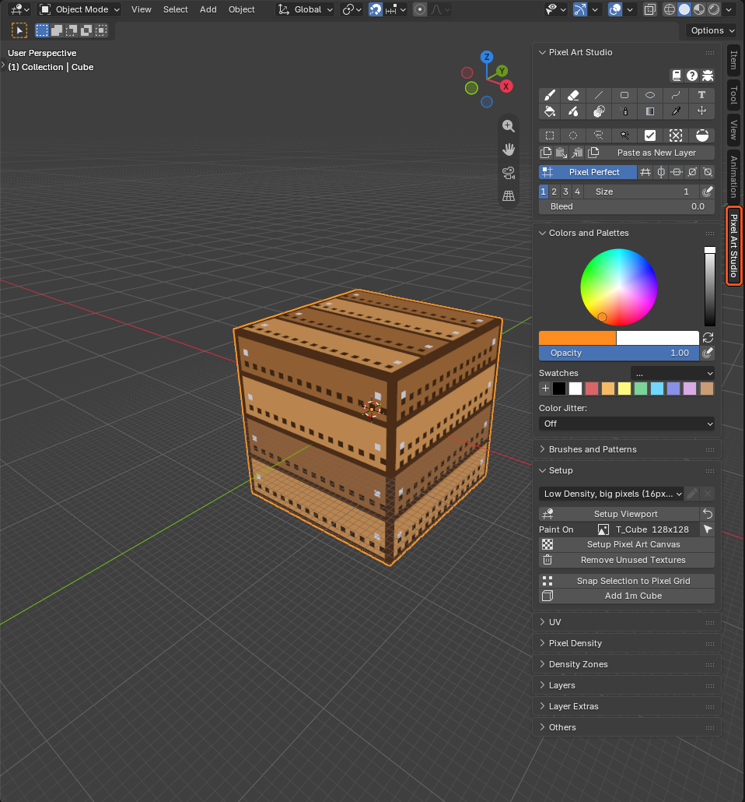
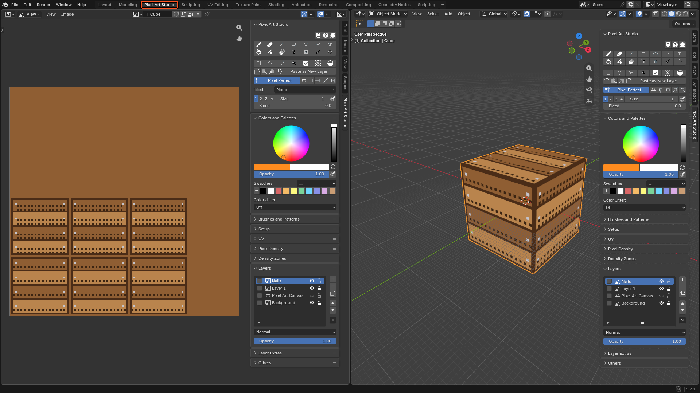

Installation
=========================================

Pixel Art Studio works on **Blender 3.6 through 5.x**, with no external dependencies.

Download
------------------------------

Download Pixel Art Studio from the marketplace of your preference:

- `itch.io <https://alfredbaudisch.itch.io/pixel-art-studio>`_
- `Superhive (aka Blender Market) <https://superhivemarket.com/products/pixel-art-studio?ref=10057>`_
- `Gumroad <https://alfredbaudisch.gumroad.com/l/pixel-art-studio>`_
- `Hotmart (payment options for Brazilians) <https://go.hotmart.com/F107441454W?dp=1>`_

Pixel Art Studio comes as two zips, with the same add-on inside:

.. list-table::
   :widths: 30 35 35
   :header-rows: 1

   * - Zip
     - File name
     - Blender
   * - **Extension**
     - ``pixel_art_studio_blender_extension_v...zip``
     - 4.2 and newer
   * - **Classic add-on**
     - ``pixel_art_studio_blender_v...zip``
     - 3.6 and newer (on 4.2 and newer it installs as a legacy add-on)

On Blender 4.2 and newer pick the extension zip, on Blender 3.6 to 4.1 pick the classic one.

.. warning::
    Install only one of the two zips. If you switch from one to the other, remove the old one first.

Install on Blender 4.2 and newer
--------------------------------

1. Go to ``Edit > Preferences``.

   .. image:: _static/images/install-01.png

2. Go to ``Add-ons``, click the arrow at the top right corner and choose ``Install from Disk...``.

   .. image:: _static/images/install-02.png

3. Find the zip file you downloaded and choose it.
4. Make sure the checkbox next to ``Pixel Art Studio`` is ticked.

   .. image:: _static/images/install-03.png

Install on Blender 3.6 to 4.1
-----------------------------

1. Go to ``Edit > Preferences > Add-ons``.
2. Click ``Install...`` at the top.
3. Find the classic zip file you downloaded and choose it.
4. Tick the checkbox next to ``Pixel Art Studio``.

Updating
--------

1. Install the new zip the same way.
2. **Restart Blender** (or disable and enable the add-on again). Blender caches add-on modules, so the old version keeps running until then.

Open the add-on
---------------

In the 3D Viewport or in the Image Editor, press :kbd:`N` to open the sidebar and click the ``Pixel Art Studio`` tab.

The same panels show in both editors. See :doc:`interface` for what's in each of them.

.. _installation-workspace:

The Pixel Art Studio workspace
------------------------------

As soon as the add-on is enabled, a ``Pixel Art Studio`` workspace tab shows up at the top of the window: **Image Editor on the left** (the texture, flat) and **3D Viewport on the right** (the model), both with the sidebar open on the ``Pixel Art Studio`` tab. It's the easiest way to paint on the model and on the texture side by side.

* It's added to every file you open (it doesn't take you there, click its tab).
* ``Others`` panel > ``Pixel Art Studio Workspace``: goes to the workspace, and builds it again if it's broken (for example, one that lost its Image Editor).
* Don't want it? Untick ``Keep the Pixel Art Workspace`` in ``Edit > Preferences > Add-ons > Pixel Art Studio``.
* Its grid isn't on your pixel size: that's only needed for modelling and unwrapping on the pixel grid, with ``Setup Viewport`` (see :ref:`setup-viewport`). Painting works without it.

.. note::
    On Blender 3.6 and 4.0, the buttons and the workspace open the sidebar, but you may have to click the ``Pixel Art Studio`` tab yourself.

Next step: the :doc:`quickstart-tutorial`.
