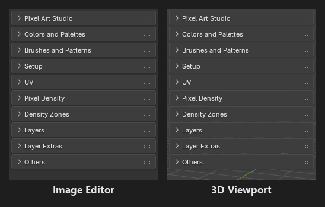
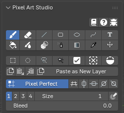
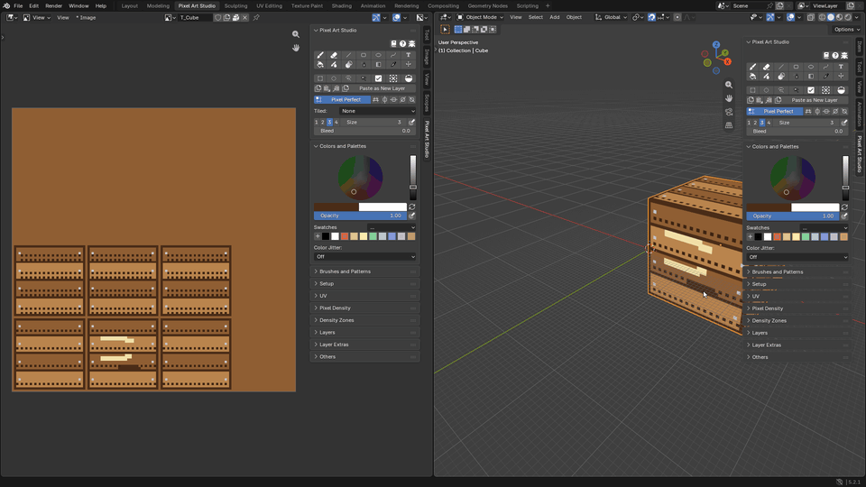
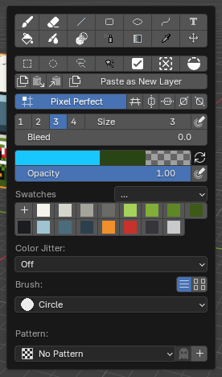
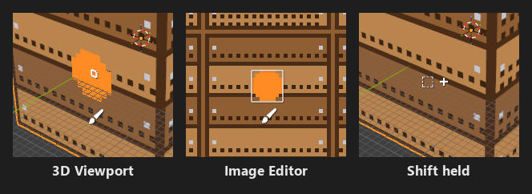
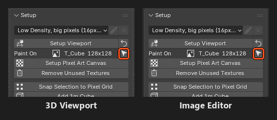

Interface
=========================================

Everything in Pixel Art Studio lives in the sidebar of the 3D Viewport and of the Image Editor, and the tools only take over the keyboard while you have one armed.

.. _interface-sidebar-panels:

The sidebar tab
---------------

Press :kbd:`N` in the 3D Viewport or in the Image Editor (the UV Editor too) and click the ``Pixel Art Studio`` tab. **Both editors get the same panels, in the same order**.

.. list-table::
   :widths: 22 12 46 20
   :header-rows: 1

   * - Panel
     - Starts
     - What's in it
     - Manual
   * - ``Pixel Art Studio``
     - Open
     - The help buttons (``Documentation``, ``Help Forums``, ``Bug Reports``), the big ``Setup`` button for a mesh with no texture (see :doc:`quick-setup`), the toolbar, the armed tool's settings, ``Pixel Perfect``, ``Pixel Grid``, the symmetry toggles and ``Tiled`` (Image Editor only)
     - :doc:`painting-tools`
   * - ``Colors and Palettes``
     - Open
     - Color picker, primary and secondary color, opacity, swatches and palettes, ``Color Jitter``
     - :doc:`colors-and-palettes`
   * - ``Brushes and Patterns``
     - Closed
     - Brush shape, custom brushes, fill patterns
     - :doc:`brushes-and-patterns`
   * - ``Setup``
     - Closed
     - Density preset, ``Setup Viewport``, ``Paint On`` (the texture the model paints on), ``Filtering``, ``Setup Pixel Art Canvas``, ``Remove Unused Textures``, ``Snap Selection to Pixel Grid``, ``Add 1m Cube`` and the warning line
     - :doc:`setup-and-canvas`
   * - ``UV``
     - Closed
     - ``UV Tools``, ``Unwrap Options``, ``Pixel Art Unwrap``, ``Quick Unwrap Model`` and its eye (the UV preview), then the ``Stacked Faces`` and ``Joined Faces (UVs Together)`` lists
     - :doc:`uv-tools`
   * - ``Pixel Density``
     - Closed
     - ``Try Pixel Densities``, ``Texel Density``, ``Apply Texel Density``, ``Detect Texel Density``, your own presets, the unwrap density mode and ``Grow Texture to Fit``
     - :doc:`pixel-density`
   * - ``Density Zones``
     - Closed
     - Several pixel sizes on one model
     - :doc:`density-zones`
   * - ``Layers``
     - Open
     - The layer stack, blend mode and opacity
     - :doc:`layers`
   * - ``Layer Extras``
     - Closed
     - Adjustments, PNG import and export (a layer, a group or the whole texture), ``Texture Dilation``, paste an image as a layer, the pixel grid layer
     - :doc:`layers`
   * - ``Others``
     - Closed
     - ``Pixel Art Studio Workspace``, the watch for texture files changed by other programs, and the game engines
     - :doc:`game-engines`

* **Which texture the panels work on**: in the Image Editor, the image it shows; in the 3D Viewport, the texture of the **active object**. A texture that isn't a canvas yet too: ``Layers`` shows it as the one layer it's going to be, and the first thing you do makes it a canvas (see :ref:`automatic-canvas`).
* **With an Armature or an Empty active** (a rig): the texture of the part under the pointer, while a tool is armed (see :ref:`several-parts`).
* **The Pixel Art Studio panels hide while** ``Quick Setup`` **is open**: the sidebar shows the mode instead.

.. note::
    Looking for a command with :kbd:`F3`? Blender's search only finds what is in a Blender menu, and only ``Pixel Art Unwrap`` and ``Quick Unwrap Model`` are (in the 3D Viewport's ``UV`` menu, :kbd:`U`, in Edit Mode). Everything else is a button in the sidebar.

.. _interface-arming-a-tool:

Arming a tool
-------------

**Click a tool in the toolbar to arm it.** It arms in the editor you clicked in, and its button is drawn pressed in that editor's sidebar.

* Click the armed tool again to leave (every key goes back to Blender).
* Click another tool to switch to it.
* Hover a tool button for its name, its key and what it does. A key you rebound shows up there too.

While a tool is armed:

* **The add-on's keys only work in the armed editor**, with the pointer over its main area (over the sidebar or the header, every key is Blender's). In the default ``Shortcut Mode``, ``Alongside Blender``, Blender's own keys keep working too (:kbd:`G` is still Grab). In ``Pixel Art Studio Only`` the add-on's keys win: :kbd:`G` is the Bucket instead of Grab, :kbd:`E` the Eraser instead of Extrude, :kbd:`S` Shading instead of Scale, and so on. See :ref:`shortcut-mode`.
* **A left click is the tool's**: you can't click to select another object in an armed 3D Viewport. Leave the tool first (or select it in the Outliner).
* **Navigating stays Blender's**: middle mouse orbit and pan, the mouse wheel, trackpad gestures, numpad views, right click menus and every key that isn't one of the add-on's (:kbd:`Tab`, :kbd:`N`, :kbd:`Shift+A`...). If your keymap orbits with :kbd:`Alt+click` (``Industry Compatible`` or ``Emulate 3 Button Mouse``), the orbit keeps working.
* **Arming a tool opens the sidebar on the** ``Pixel Art Studio`` **tab**: a hidden sidebar is shown, and a sidebar on another tab switches to ours.
* **Closing the sidebar, or picking another of its tabs** (``Item``, ``Tool``, ``View``...), **puts the tool away**: keep it open on ``Pixel Art Studio`` while you paint (on Blender 3.6 and 4.0 only closing it does).
* A file you open never has a tool armed, even if you saved it with one.

.. _interface-activator:

The activator shortcut
----------------------

Point at the editor and press :kbd:`;` (semicolon): it arms the **last tool you used** (the Brush the first time). Press it again to leave. This is the fastest way to **toggle between Pixel Art Studio and Blender**, for example to click and select another object.

* It arms the editor **under the pointer**: point at the texture to arm the Image Editor, point at the model to arm the 3D Viewport.
* Prefer :kbd:`Esc` twice? In ``Edit > Preferences > Add-ons > Pixel Art Studio > Shortcuts``, switch ``Activator`` from ``Custom shortcut`` to ``ESC, ESC``. Then two quick presses of :kbd:`Esc` over the viewport arm the last tool, and a single :kbd:`Esc` still does whatever it does in Blender.
* To change the key, in the same place click the key on the ``3D Viewport`` row and press the new one, and do the same on the ``Image Editor`` row.

.. tip::
    On many keyboards that aren't US layout, :kbd:`;` sits somewhere else or needs :kbd:`Shift`. Rebind it to a key that's easy for you.

Esc
---

:kbd:`Esc` does the first of these that applies:

1. A transform box (the selection being transformed, or text being placed) is up: drops the transform (:kbd:`Enter` lands it).
2. A path is being placed: drops the path, the tool stays armed.
3. The mouse button is down (a stroke, a shape, a selection or a move): cancels it and puts the pixels back, the tool stays armed.
4. Otherwise: leaves the tool.

.. _interface-floating-panel:

The tools popup (D)
-------------------

Point at the editor and press :kbd:`D`. A ``Pixel Art Studio`` panel pops up at the pointer, with **the toolbar, the tool settings, the colors and swatches, the brushes and the patterns**. Move the pointer away from it to close it.

* It opens with or without a tool armed: click a tool in it to arm that tool in the editor under the pointer.
* In ``Pixel Art Studio Only`` the key is :kbd:`F`, and it opens only with a tool armed.

* It has no color wheel: click the primary color for Blender's color picker.

At the cursor: the tool icon and the brush preview
--------------------------------------------------

* **The armed tool's icon** is drawn right under the pointer, so you always know which tool is live. For the Brush, Eraser, Blur, Shading and Pixel Spray it sits under the brush, so it never covers what you are about to paint.

  * Selection tools show a ``+`` or ``-`` beside the icon while the drag is going to add or remove.
  * It hides while you orbit or pan the view, and comes back as soon as you stop.

* **The brush preview** shows the exact dab before you click: on the model in the 3D Viewport (folded over the edges the way the dab is going to land), and as pixel squares in the Image Editor. Holding :kbd:`Ctrl+Shift` previews the whole line from your last dab. See :doc:`painting-tools`.
* **The Eyedropper** wears Blender's eyedropper cursor, with the color it's going to take (and the color it replaces) in two small squares beside it.
* Both can be turned off in ``Edit > Preferences > Add-ons > Pixel Art Studio > General``, box ``Cursor``: ``Show tool icons at cursor position`` and ``Show colors sampled at cursor position``.

.. _interface-side-by-side:

The 3D Viewport and the Image Editor side by side
-------------------------------------------------

.. video:: _static/videos/v2/interface-side-by-side.mp4
  :width: 100%

The ``Pixel Art Studio`` workspace (see :ref:`installation-workspace`) has the texture on the left and the model on the right. **Paint on the model and touch up pixels on the flat texture at the same time.**

* **Each editor has its own armed tool**: you can have a tool armed in both at once, and each sidebar shows its own tool button pressed only when that editor is armed.
* **The tool and its settings are shared**: picking a tool in either sidebar (or by key) switches it in both armed editors, and the size, colors and every other setting are the same in both.
* **A stroke in one editor shows live in the other.**
* Keys go to the editor under the pointer. :kbd:`Alt+click` samples a color from the editor under the pointer too, even from the one that has no tool armed.
* Only the Image Editor has ``Tiled`` (Tiled Mode) and symmetry rulers you can drag, and it paints the whole flat texture (faces hidden in Edit Mode don't limit it there).
* Only the 3D Viewport has ``Topology`` selection, symmetry on the model, and a click on a face of another texture switching to that texture.

Object Mode and Edit Mode
-------------------------

* The 3D Viewport paints the texture of the **active object**, in Object Mode and in Edit Mode, on every visible object that uses it (see :ref:`several-parts`). You can :kbd:`Tab` between them with the tool armed.
* **Hide faces to protect them**: in Edit Mode, faces hidden with :kbd:`H` are left out of every tool (nothing is painted, filled or selected through them). :kbd:`Alt+H` (or Object Mode) brings them back.
* In Edit Mode the selected faces matter to some tools: the Bucket's ``Face`` mode fills the selected faces, and the UV tools work on the selected faces.
* With a tool armed in Edit Mode, :kbd:`Ctrl+Z` takes your strokes back, one per press. Leave the tool for Blender's own mesh undo. In Object Mode strokes are ordinary undo steps, mixed with everything else.
* A brush stroke can start in empty space: press beside the model and drag onto it, it paints from where it arrives.

.. _interface-show-in-editor:

Show in Image Editor and Show in 3D Viewport
--------------------------------------------

In ``Setup``, the ``Paint On`` row shows the texture the model paints on with its size (for example ``T_Cube  128x128``), a canvas already or not yet, and the arrow button at the end of that row jumps to the other editor.

* In the 3D Viewport it's ``Show in Image Editor``: the texture shows up in every Image Editor on the screen, with their sidebar open on ``Pixel Art Studio``.
* In the Image Editor it's ``Show in 3D Viewport``: the model that uses the texture is selected (and put in Object Mode), with the 3D Viewport's sidebar open on ``Pixel Art Studio``.
* A mesh with several color textures shows a dropdown there instead, to select the one to paint on (see :ref:`several-textures`).

The warning line
----------------

When something needs your attention, a coral warning shows at the bottom of ``Setup`` (in both editors). Click any of its lines, or the ``X``, to dismiss it.

* ``No Pixel Art Studio canvas here. Run Setup Pixel Art Canvas to give this model a texture to paint on``: a key, or a click beside the model, on a mesh with no texture. ``Setup Pixel Art Canvas`` turns coral too (a click on the model itself opens ``Quick Setup`` instead).
* ``No Pixel Art Studio canvas here. Open or create an image to paint on``: a tool used in an Image Editor that shows no image.
* A texture that can't be painted says why (see :ref:`automatic-canvas`).
* An unwrap that didn't fit the texture, or a texture file that couldn't be written back, say so there as well.
* Things that went fine only show in Blender's status bar.
