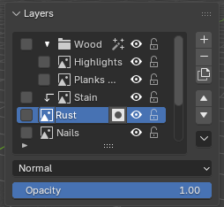
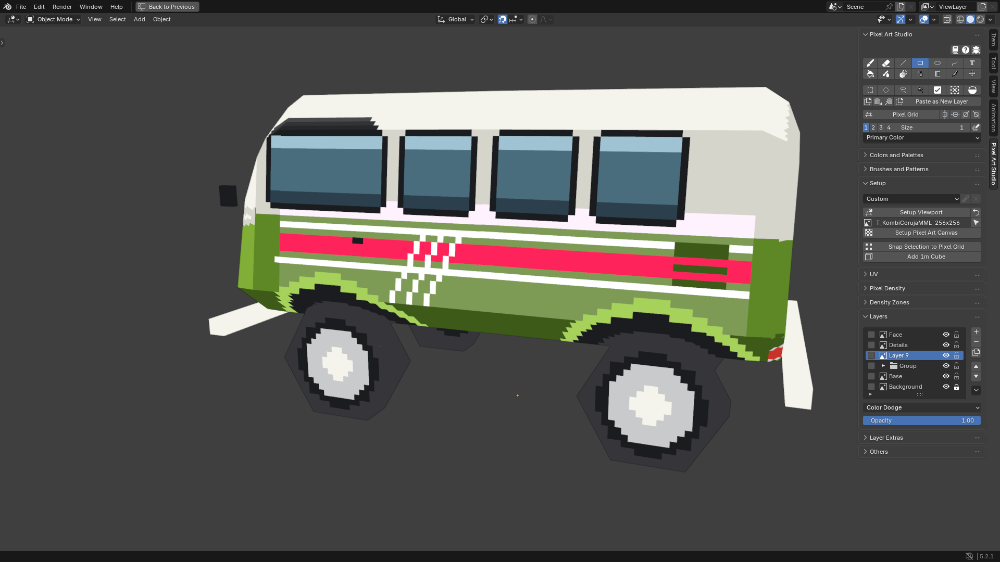
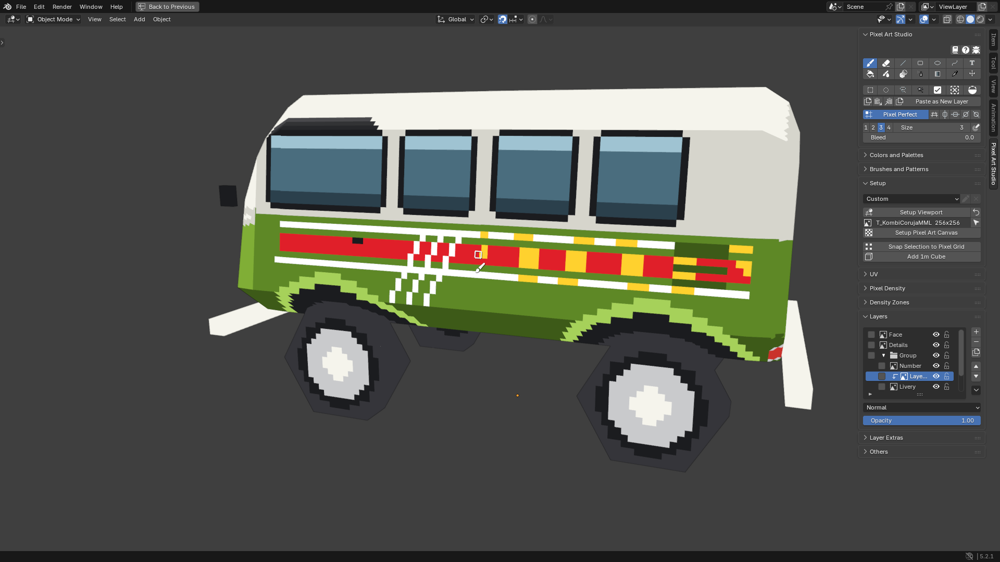
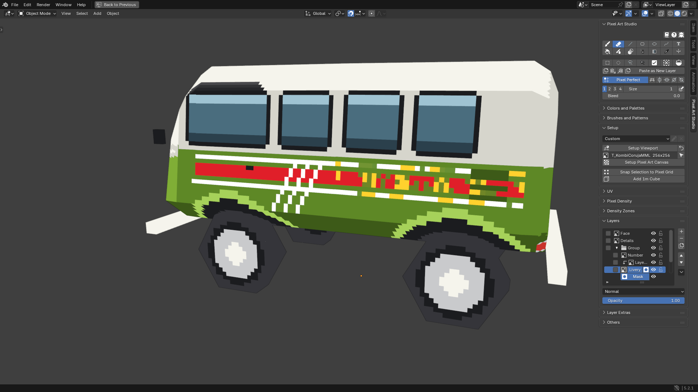
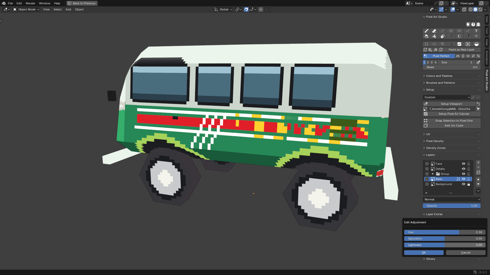
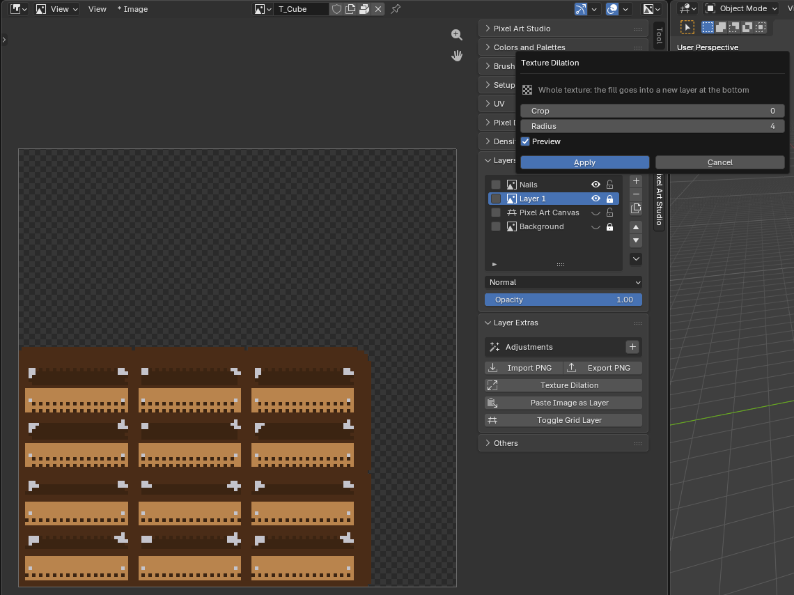
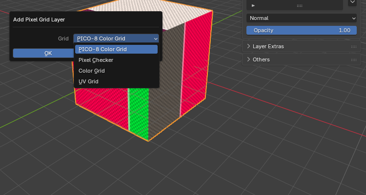

.. _layers:

Layers
=========================================

**Real layers on a Blender texture**, like in painting programs: groups, blend modes, opacity, lock and visibility, clipping, masks and non destructive adjustments, painted on the model or in the Image Editor.

The ``Layers`` panel (open) and the ``Layer Extras`` panel (closed by default) are in the sidebar (:kbd:`N`) > ``Pixel Art Studio`` tab, in the 3D Viewport and in the Image Editor.

* In the Image Editor they show the layers of the canvas the editor shows. In the 3D Viewport, the layers of the active object's canvas texture.
* Each canvas texture has its own layer stack, saved inside the .blend. The texture itself is the flattened picture of the stack, so it renders and exports like any other texture.
* A canvas made with ``Setup Pixel Art Canvas`` starts with ``Layer 1`` (empty, active), the pixel grid layer, and a locked ``Background`` (when the canvas isn't transparent). A texture the model already had starts with ``Layer 1`` holding the texture as it was, made by the first thing you do on it (see :ref:`automatic-canvas`). Before that, ``Layers`` shows the texture as the one layer it's going to be, with ``+`` and the other buttons ready to use.

The Layers panel
----------------

Each row of the list, from left to right:

* **Checkbox**: marks layers for ``Merge Selected`` and ``Group Layers`` (the list itself picks one row at a time).
* **Arrow** (groups only): folds and unfolds the group.
* **Bent arrow** (clipped layers only): click it to stop clipping.
* **Icon**: a paint layer, a group (folder) or the pixel grid layer. On a layer with a mask, the icon and the mask icon beside the name pick what you paint: the layer's pixels or its mask.
* **Name**: double-click to rename.
* ``fx``: shown while an adjustment is on.
* **Eye**: shows and hides the layer or group.
* **Padlock**: locks and unlocks it.

The column of buttons right of the list:

* ``+``: adds a layer above the active one (inside the same group).
* ``-``: removes the active layer (a group takes its layers along), or its mask while the mask is the one being painted.
* **Duplicate**: copies the active layer above it, with its blend mode, opacity, adjustments and mask.
* **Up and down arrows**: move the active layer in the stack. A group moves as a block, and a layer at the top or bottom of its group steps out of it. Where a group is in the way, a small menu asks: ``Move Up (Skip Group)`` / ``Move Down (Skip Group)``, or ``Move Inside Group`` (the one way into a group that already exists).
* **Down arrow**: the ``Layer Operations`` menu (below).

Under the list, for the active layer or group:

* **Blend mode** dropdown (``Normal`` by default).
* ``Opacity``.

While the texture is filtered (``Linear`` or ``N64 (3 Point)``), the panel ends with ``Seam padding fills the margin`` / ``while the texture is filtered`` (see :ref:`seam-padding`).

Layer Operations menu
---------------------

* ``Merge Down`` (:kbd:`Ctrl+Shift+E`): merges the active layer into the paint layer under it. The result keeps the lower layer's name, blend mode and adjustments.
* ``Merge Selected``: merges every checked layer into the lowest of them.
* ``Group Layers``: wraps the checked layers (or the active one) into a group. It takes the whole run from the topmost checked layer to the lowest one, unchecked layers in between included.
* ``Ungroup``: dissolves the active group, its layers move up a level.
* ``Select Pixels``: selects every pixel the active layer has painted.
* ``Add Layer Mask``, ``Apply Layer Mask`` and ``Delete Layer Mask`` (see :ref:`layer-masks`).
* ``Clip to Layer Below`` (see :ref:`clipping-layers`).
* ``Mask Enabled`` (on a layer with a mask): switches the mask off without losing it.

.. warning::
    Merging bakes the upper layer as ``Normal``: its blend mode and adjustments are not carried into the merged pixels (its opacity, mask and clip are). Hidden layers merge too. :kbd:`Ctrl+Z` if it doesn't look right.

Groups
------

* A group is a folder: it holds no pixels of its own, and it has its own eye, lock, opacity, blend mode, clip and adjustments. Groups nest at any depth.
* Hiding a group hides everything inside it.
* **Group opacity and blend mode work like Photoshop's**: the layers inside are composited together first, then the group is blended as one picture (overlapping layers don't double fade).
* Folding a group that holds the active layer makes the group itself active.
* A group can't be painted, but the Move tool and the transform box move and transform every layer inside it.
* ``-`` on a group deletes it with all its layers. ``Ungroup`` keeps the layers.

Blend modes
-----------

All 19 blend modes of `Aseprite <https://www.aseprite.org/>`_, on layers and on groups: ``Normal``, ``Multiply``, ``Darken``, ``Color Burn``, ``Lighten``, ``Screen``, ``Color Dodge``, ``Addition``, ``Overlay``, ``Soft Light``, ``Hard Light``, ``Difference``, ``Exclusion``, ``Subtract``, ``Divide``, ``Hue``, ``Saturation``, ``Color`` and ``Luminosity``.

* A blend mode never changes alpha: it can't make a texel appear or vanish.
* Where nothing is underneath, the layer shows as painted (``Multiply`` on the bottom layer doesn't turn the drawing black).

.. _clipping-layers:

Clipping layers
---------------

Like Photoshop and Krita: **a clipped layer only shows where the layer below it has pixels**. Paint the base shape on one layer, paint the details on the layer above, and clip it: the details stay inside the shape.

* ``Layer Operations`` > ``Clip to Layer Below``, and the bent arrow in the row stops clipping. It works on layers and on groups.
* A run of clipped layers all clip to the same base (the first layer under them that isn't clipped).
* The clipped layer keeps its own blend mode over what is under it.

.. _layer-masks:

Layer masks
-----------

**Hide part of a layer without erasing it**, and change your mind later.

1. Optionally, select what should stay visible.
2. ``Layer Operations`` > ``Add Layer Mask``. With a selection, everything outside of it is hidden. Without one, the whole layer shows.
3. The mask is now what the tools paint: **black hides, white shows**, grey hides partly, and the Eraser brings back what was hidden.
4. Click the layer's own icon (or its name) to paint the layer's pixels again, and the mask icon to go back to the mask.

* While the mask is being painted, a ``Mask`` row shows under the layer, with its own eye (``Mask Enabled``).
* ``Apply Layer Mask`` bakes the mask into the layer's pixels, ``Delete Layer Mask`` throws it away.
* ``-`` (or :kbd:`Ctrl+Backspace`) while the mask is being painted removes the mask, not the layer.
* The mask follows its layer: the Move tool and the transform box move both, and ``Duplicate`` copies it.

.. note::
    Paint goes nowhere? The mask is the paint target (the ``Mask`` row is showing). Click the layer's icon to paint its pixels.

.. _adjustments:

Adjustments
-----------

**Non destructive adjustments**, stackable, on a layer or on a whole group. The pixels are never rewritten, so you can switch them off or remove them any time.

1. Open ``Layer Extras``.
2. Click ``+`` beside ``Adjustments``, pick one and click ``OK``:

   * ``Brightness/Contrast``
   * ``Hue/Saturation`` (``Hue``, ``Saturation`` and ``Lightness``)
   * ``Color Curve`` (Blender's color curve, combined and per channel)

3. Click the adjustment's name to edit it. The canvas updates while you drag the sliders and bend the curve.

* The checkbox switches an adjustment off without removing it, ``X`` removes it.
* They run top to bottom, in the order they were added. On a group, they run over everything inside it.
* Paint lands as it always does, and the adjustment runs over what you paint.
* Alpha is never touched.

.. note::
    Closing ``Edit Adjustment`` keeps the values (they apply as you drag). :kbd:`Ctrl+Z` or set them back by hand.

Layer Extras
------------

Under ``Adjustments``, the ``Layer Extras`` panel has:

* ``Import PNG``: adds an image (``.png``, ``.jpg``, ``.bmp`` or ``.tga``) as a new layer above the active one, **at its own size, never scaled**. It's centered on the 3D cursor when the cursor sits on the model (3D Viewport) or on the Image Editor's 2D cursor, otherwise it goes to the bottom left corner.
* ``Export PNG``: asks what to write, then opens the file browser. The colors go out byte for byte.

  .. image:: _static/images/v2/layers-export-question.png

  * ``Export Layer`` (``Export Group`` when a group is selected): the active layer or group, **cropped to what is painted**. A layer exports its own pixels, without its mask, opacity, blend mode or adjustments. A group exports as one picture of everything in it (blend modes, masks, clips and the group's adjustments included, hidden layers left out).
  * ``Export Texture``: the whole texture at its full size, **the same file** ``Image > Save As`` **writes** (every visible layer, the pixel grid layer while it shows).
  * On a texture that isn't a canvas yet, there's nothing to ask: it writes the texture's own pixels, and doesn't make a canvas.

* ``Texture Dilation``: fills the transparent texels around the art with the color of the nearest painted texel, see :ref:`texture-dilation`.

* ``Paste Image as Layer``: adds the image on the system clipboard as a new layer named ``Pasted`` (an image copied in another program, or with Blender's own ``Copy Image``). It comes up **selected with the Marquee armed**, ready to move, cut or transform. From the 3D Viewport it needs an Image Editor open somewhere (the ``Pixel Art Studio`` workspace has one).
* ``Add Pixel Grid Layer`` / ``Toggle Grid Layer``: see below.

When the image is bigger than the canvas, a dialog asks:

* ``Crop to Canvas`` (default): keeps only the part that lands on the canvas.
* ``Keep Full Size``: keeps every pixel on a layer bigger than the canvas, and you slide the rest into view with the Move tool.

``Paste as New Layer``, for pixels copied inside Pixel Art Studio, is in the main panel, see :ref:`copy-cut-paste`.

.. _texture-dilation:

Texture Dilation
----------------

**Every transparent texel around the art takes the color of the nearest painted texel**, so the edges of the UV islands don't pull the background in when the texture gets filtered or scaled down later (mipmaps in a game engine, for example). The fill is hard edged pixel art, never blended or blurred.

.. note::
    Does it hide the seams under ``Linear``? No: it grows each island's own colors, and a filtered seam wants the color the model shows across it. That's what Seam Padding fills the margin next to the islands with, automatically, while the texture is filtered (see :ref:`seam-padding`). The dilation still fills what's farther out.

1. Select the layer or the group in the ``Layers`` panel.
2. Click ``Texture Dilation`` in ``Layer Extras`` and select what it applies to:

   .. image:: _static/images/v2/layers-texture-dilation-question.png

   * ``Apply to Selected Layer``: fills the layer itself.
   * ``Apply to Selected Group``: fills around what the group shows. **The fill goes into a new** ``Texture Dilated`` **layer** at the bottom of the group, and the group's own layers stay as they are.
   * ``Apply to the Whole Texture``: fills around everything you see, into a new ``Texture Dilated`` layer at the bottom of the stack. Every layer above stays editable, and hiding ``Texture Dilated`` turns the fill off.

3. Set ``Crop`` and ``Radius`` (the canvas shows the result as you change them) and click ``Apply``.

Above: the crate with its ``Background`` hidden, ``Apply to the Whole Texture`` at ``Radius`` 4: a rim of each island's colors grows into the empty texture around it.

Settings:

* ``Crop`` (0): painted texels this close to a transparent one are thrown away first and filled again from further in (for edges that came out blurry or dark).
* ``Radius`` (400): how far, in texels, the colors reach into the transparent texels. Farther ones stay transparent.
* ``Preview`` (on): shows the result on the canvas while the dialog is open.

.. note::
    With a selection, only the selected texels are filled. ``Apply`` is one undo step, and ``Cancel`` (or :kbd:`Esc`) leaves the canvas exactly as it was. The pixel grid layer is left out of the whole texture.

.. note::
    On a texture that isn't a canvas yet, the dialog has no preview (``No preview on a texture nobody has painted yet``): ``Apply`` makes the canvas, then fills, as two undo steps, and :kbd:`Esc` leaves the texture untouched.

.. _pixel-grid-layer:

Pixel grid layer
----------------

A real layer with one cell per texture pixel, **so every texel is countable on the model**.

* ``Add Pixel Grid Layer`` (``Layer Extras``) asks for the grid: ``PICO-8 Color Grid`` (default), ``Pixel Checker`` (one checker square per texel), ``Color Grid`` or ``UV Grid``. The layer is named ``Pixel Art Canvas`` and goes at the bottom of the stack (above the ``Background``, if there is one).
* Once the canvas has one, the button becomes ``Toggle Grid Layer`` (shows and hides it).
* It's an ordinary layer otherwise: paint on it, move it, delete it. The eyedropper never samples its colors.

.. note::
    The pixel grid layer is part of the texture while it's visible. The ``Pixel Grid`` overlay (:kbd:`\\`) only draws lines in the viewport and never touches the texture, see :ref:`pixel-grid-overlay`.

Hidden and locked layers
------------------------

* A **hidden** layer (or a layer inside a hidden group) can't be edited: every tool, ``Delete``, ``Cut``, ``Paste``, the Move tool and the transform box refuse it. The eyedropper still reads it.
* A **locked** layer refuses the same edits. ``Copy`` still works.
* Lock and hide protect the **pixels**: a locked or hidden layer can still be renamed, moved in the list, deleted, merged and exported.
* The ``Background`` layer of a new canvas starts locked.

Layer shortcuts
---------------

All rebindable (see :doc:`shortcuts`), and the ``Pixel Art Studio Only`` ones are Photoshop and Krita's. They work while a Pixel Art Studio tool is armed, with the pointer over the editor.

.. list-table::
   :widths: 31 23 23 23
   :header-rows: 1

   * - Action
     - Alongside Blender
     - Pixel Art Studio Only
     - Button
   * - New Layer
     - :kbd:`Shift+Alt+N`
     - :kbd:`Ctrl+Shift+N`
     - ``+``
   * - Duplicate Layer
     - :kbd:`Ctrl+Shift+J`
     - :kbd:`Ctrl+J`
     - Duplicate
   * - Delete Layer (or its mask while painting the mask)
     - :kbd:`Ctrl+Backspace`
     - :kbd:`Ctrl+Delete`, :kbd:`Ctrl+Backspace`
     - ``-``
   * - Merge Down
     - :kbd:`Ctrl+Shift+E`
     - :kbd:`Ctrl+E`
     - ``Merge Down``
   * - Group Layers
     - None
     - :kbd:`Ctrl+G`
     - ``Group Layers``
   * - Ungroup
     - None
     - :kbd:`Ctrl+Shift+G`
     - ``Ungroup``
   * - Paste as New Layer
     - None
     - :kbd:`Ctrl+Shift+V`
     - ``Paste as New Layer``

Every layer action is **one undo step**, mixed with Blender's own undo: adding, removing, merging, grouping, moving, masks, clips, imports and pastes, and also renaming, the eye, the lock, the opacity and the blend mode.
