.. _painting-tools:

Painting Tools
=========================================

Every tool lives in the sidebar (:kbd:`N`) > ``Pixel Art Studio`` tab > ``Pixel Art Studio`` panel, **in the 3D Viewport and in the Image Editor** (it's the same panel in both editors). The tools paint on top of the model in 3D and on the texture in 2D, in **perspective and orthographic** views, in **Object and Edit Mode**.

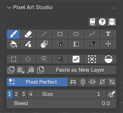

* All tools are directly inspired by `Aseprite <https://www.aseprite.org/>`_, so you are going to feel right at home.
* **Click a tool to arm it**, click it again (or press :kbd:`Esc`, close the sidebar or pick another of its tabs) to put it away. The activator shortcut (:kbd:`;` by default) arms the last tool you used (see :doc:`interface`).
* Tool shortcuts only work while a Pixel Art Studio tool is armed, with the pointer over the editor. The keys on this page are the default ``Alongside Blender`` ones, :doc:`shortcuts` has the ``Pixel Art Studio Only`` set too.
* The settings of the armed tool show right under the toolbar.
* :kbd:`D` over either editor opens the **tools popup** at the pointer with the tools, their settings, the colors, the brushes and the patterns (:kbd:`F` in ``Pixel Art Studio Only``).
* The colors, opacity and swatches live in ``Colors and Palettes`` (:doc:`colors-and-palettes`). Brush shapes, custom brushes and fill patterns live in ``Brushes and Patterns`` (:doc:`brushes-and-patterns`).
* While a selection is active, tools affect only the selected pixels (:doc:`selection-and-transform`).

.. list-table::
   :widths: 24 18 18 40
   :header-rows: 1

   * - Tool
     - Alongside Blender
     - Pixel Art Studio Only
     - What it does
   * - **Brush**
     - :kbd:`Shift+Alt+B`
     - :kbd:`B`
     - Freehand painting, pixel perfect
   * - **Eraser**
     - :kbd:`Shift+Alt+E`
     - :kbd:`E`
     - Erases to transparent
   * - **Line**
     - :kbd:`Shift+Alt+L`
     - :kbd:`L`
     - Pixel perfect lines, with angle snapping
   * - **Rectangle**
     - :kbd:`Shift+Alt+U`
     - :kbd:`U`
     - Outlined or filled rectangles and squares
   * - **Ellipse**
     - :kbd:`Shift+Alt+O`
     - :kbd:`O`
     - Outlined or filled ellipses and circles
   * - **Path and Polygon**
     - :kbd:`Shift+Alt+C`
     - :kbd:`C`
     - Bezier paths and polygons, outlined or filled
   * - **Text**
     - None
     - :kbd:`T`
     - Pixel font text, never antialiased
   * - **Bucket**
     - :kbd:`Shift+Alt+F`
     - :kbd:`G`
     - Flood fill by pixels, or fill whole faces
   * - **Blur**
     - :kbd:`Shift+Alt+H`
     - :kbd:`H`
     - Pixel aware blur, and ``Scramble``
   * - **Shading**
     - None
     - :kbd:`S`
     - Lightens or darkens what is already painted
   * - **Pixel Spray**
     - None
     - :kbd:`Shift+B`
     - Spray can
   * - **Gradient**
     - :kbd:`Shift+Alt+D`
     - :kbd:`D`
     - Two color gradient with ordered dithering
   * - **Eyedropper**
     - :kbd:`Shift+Alt+I`
     - :kbd:`I`
     - Samples a color (also :kbd:`Alt+click` and :kbd:`Alt+Shift+X`)
   * - **Move**
     - :kbd:`Shift+Alt+V`
     - :kbd:`V`
     - Drags a whole layer around

.. _shared-tool-settings:

Settings shared by the paint tools
----------------------------------

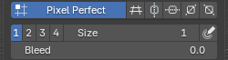

* **Size**: the ``1`` ``2`` ``3`` ``4`` buttons set the size in one click, the ``Size`` field goes from 1 to 64, and :kbd:`Alt+[` :kbd:`Alt+]` decrease and increase it while you paint (the brush preview updates at once).

  * It's the thickness of the Brush, the Eraser, the Line, the Rectangle and Ellipse outlines and the Path, and the dab of Blur, Shading and Pixel Spray. The Bucket and the Gradient ignore it.

* **Size Pressure** (the stylus icon right of ``Size``): tablet pressure sets the size, light presses draw thinner, down to one texel. It works on every tool that paints with a dab (Brush, Eraser, Blur, Shading and Pixel Spray). The Line, the shapes and the Path keep the plain size, so an outline never changes thickness while you drag it.
* **Opacity** (in ``Colors and Palettes``): applied **once per stroke**, like `Aseprite <https://www.aseprite.org/>`_: dragging over the same texels twice inside one stroke doesn't darken them, a new stroke builds up.

  * **Opacity Pressure** (the stylus icon right of ``Opacity``): tablet pressure sets the opacity of the Brush, the Eraser and Pixel Spray. Overlapping clicks build up the opacity.

* **The Eraser keeps its own settings**: its own ``Size``, shape, ``Opacity``, custom brush, fill pattern and ``Bleed``. Switch to the Eraser and the fields show the Eraser's values, switch back and the Brush's come back. Every other tool shares the Brush's settings.

.. note::
    A mouse always reports full pressure, so the pressure toggles do nothing without a tablet.

.. _pixel-perfect:

Pixel Perfect
-------------

``Pixel Perfect`` (on by default, :kbd:`Shift+Alt+P`) is in the row under the toolbar while the Brush or the Eraser is armed. It removes the extra corner texel where a freehand one texel line turns (the doubled **L corners**), so **a hand drawn curve comes out as clean stair steps**, like Aseprite's pencil. It works on mirrored strokes too.

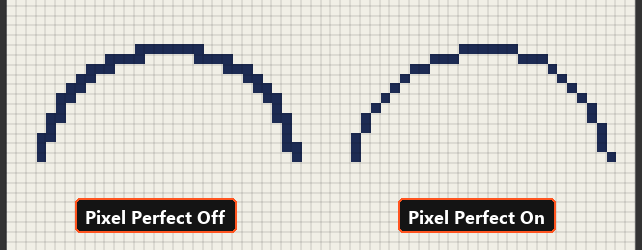

* It's automatically disabled (greyed out) for brushes bigger than 12, and comes back to your own choice when the size goes back to 12 or less.
* The Line and the Path are always pixel perfect, that's why they don't show the toggle.

.. _bleed:

Bleed
-----

On the model, a texel gets painted when its center lies on a face (plus the texel under the pointer). Along a diagonal UV edge, that leaves a stair of half covered texels unpainted, and **the color underneath shows as a jagged line along the edge** on the model. ``Bleed`` fixes it.

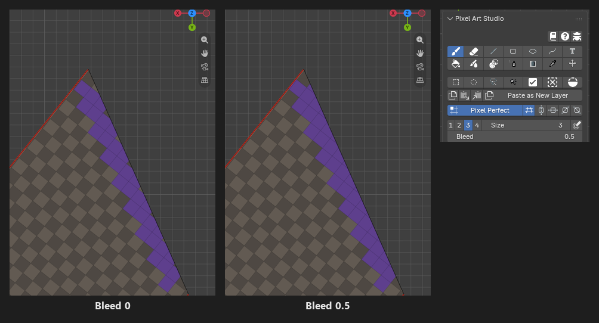

* The Brush, the Eraser and the Line show ``Bleed`` under ``Size`` (the Eraser keeps its own value):

  * ``0``: only the texels of the faces the brush touches.
  * ``0.5``: also the half covered texels along a diagonal edge, right next to what the brush painted (a dab in the middle of a face doesn't change).
  * ``1`` or more: on top of that, that many rings into the empty texture space around the UV island (padding against mipmap bleeding).
  * It never paints over a texel another face owns, and never onto a face hidden in Edit Mode.

* The Bucket and the Gradient have their own ``Bleed`` (up to 64). ``0.5`` reaches only the half covered texels, the same as the brush. Whole numbers grow the fill over **anything** next to it, so they can cover neighbouring art.
* Bleed reaches past a selection.
* In the Image Editor, bleed works when the active object is a mesh that uses the canvas.
* The brush preview shows the bleed texels before you click.

.. _brush-tool:

Brush
-----

**Brush** (:kbd:`Shift+Alt+B`): freehand painting, pixel perfect.

* Settings: ``Size``, ``Bleed`` and ``Pixel Perfect`` in the main panel, the shape and the fill pattern in ``Brushes and Patterns``, and ``Color Jitter`` in ``Colors and Palettes``.
* :kbd:`Ctrl+Shift+click` draws a straight line from the last dab, see :ref:`lines-from-last-dab`.
* :kbd:`Alt+click` samples a color instead of painting.
* In 3D a stroke can start in empty space: press off the model, drag onto it, and painting starts where the pointer reaches the model.

Eraser
------

**Eraser** (:kbd:`Shift+Alt+E`): erases to transparent, with opacity control.

* It's the Brush with the color taken out: same footprint, ``Pixel Perfect``, ``Bleed``, lines from the last dab and behavior on the model.
* With a fill pattern it erases only through the pattern's set texels and never touches the gaps.
* Its preview is a neutral grey at the eraser's strength.

Line
----

**Line** (:kbd:`Shift+Alt+L`): press, drag and release. Always **pixel perfect stair steps** (Aseprite's line), stamped with the brush size and shape.

* :kbd:`Shift` while dragging snaps the line to a perfect angle (see :ref:`angle-snaps`).
* ``Bleed`` uses the Brush's value.
* The pixels you see while dragging are the final pixels.
* In 3D, a line over a UV seam is **drawn straight across onto the next face**, as if the model was unfolded.

Rectangle and Ellipse
---------------------

**Rectangle** (:kbd:`Shift+Alt+U`) and **Ellipse** (:kbd:`Shift+Alt+O`): drag from corner to corner. The outline is stamped with the brush size and shape, and the pixels you see while dragging are the final pixels.

* :kbd:`Shift` while dragging makes a square or a circle.
* The fill dropdown under ``Size``:

  * ``Not Filled``: the outline only, in the primary color.
  * ``Primary Color``: a solid shape.
  * ``Secondary Color``: the outline in the primary color, filled with the secondary (handy for frames and panels).

* The ellipse is pixel identical to Aseprite's, so circles come out clean at every size.
* In 3D, the sides stay straight on each face when the shape crosses a seam, and a shape over a corner where three faces meet reaches all three. The pointer can leave the model while you drag and the shape keeps updating.

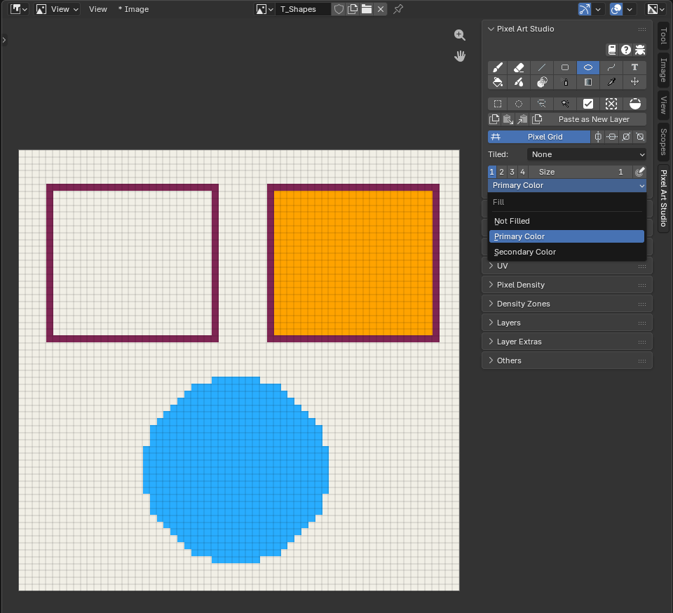

.. _path-tool:

Path and Polygon
----------------

**Path and Polygon** (:kbd:`Shift+Alt+C`, marked experimental): bezier paths and polygons laid down over several clicks, drawn as pixel art lines (pixel perfect stair steps), outlined or filled.

.. video:: _static/videos/v2/painting-tools-path.mp4
  :width: 100%

* **Click** places a corner point. Two corner points draw exactly what the Line tool draws.
* **Click and drag** places a smooth point: the drag pulls the curve, and the further you pull the more it bends (a dashed guide shows the handles).
* Moving the pointer previews the next segment (and the fill, as if the path was closed).
* :kbd:`Shift` while clicking snaps the new segment to a perfect angle (see :ref:`angle-snaps`).
* **Click the first point** to close the path (it needs at least 3 points, the first point's mark turns green under the pointer).
* :kbd:`Enter` finishes an open path (also :kbd:`Space` in ``Pixel Art Studio Only``).
* :kbd:`Ctrl+Z` takes the last point off. :kbd:`Esc` or :kbd:`Backspace` drop the whole path.
* The fill dropdown under ``Size``: ``Not Filled``, ``Primary Color`` or ``Secondary Color`` (primary as the outline). With a fill, an open path finished with :kbd:`Enter` is filled as if its last point joined the first.
* A finished path can't be edited anymore. Leaving the tool, or switching to another one, keeps the path as drawn.
* In 3D the points stay anchored on the model, so **you can orbit, pan and zoom between clicks**. Segments run straight over edges onto the next faces, and the fill covers what the outline encloses even around a corner of the model.

.. _bucket-fill:

Bucket Fill
-----------

**Bucket** (:kbd:`Shift+Alt+F`): fills the area under the click, with two modes.

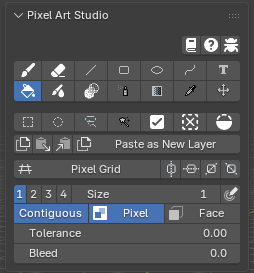

* ``Pixel`` (default): flood fill the color under the cursor, texel by texel.

  * ``Tolerance``: how far a color may drift and still be filled (``0`` is the exact color).
  * ``Contiguous`` (on by default): fills only the connected area under the cursor. Off, it fills every matching pixel of the layer (inside the selection, if there is one).
  * It reads the **active layer only**, not everything you see. A one texel stair stepped outline holds the fill.
  * In 3D, a contiguous fill **follows the surface of the model**: a closed outline drawn on the model holds the fill even when the area is split into many UV islands (a cylinder cap cut into triangles, for example), and the fill doesn't escape through the empty space between islands.

* ``Face``: fills the **mesh faces out to their own edges**: the selected faces in Edit Mode, or every face when none are selected (every face of the object in Object Mode). The texels an edge only partly covers are filled too, so a diagonal edge is **filled all the way to the geometry**, with no stair step left behind. Where you click doesn't matter, as long as it's on the model or the canvas.
* :kbd:`Ctrl+Alt+G` toggles between ``Pixel`` and ``Face`` (``Pixel Art Studio Only``).
* ``Bleed``: grows the fill past its edge, see :ref:`bleed`.
* With symmetry on, it fills from each mirrored click point.
* Fill patterns and ``Color Jitter`` work with the Bucket (:doc:`brushes-and-patterns`).

See :doc:`tutorial-how-to-blockout-colors` for the Bucket in a blockout workflow.

Gradient
--------

**Gradient** (:kbd:`Shift+Alt+D`): drag from where the primary color starts to where the secondary color ends (texels past the ends stay at the end colors).

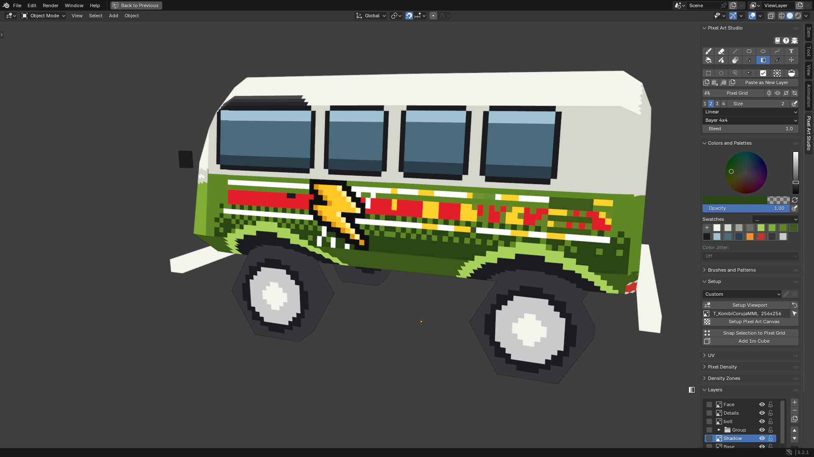

* Type: ``Linear`` or ``Radial`` (the center is where you press, the radius is the drag length).
* Dither: ``Smooth`` blends the colors (it makes new in between colors), ``Bayer 2x2``, ``Bayer 4x4`` (default) and ``Bayer 8x8`` keep **only the two colors**, as an ordered dither. The dither is anchored to the canvas, so it never shifts with the drag.
* ``Bleed``: shared with the Bucket, see :ref:`bleed`.
* It covers the selection, or with no selection, the whole active layer (Image Editor) or every texel visible from the view (3D).
* :kbd:`Shift` while dragging snaps the drag to a perfect angle.
* In 3D the gradient is laid as you see it on screen, across UV islands, so **it reads continuous over the model's faces**. Faces turned away from the view are left alone.
* With symmetry on, the far side gets the mirrored ramp.

Blur and Scramble
-----------------

**Blur** (:kbd:`Shift+Alt+H`): box blur, pixel aware (it never makes sub-pixels). Two modes:

* ``Blur``: softens the texels under the brush, each one averaged with its neighbours (new colors come out of it). Dragging over a spot again blurs it further. Alpha is averaged too, so blurring next to transparent texels makes semi transparent ones.
* ``Scramble``: shuffles the texels under the brush around. The area gets noisy and **keeps exactly the colors it already had** (great for wood grain, rust, grass or dirt without breaking your palette).
* ``Strength``: Blur, how far each texel goes towards the average of its neighbours. Scramble, how many texels swap places on each dab.

  * ``Strength Pressure`` (the stylus icon right of ``Strength``): a light press blurs less, or swaps fewer texels.

* The footprint is the brush ``Size`` and shape, never smaller than 3 texels.

Shading
-------

**Shading**: lightens or darkens **what is already painted**, under the brush (it never lays the paint color down). Ported from `Pixelorama <https://github.com/Orama-Interactive/Pixelorama>`_.

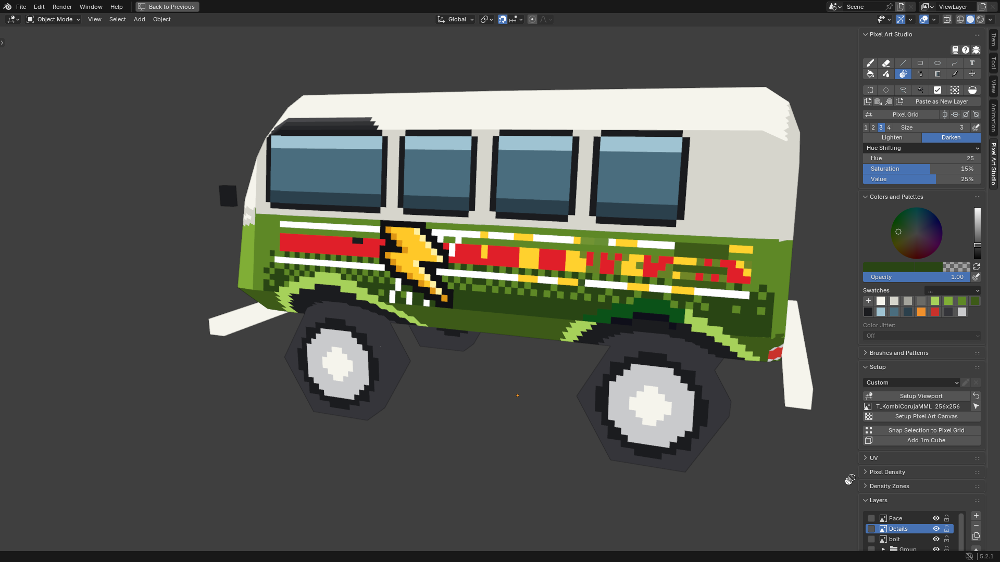

* ``Lighten`` / ``Darken``: which way the color moves. Hold :kbd:`Ctrl` as you press to swap it for that stroke.
* The mode dropdown:

  * ``Simple Shading``: moves every channel towards white or towards black, by ``Amount`` (with ``Strength Pressure`` beside it).
  * ``Hue Shifting``: turns the hue as well, **a highlight warms towards yellow and a shadow cools towards blue**. ``Hue``, ``Saturation`` and ``Value`` say how far one stroke goes. Highlights never go flat white and shadows never go flat black.
  * ``Color Replace``: steps along your swatches. The ramp starts at the swatch you last clicked in ``Colors and Palettes`` and runs ``Colors Right`` swatches to the right (the ramp is drawn in the panel). ``Lighten`` moves a texel one swatch right, ``Darken`` one swatch left. A color that is not on the ramp is left alone.

* Each texel moves **once per stroke**, however many times the drag passes over it. Release and stroke again to build up.
* Transparent texels are left alone in ``Simple Shading`` and ``Hue Shifting``.
* :kbd:`Ctrl+Shift+click` shades a straight line from the last dab (see :ref:`lines-from-last-dab`).
* The size and shape are the brush's, and ``Size Pressure`` works too.

Pixel Spray
-----------

**Pixel Spray**: spray can, scattering random brush dabs around the pointer.

* ``Spray Width``: the radius of the disk the dots land in.
* ``Spray Speed``: how many dots it sprays for every texel the pointer moves over. A fast drag is as dense as a slow one, and holding the pointer still sprays nothing.
* Every dot is a stamp of the brush: its ``Size`` and shape (custom brushes included), the primary color, ``Opacity`` and the fill pattern. With the pressure toggles on, a light press sprays smaller or fainter dots (the width and the dot count stay).
* On the model the disk is laid on the surface around the pointer, over seams onto the neighbouring faces.

Text
----

**Text**: pixel font text, **never antialiased**, placed and transformed like a selection.

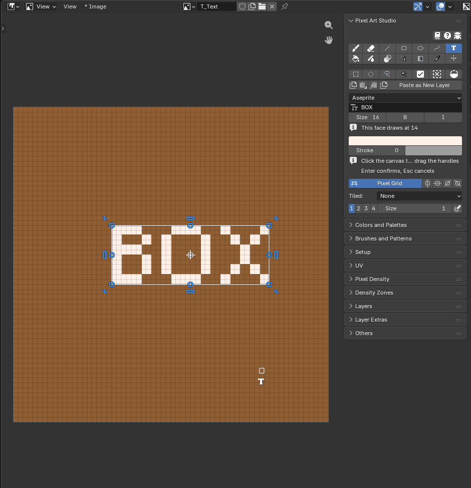

1. Pick a font: nine pixel fonts ship with the add-on (``Aseprite`` is the default), followed by every font installed on your system.
2. Type the words in the text box.
3. Set ``Size`` (height in texels), ``B`` (bold) and ``I`` (italic), the text color and the ``Stroke`` (an outline around the letters, ``0`` for none) with its own color.
4. Click the canvas: the clicked texel becomes the bottom left corner of the text, and it comes up inside the transform box.
5. Drag it around, pull a corner or turn it (see :ref:`transform-box`), then press :kbd:`Enter` to confirm (:kbd:`Esc` cancels).

* While the text is live, typing in the viewport adds letters, :kbd:`Backspace` deletes the last one, and changing any setting redraws it where it is (keeping the scale and turn you gave the box).
* A click away from the box moves the text there. Switching tools lands it.
* The text uses its own text color, not the primary color.
* A pixel font is drawn at its own size or a whole multiple of it, so letters stay crisp. When that differs from ``Size``, the panel says ``This face draws at`` and the real size (it shows after the first placement).
* Place text in the Image Editor (in the 3D Viewport a click on the model also places it, flat on the texture at the clicked texel).
* Symmetry and Tiled Mode don't apply to text.

.. _eyedropper:

Eyedropper
----------

The sampled color becomes the primary color. There are three ways to sample:

* **Eyedropper** (:kbd:`Shift+Alt+I`): click to sample, or keep the button down and the color follows the pointer.
* :kbd:`Alt+click` from any paint tool (with a selection tool armed, :kbd:`Alt` removes from the selection instead).
* **Eyedropper on hover** (:kbd:`Alt+Shift+X`): point at a color and press, **no click and no tool armed**. Keep it held and the color follows the pointer. It works in the 3D Viewport and in the Image Editor.

.. video:: _static/videos/v2/painting-tools-eyedropper.mp4
  :width: 100%

What it samples:

* **On the canvas**: the color you see, with every visible layer, blend mode and adjustment (it never samples the pixel grid layer).
* **In the 3D Viewport, off the model**: the image texture of any other mesh under the pointer (a reference image plane, another object), read exactly as the image has it, with no lighting. Anything else (an image on an Empty, a solid color material, the background) is sampled as the viewport shows it.
* **A texture that isn't a canvas yet** (in either editor): its own texel. The eyedropper never makes a canvas.
* **In the Image Editor**: the canvas only.

Color preview at the cursor:

* While you pick, **two small squares sit beside the pointer**: on the left the color it would take, on the right the color you have now. One square means they are the same.
* ``Show colors sampled at cursor position`` in the add-on preferences (``General`` > ``Cursor``) turns the squares and the eyedropper cursor off. Sampling still works.

.. warning::
    If your Blender keymap orbits with :kbd:`Alt+click` (``Industry Compatible``, or ``Emulate 3 Button Mouse``), the orbit wins. Rebind ``Eyedropper (hold and click)`` in the add-on's ``Shortcuts`` preferences, or use the ``Eyedropper`` tool and :kbd:`Alt+Shift+X`.

.. note::
    Why does the sampled color look different from the screen? Under the ``AgX`` or ``Filmic`` view transforms, the screen shows a transformed color and the eyedropper samples the texture's own value. ``Setup Viewport`` sets the ``Standard`` view transform, where both match.

Move
----

**Move** (:kbd:`Shift+Alt+V`): drags the whole active layer around. A selection travels with it.

* ``Auto Select Layer``: grabs the layer under the click instead of the active one (the topmost visible, unlocked layer with paint there).
* :kbd:`Shift` while dragging holds the move to one axis.
* :kbd:`Ctrl` as you press duplicates: a copy moves and the original stays.
* With a **group** active, every layer inside it moves together (locked layers stay put).
* In the Image Editor the layer slides, so pixels pushed off the canvas are not lost and come back when you slide it back.
* In the 3D Viewport the drawing is **carried across the model's faces**, over the seams.
* :kbd:`Esc` during the drag puts it back. Each drag is one undo step.

.. _lines-from-last-dab:

Lines from the last dab
-----------------------

Paint a dab (a click or a stroke), then hold :kbd:`Ctrl+Shift` and click somewhere else: a **straight pixel perfect line from the last dab to the click**, painted as one stroke of the armed tool.

.. video:: _static/videos/v2/painting-tools-ctrl-shift-lines.mp4
  :width: 100%

* It works with the **Brush**, the **Eraser** and **Shading**, with their size, shape, opacity, pressure, pattern, ``Pixel Perfect`` and ``Bleed``.
* Each click continues from where the previous line ended, so a chain of clicks draws a polygon.
* :kbd:`Ctrl+Shift+Alt+click` draws the same line snapped to a perfect angle (see :ref:`angle-snaps`).
* While :kbd:`Ctrl+Shift` is held, **the preview under the pointer is the whole line** the click will paint.
* The three tools share one last dab: paint with the Brush, switch to the Eraser (:kbd:`Shift+Alt+E`), and :kbd:`Ctrl+Shift+click` erases a line from the last painted dab.
* The first :kbd:`Ctrl+Shift+click` right after you arm Pixel Art Studio just paints a dab (there is no last dab yet).
* In 3D the line runs over the surface between the two points, **straight across seams and onto other faces**, and you can orbit between the two clicks.
* Both are hold and click shortcuts, and you can rebind them to a key held down (``Line from last dab`` and ``Angled line from last dab`` in :doc:`shortcuts`).

.. _angle-snaps:

Angle snaps
-----------

The Line (:kbd:`Shift`), the Gradient (:kbd:`Shift`), a Path segment (:kbd:`Shift` on click) and the angled line from the last dab (:kbd:`Ctrl+Shift+Alt+click`) all snap to the **same sixteen perfect pixel art directions**:

* Horizontal and vertical.
* The two 45 degree diagonals.
* The **2:1 and 1:2 isometric** lines, in every direction (a 2:1 line comes out in even runs of two texels).

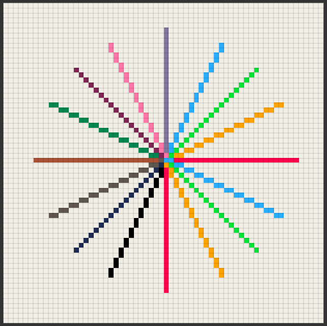

.. _brush-preview:

Brush preview
-------------

The Brush, the Eraser, Shading and Pixel Spray show **the exact dab under the pointer before you click**: the same footprint, shape, custom brush, pattern colors, ``Color Jitter``, bleed texels, symmetry copies and Tiled Mode wrapping.

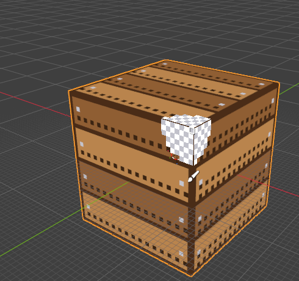

* The Brush's preview is the paint color at the real strength. The Eraser and Shading show a neutral grey.
* In the 3D Viewport it's drawn **on the model**, folded over seams and corners the way the dab is going to land.
* With :kbd:`Ctrl+Shift` held, it shows the whole line from the last dab.
* The Line, the shapes and the Path have no preview of their own: what you see while dragging is already the final pixels.
* The armed tool's icon follows the pointer, below the brush footprint. ``Show tool icons at cursor position`` in the add-on preferences (``General`` > ``Cursor``) turns it off.

.. _painting-on-the-model:

Painting on the model
---------------------

* The tools paint the texture of the **active object**, on every visible object that uses it (see :ref:`several-parts`). The Image Editor paints the canvas it shows.
* **A texture that isn't a canvas yet** becomes one with your first click on it, and the click paints (see :ref:`automatic-canvas`). A click on a mesh with no texture opens ``Quick Setup`` (see :doc:`quick-setup`).
* You can switch between Object Mode and Edit Mode, and use Blender's own tools in between strokes.
* **Faces hidden in Edit Mode** (:kbd:`H`) are out of reach of every tool: no paint, no fill and no bleed goes through them. Unhide them (:kbd:`Alt+H`) or go back to Object Mode to paint there again.
* **Strokes follow the surface**: crossing a UV seam never draws a bridge line across the texture, each island gets its own piece and nothing lands in the empty texture space.
* **Big brushes fold over seams** onto the next face, even when that face's UV island is somewhere else in the texture or turned, and around a corner onto all three faces. Nothing leaks into other islands.
* **A dab stops at faces turned away from the view** (it doesn't spill under a hat brim or onto a back face you can't see). Orbit to face them and paint there.
* **Straight things stay straight across faces**: the Line, the shapes, the lines from the last dab and the Path are drawn as if the model was unfolded when they cross a seam.
* Faces sharing the same UV spot (``Stack UVs``, or faces overlapping in the UVs) all show what you paint on one of them.

.. _several-parts:

Models made of several objects
------------------------------

A rig, a vehicle in parts, a character split into a head and a body: when several objects use **one texture**, every visible one of them takes the brush where you point at it, not only the active object.

* **Blender's selection, active object and mode never change**: you paint the wheel under the pointer with the body selected.
* **The brush preview, the tool icon, the pixel grid, the selections and their marching ants** show on every part.
* **A stroke, a shape, a gradient, a selection or a drag stays on the part it started on**: going onto another part is like going off the model.
* **A part in front hides the one behind it**: the brush lands on the nearest part under the pointer.
* **Objects that use another texture are seen through**, as in Blender's own Texture Paint: they never block, never get painted.
* **An Armature or an Empty active** (you selected the rig): the part under the pointer decides which texture is painted, and the ``Layers`` panel and the layer keys follow it while a tool is armed.
* The first click on a plain texture makes it a canvas on the part you clicked, as usual (see :ref:`automatic-canvas`).

.. note::
    Not done yet: a selection or a stroke spanning several parts at once, and symmetry across separate parts. A part scaled flat (a scale of 0) can't be painted.

Undo
----

* Every stroke, shape, fill, gradient, line from the last dab and finished path is **one undo step**, named after the tool, and :kbd:`Ctrl+Z` / :kbd:`Ctrl+Shift+Z` share Blender's own undo (setup steps and strokes undo in order).
* :kbd:`Ctrl+Z` works wherever the pointer is while a tool is armed. With the mouse button still down, it cancels the drag instead (so does :kbd:`Esc`).
* Tool settings are not undone: the size, the shape, the colors, the opacity and the armed tool stay as they are.
