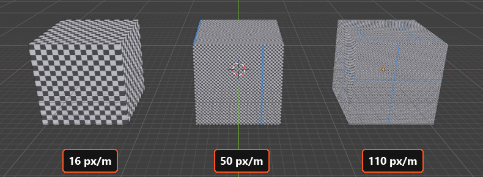
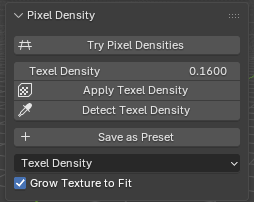
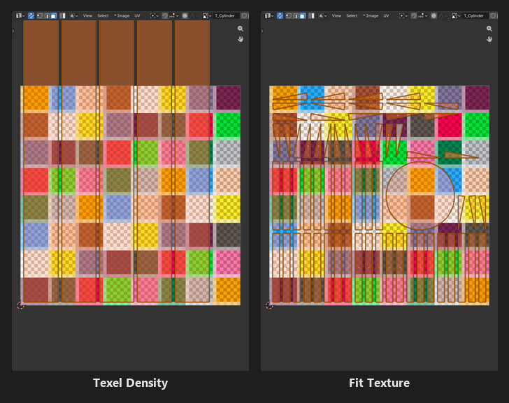
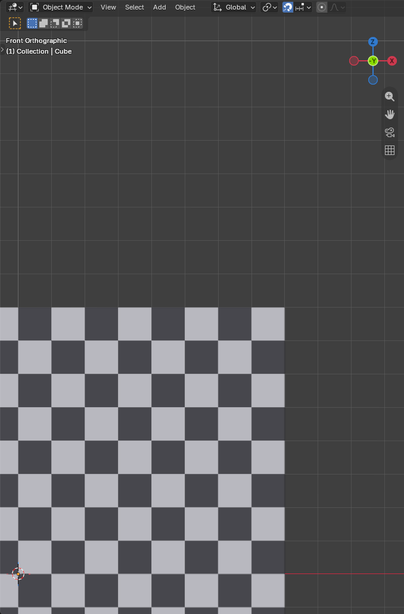

Pixel Density
=========================================

Pixel density (aka **texel density**) is how many texture pixels cover one meter of the model's surface. Pixel Art Studio counts it in **px/m**, pixels per meter.

* **50 px/m**: a 1 m wall is 50 pixels across, so one pixel is 2 cm on the model.
* **16 px/m**: one pixel is 6.25 cm, and a 2 m tall character is 32 pixels tall.
* **Bigger number, smaller pixels** (and more of them, so more detail and bigger textures).

**The same density on every face means the same pixel size everywhere**: no stretched pixels, no face with bigger pixels than its neighbor, and two models at the same density have pixels of the same size.

.. note::
    Does the texture size set the pixel size?

    No, the density does. At the same density a bigger model needs a bigger texture, and a smaller model leaves part of the texture empty. ``Fit Texture`` works the other way round: it picks the density from the texture (see :ref:`fit-texture`).

You pick the density with a preset in ``Setup`` (see :ref:`density-presets`), or type your own in the ``Pixel Density`` panel. To see a density on the model before choosing it, use ``Quick Setup`` or ``Try Pixel Densities`` (see :doc:`quick-setup`).

The Pixel Density panel
-----------------------

In the sidebar (:kbd:`N`), tab ``Pixel Art Studio``, panel ``Pixel Density`` (closed by default), in the 3D Viewport and in the Image Editor:

* ``Try Pixel Densities``: other pixel sizes on the model, live, then applied keeping your painting (see :doc:`quick-setup`).
* ``Texel Density``: your own density, in **px/cm** (``0.50`` is 50 px/m, ``1.10`` is 110 px/m).
* ``Apply Texel Density``: puts the selected models on that density.
* ``Detect Texel Density``: measures the density a model already uses.
* ``Save as Preset`` and ``Update Preset``: your own presets (see :ref:`density-presets`).
* **Unwrap density**: ``Texel Density`` or ``Fit Texture``, what the unwraps use.
* ``Grow Texture to Fit``.

Texel Density
-------------

* **The field is in px/cm, everything else says px/m**: ``0.16`` is 16 px/m, ``0.50`` is 50 px/m, ``2.20`` is 220 px/m.
* **Always a whole px/m**: whatever you type is rounded to the nearest whole px/m, so a model built on the grid lands on whole texels.
* Typing a number switches the preset to ``Custom`` (a preset of your own stays selected, so ``Update Preset`` can save the new number).
* It doesn't touch the model: on a model that already has a pixel size, ``Apply Texel Density`` turns red until you apply it.

.. note::
    Keep the scene's ``Unit Scale`` (``Scene Properties > Units``) at ``1.0``. Any other value multiplies every density.

.. _apply-texel-density:

Apply Texel Density
-------------------

Scales the UVs of the selected models to the density and snaps them onto the texel grid. **It keeps your UV layout**: islands stay where they are, and every face keeps its shape (no slanted pixels).

* **Whole models**: every face of every selected mesh, in Object Mode or Edit Mode (the face selection doesn't matter).
* **Islands that grow into each other** (closer than the margin) or past the texture edge: then every island is packed again, and with ``Grow Texture to Fit`` on the canvas grows to hold them.
* **Other objects on the same texture that you didn't select** stay as they are: the selected models are packed around them, and their islands that kept their size stay where they are. The canvas doesn't grow then, since that would change the pixel size of the others: the report says ``does not fit beside the other objects`` and nothing changes. Select every object on the texture to lay them out together (and grow it).
* **Islands stacked on purpose** (with ``Stack UVs``, or mirrored halves on one spot) move together.
* **Applying the density a model already has moves nothing.**
* It follows the ``Unwrap Options`` of the ``UV`` panel: the margin, density zones, pixel aspect, face shapes and pinned UVs (see :doc:`uv-tools`).
* It always applies the scene's density, whatever the unwrap density dropdown says.
* Meshes on the same texture are one layout, so packing one can't land it on another.
* **A texture with painting on it is asked about first**: ``Keep my painting`` (every layer scaled to the new pixel size) or ``Start with a blank texture``. The button itself takes no undo step, the answer takes one (see :ref:`density-question`).
* **A new object added to a painted texture isn't asked about** when the other objects on it are already at the density: it's laid out on its own, around them, and the painting and the other objects stay as they are. Painting that only the selected models show is still asked about.

.. video:: _static/videos/v2/apply-texel-density.mp4
  :width: 100%

Why is the button red?
~~~~~~~~~~~~~~~~~~~~~~

Once a model has a pixel size (from ``Quick Setup``, the wizard, an unwrap, ``Apply Texel Density`` or ``Detect Texel Density``), the model remembers it. Pick another preset or type another density and the model **owes** the new one: ``Apply Texel Density (needed)`` turns red, and ``Try Pixel Densities``, at the top of the same panel, turns red too.

* Click it (or ``Setup Viewport``) to put the model on the new density, or ``Try Pixel Densities`` to see the new density on the model first.
* ``Setup Viewport`` itself is never red: painting never needs it.
* Picking the old preset back clears the red too, with nothing applied.
* :kbd:`Ctrl+Z` past an apply brings the red back.
* A model the add-on never touched owes nothing.

.. _detect-texel-density:

Detect Texel Density
--------------------

Measures the density the selected models already use (the whole model, averaged by area) and makes it the scene's density: the preset goes to ``Custom``, ``Texel Density`` takes the number, and the grid follows.

* **The model you're matching**: open somebody else's textured model, click ``Detect Texel Density``, and everything you model and unwrap from then on (``Pixel Art Unwrap``, ``Quick Unwrap Model``, ``Apply Texel Density``, ``Add 1m Cube``) gets the same pixel size.
* **Painting doesn't need it**: a model with UVs and a texture only needs a tool (see :ref:`automatic-canvas`).
* **Several textures on one mesh**: each texture's faces are measured against that texture's own size.
* ``F9`` after the click: ``Match the Viewport`` (on) sets the grid to the density just measured.

.. tip::
    ``Setup Viewport`` does the same measure by itself, the first time it meets a textured model the add-on never measured. Painting never measures anything. On a model with several pixel sizes, use :doc:`density-zones` instead.

.. warning::
    Measure a model that has a texture. With no texture there's nothing to count the pixels against, and the number says nothing about the model.

.. _fit-texture:

Texel Density or Fit Texture
----------------------------

The dropdown at the bottom of the panel picks what ``Pixel Art Unwrap``, ``Quick Unwrap Model`` and ``Add 1m Cube`` use:

* ``Texel Density`` (default): the density above, **so the pixel size matches your other models**. When the model doesn't fit, the canvas grows (or the report says what size it needs).
* ``Fit Texture``: the **biggest density that fills the texture**. It tries multiples of 16 px/m first (so a 1/16 m grid square stays whole texels), and the report says which one it picked, so you can match other models to it.

.. note::
    After a ``Fit Texture`` unwrap, the model is at the fit density and the scene still asks for its own, so ``Apply Texel Density`` turns red. Clicking them rescales the model back to the scene's density. To keep the fit, click ``Detect Texel Density`` (or type the number from the report).

``Fit Texture`` ignores density zones: it's one density for everything on that texture.

.. _grow-texture-to-fit:

Grow Texture to Fit
-------------------

When the layout doesn't fit the texture at the density, **the canvas grows** (every layer with it) to the smallest square size that holds it, up to 1024 x 1024, and the layout is done again. On by default.

* **Your pixels are kept** as they are, at the bottom left of the bigger canvas (the faces get new places, so paint after the unwrap).
* **Only a Pixel Art Studio canvas grows.** A plain image never does.
* **One undo step** with the unwrap, and the masks, the pixel grid layer and the ``Background`` grow with it.
* Off, the unwrap still runs and the report says how big the texture needs to be (``Crate: does not fit the 64x64 texture T_Crate at 50 px/m, needs 256px``).

Used by ``Pixel Art Unwrap``, ``Quick Unwrap Model``, ``Add 1m Cube`` and ``Apply Texel Density``.

.. _pixel-grid-match:

The grid that matches the pixel
-------------------------------

After ``Setup Viewport`` (optional, see :ref:`setup-viewport` for everything it changes), **one square of Blender's grid is exactly one texel** at the scene's density: model on the grid, and every edge on a grid line lands on a whole pixel (no thin strips of half pixels).

* **Snapping lands on the grid**: ``Setup Viewport`` turns on ``Increment`` snapping with ``Absolute Grid Snap``, so a move lands on grid positions.
* ``Add 1m Cube``: the reference cube, every face exactly as many texels as the density.

  * The smallest square texture that holds it: 64 at 16 px/m, 256 at 50 px/m, 512 at 110 px/m, 1024 at 220 px/m.

* ``Snap Selection to Pixel Grid`` (``Setup`` panel): puts the selection exactly on the pixel grid, **whatever the zoom**. Blender's own snapping follows the grid it's drawing, which gets coarser as you zoom out; this one always uses one texel.

  * Object Mode: moves the selected objects' origins. Edit Mode: moves the selected vertices.
  * ``F9`` after the click: ``Every N Texels`` (1 to 64), for coarser steps.

* **A model with several pixel sizes**: the grid can follow the face under the pointer while you paint (see :doc:`density-zones`).

.. note::
    Two more grids, and they're different things:

    * The ``Pixel Grid`` overlay (:kbd:`\\` while a tool is armed): lines on the texel borders, drawn over the canvas and the model, never in the texture (see :ref:`pixel-grid-overlay`).
    * The ``Pixel Art Canvas`` grid **layer** from the canvas wizard: a real layer of the texture, to count pixels on the model (see :ref:`pixel-grid-layer`).

How to
------

**Change the pixel size of a model, keeping what you painted**

1. Click ``Try Pixel Densities`` and try the sizes on the model (``Current Texture`` shows your painting at each of them).
2. ``Apply New Density``, then ``Keep my painting``. See :ref:`quick-setup-try`.

**Change the pixel size of a model that's already unwrapped, with the buttons**

1. Pick another preset, or type a ``Texel Density``. ``Apply Texel Density (needed)`` turns red.
2. Select the models and click ``Apply Texel Density`` (or ``Setup Viewport``, which also puts the grid on the new density).
3. The report says ``does not fit``? Turn on ``Grow Texture to Fit`` and apply again, or pick a lower density. It says ``does not fit beside the other objects``? Select every object on that texture and apply again.

**Give two models the same pixel size**

1. Select both and click ``Apply Texel Density``. Different object sizes, same px/m, same pixel size.

**Fill a texture of a fixed size**

1. Set the unwrap density dropdown to ``Fit Texture``.
2. ``Quick Unwrap Model`` and read the density in the report.
3. Click ``Detect Texel Density`` to make it the scene's density, so the next models match it.
