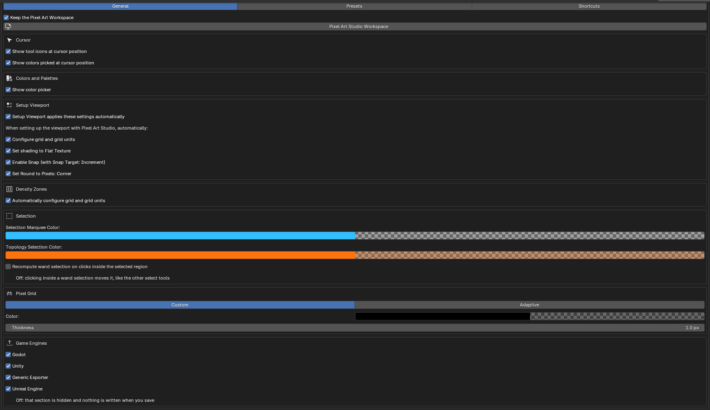
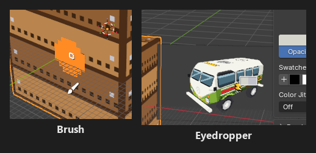
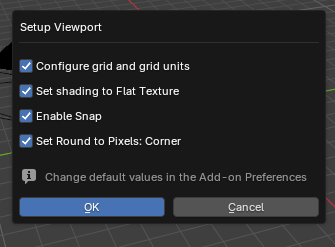
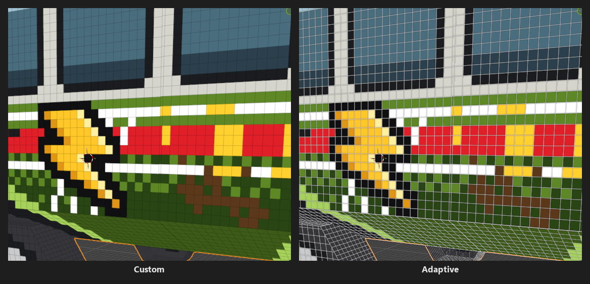
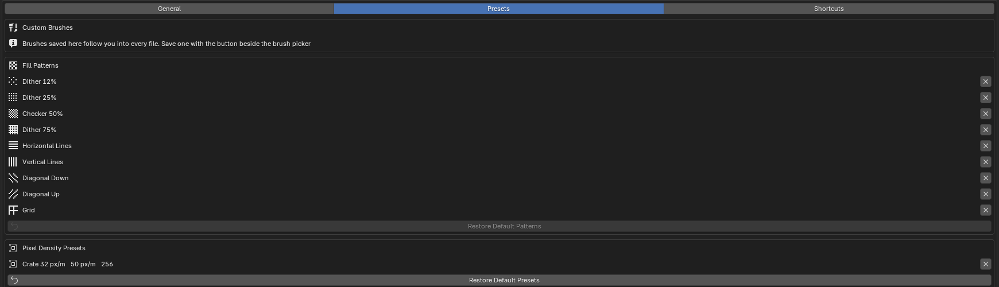

Preferences
=========================================

Pixel Art Studio's preferences are in ``Edit > Preferences > Add-ons > Pixel Art Studio`` (expand the add-on's entry). They're split in three tabs: ``General``, ``Presets`` and ``Shortcuts``.

* Everything here is **global**: the same in every .blend you open.
* The ``General`` tab and the shortcuts are saved like any Blender preference (with Blender's ``Auto-Save Preferences`` off, click ``Save Preferences``).
* The ``Presets`` libraries are saved the moment you add or remove something.

General
-------

At the top:

* ``Keep the Pixel Art Workspace`` (on): every file you open gets the ``Pixel Art Studio`` workspace tab (the Image Editor on the left, the 3D Viewport on the right). Workspaces are saved inside the .blend, so without this the workspace is gone the next time you open Blender. Off, nothing is added when a file opens.
* ``Pixel Art Studio Workspace``: takes you to the workspace, and builds it when the file has none (the same button is in the sidebar's ``Others`` panel).

Cursor
~~~~~~

* ``Show tool icons at cursor position`` (on): the armed tool's icon is drawn under the pointer (and below the brush preview, so it never covers what you're about to paint). Off, only Blender's precision cursor is shown, and the selection tools also lose the ``+`` / ``-`` they show beside the pointer while adding or removing.
* ``Show colors sampled at cursor position`` (on): while sampling a color (the ``Eyedropper``, :kbd:`Alt+click` or the hover eyedropper), the pointer becomes Blender's eyedropper and **the sampled color and the color it replaces** are drawn beside it. Off, the eyedropper still samples, only the drawing goes.

Colors and Palettes
~~~~~~~~~~~~~~~~~~~

* ``Show color picker`` (on): Blender's color picker above the two colors in ``Colors and Palettes``. Its shape is Blender's own setting, ``Preferences > Interface > Editors > Color Picker Type``. See :doc:`colors-and-palettes`.

Setup Viewport
~~~~~~~~~~~~~~

What ``Setup Viewport`` (``Setup`` panel) does when you click it:

* ``Setup Viewport applies these settings automatically`` (on): one click applies the ticked settings below. **Off, the button asks first**, with the same four checkboxes, so you can leave parts out for that one click (your answer is remembered until Blender restarts).
* ``Configure grid and grid units`` (on): turns the unit system off and sets the viewport grid to **one grid square per texel**, so you model on the grid the pixels sit on.
* ``Set shading to Flat Texture`` (on): ``Viewport Shading > Solid > Flat > Texture``, in every 3D Viewport.
* ``Enable Snap (with Snap Target: Increment)`` (on): snapping on, to increments and absolute grid positions.
* ``Set Round to Pixels: Corner`` (on): the Image Editor's ``Round to Pixels`` set to ``Corner``, so UVs you drag land on a texel corner, never in between pixels.

.. note::
    ``Setup Viewport`` always sets Color Management's view transform to ``Standard``, whatever is ticked, so the colors on screen are the colors you painted.

Density Zones
~~~~~~~~~~~~~

* ``Automatically configure grid and grid units`` (on): while you paint in 3D on a model with density zones, the viewport grid follows the density of the face under the cursor. Off, the grid stays where ``Setup Viewport`` left it. The model's own ``Grid Follows the Face`` has to be on too, see :doc:`density-zones`.

Selection
~~~~~~~~~

* ``Selection Marquee Color`` (light blue, with its alpha at 0): the color washed over the selected texels, and how strongly (the alpha). **At 0 there's no wash** and the marching ants alone show the selection. Raise the alpha to tint selections.
* ``Topology Selection Color`` (orange, alpha 0.3): the same for a selection that matches the topology (3D Viewport only). It's a different color on purpose, that selection is tied to the geometry and can't be moved.
* ``Clear selection when Pixel Art Studio is de-activated`` (on): **putting the last tool away deselects the pixels**, so the marching ants don't stay on the texture (with the tool button, the activator, :kbd:`Esc`, or by closing the sidebar or picking another of its tabs). One :kbd:`Ctrl+Z` brings the selection back. With tools armed in both editors, the selection goes when the second one is put away. Off, the selection stays until you deselect it.
* ``Recompute wand selection on clicks inside the selected region`` (off): on, clicking inside a ``Magic Wand`` selection samples the region again (how you re-apply a tolerance change). Off, a click inside a wand selection moves it, like the other select tools.

Neither color is ever saved into the texture. See :doc:`selection-and-transform`.

Pixel Grid
~~~~~~~~~~

How the ``Pixel Grid`` overlay looks, in the Image Editor and on the model (see :doc:`symmetry-tiled-mode-and-grid`):

* ``Custom`` | ``Adaptive`` (``Custom`` by default):

  * ``Custom``: the grid is drawn in the ``Color`` below, at its opacity.
  * ``Adaptive``: **a light line with a dark halo under it, so the grid reads over dark art and light art alike**. It only uses the opacity of ``Color`` (the row is greyed out while ``Adaptive`` is picked).

* ``Color``: black at 35% opacity by default.
* ``Thickness``: 1 to 8 pixels, 1 by default.

.. tip::
    To change the opacity of ``Adaptive``, switch to ``Custom``, change the alpha of ``Color`` and switch back.

Game Engines
~~~~~~~~~~~~

* ``Godot``, ``Unity``, ``Generic Exporter`` and ``Unreal Engine`` (all on): off, that section is hidden from the ``Others`` panel and nothing is written for it when you save. The .blend keeps its settings, so ticking it again brings the integration back. See :doc:`game-engines`.

Not in this tab: the two ``Always Highlight`` checkboxes at the top of the ``Stacked Faces`` and ``Joined Faces (UVs Together)`` lists (``UV`` panel) are preferences too, the same in every file. See :doc:`uv-tools`.

Presets
-------

Your own libraries, the ones that **follow you into every file**.

* ``Custom Brushes``: the brushes you saved to the preferences (name and size). Save one with the button beside the brush picker in ``Brushes and Patterns`` (see :doc:`brushes-and-patterns`).
* ``Pixel Density Presets``: your own density presets (name, px/m and texture size). Make one with ``Save as Preset`` in the ``Pixel Density`` panel (see :doc:`pixel-density`).

  * ``X`` removes one (it asks first). A scene that was on it goes to ``Custom``, and its density doesn't change.
  * ``Restore Default Presets``: removes every saved preset, leaving the ones the add-on ships with.

* ``Fill Patterns``: the built in patterns and the ones you saved.

  * ``X`` on a built in pattern hides it from the pattern menu, ``X`` on one of yours removes it from the library.
  * ``Restore Default Patterns``: shows every built in pattern again and removes the ones you saved (it asks first).

.. note::
    Removing a brush or a pattern from the library doesn't remove it from the files that already use it. And a brush or a pattern saved to the library is copied into a file **once**, the first time Pixel Art Studio sets that file up: a file that already has its own brushes or patterns doesn't pick up the ones saved later. Density presets show up in every file right away.

Shortcuts
---------

At the top, ``Shortcut Mode``:

* ``Alongside Blender`` (default): Blender's shortcuts keep working while a tool is armed, and Pixel Art Studio's use the keys Blender leaves free (:kbd:`D` opens the tools popup, tools are :kbd:`Shift+Alt` and their letter).
* ``Pixel Art Studio Only``: the classic set, like in Aseprite. While a tool is armed the keys are Pixel Art Studio's (:kbd:`B` the ``Brush``, :kbd:`G` the ``Bucket``).
* ``Show the Shortcut Question Again``: the question Pixel Art Studio asks the first time you arm a tool.

Under it, every key of the mode you're on, the activator and the hover eyedropper, all rebindable with Blender's own key editor. Each mode keeps its own set. See :ref:`shortcut-mode`, and :ref:`bindable-shortcuts` for how to rebind and restore them.

.. image:: _static/images/v2/shortcuts-preferences-tab.png
