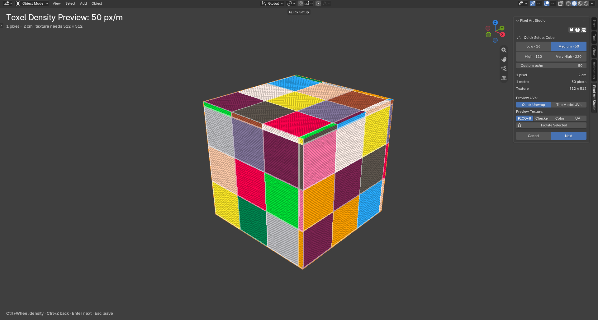
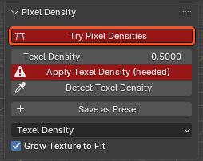
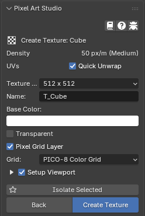
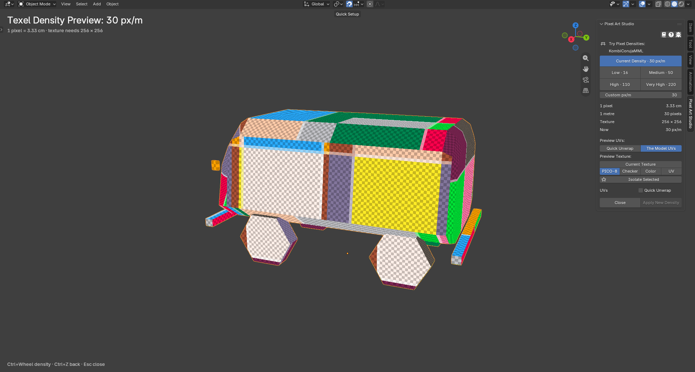
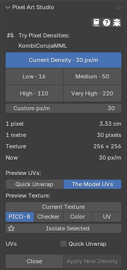
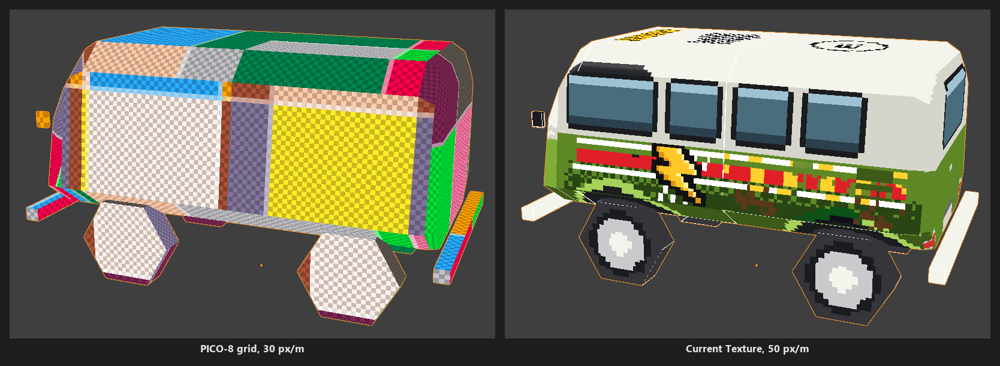
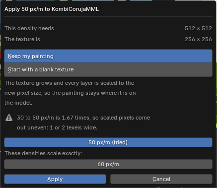
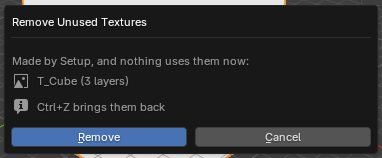

Quick Setup and Try Pixel Densities
=========================================

Try pixel sizes **on the model, live**, before anything is made or changed, then make the texture (``Quick Setup``) or give a model that already has a texture its new pixel size (``Try Pixel Densities``). Nothing is made or changed until you click ``Create Texture`` or ``Apply New Density``, and each of them is one :kbd:`Ctrl+Z`.

Both are the same mode: ``Quick Setup`` for a model with no texture, ``Try Pixel Densities`` for a model that has one.

.. _quick-setup-open:

Opening it
----------

* **The big** ``Setup`` **button**, at the top of the ``Pixel Art Studio`` panel, between the help buttons and the tools. It shows while the selected object is a mesh with no texture of its own (in the 3D Viewport and in the Image Editor; from the Image Editor it opens over the biggest 3D Viewport of the window).
* **A click on the model with any tool**, on a mesh with no texture.
* ``Try Pixel Densities``, at the top of the ``Pixel Density`` panel (3D Viewport), for a mesh with a texture. Greyed out, with the reason in its tooltip, when that texture can never be painted (a sequence, a movie, a file that's gone).
* **The eye beside** ``Quick Unwrap Model`` (``UV`` panel, 3D Viewport): opens on ``Preview UVs: Quick Unwrap``, to try new UVs without changing your model and texture (see :ref:`quick-setup-uvs`).

.. image:: _static/images/v2/uv-panel-eye.png

When the model's pixel size isn't the scene's (you picked another preset after setting it up), ``Try Pixel Densities`` turns **red**, in its usual place at the top of the ``Pixel Density`` panel, so you know the model and the scene disagree. A model Pixel Art Studio never measured (a textured model you just opened) doesn't turn it red.

What happens when it opens
--------------------------

* **Every armed tool is put away**, and no tool can be armed until you leave (``Leave Quick Setup to use the tools``).
* **The 3D Viewport is maximized** (Blender's own :kbd:`Ctrl+Space`) and cleaned up: the toolbar, the floor grid, the axes, the 3D cursor and the other overlays hide, X-Ray goes off and Wireframe shading goes to Solid. The model is framed in the middle.
* **The grid is drawn on the model** at the density you're trying, one cell per pixel, and it follows the model as you orbit and zoom. Nothing is written into the model or the file: it's only drawn.
* **The text at the top left** says the density (``Texel Density Preview: 50 px/m``), what one pixel is (``1 pixel = 2 cm``) and the texture size it needs. The keys are listed at the bottom.
* **The sidebar becomes the mode's panel**, and the other Pixel Art Studio panels hide until you leave.
* **Navigation stays Blender's**: orbit, pan, zoom, the numpad views, the navigation gizmo and the trackpad all work as always.
* **Nothing goes into Blender's undo history** while you try.

.. _quick-setup-step1:

Step 1: select a pixel size
---------------------------

From the top:

* ``Current Density`` (``Try Pixel Densities`` only): back to the density the model has now, for example ``Current Density · 30 px/m``.
* **The presets**: ``Low · 16``, ``Medium · 50``, ``High · 110``, ``Very High · 220``, then your own presets (see :ref:`density-presets`). Hover one for what one pixel is at that density.
* ``Custom px/m``: type your own density.
* **The numbers**: ``1 pixel`` (its size on the model), ``1 metre`` (how many pixels), ``Texture`` (the size the model needs at this density; red, with ``This model needs more than that at this density``, past 2048). ``Try Pixel Densities`` also says ``Now``, the density the model has.
* ``Preview UVs:`` ``Quick Unwrap`` or ``The Model UVs`` (see :ref:`quick-setup-uvs`).
* ``Preview Texture:`` ``Current Texture`` (``Try Pixel Densities`` only, see :ref:`quick-setup-current-texture`), then the grid: ``PICO-8``, ``Checker``, ``Color``, ``UV``.
* ``Isolate Selected``: shows only the selected objects, the model and the lights (Blender's own Local View). Click it again, or press :kbd:`Numpad /`, to show everything again.
* ``Quick Unwrap`` box (``Try Pixel Densities`` only, under ``UVs``).
* ``Cancel`` and ``Next`` (``Quick Setup``), or ``Close`` and ``Apply New Density`` (``Try Pixel Densities``).

Keys while it's open (everything else is Blender's):

.. list-table::
   :widths: 30 70
   :header-rows: 1

   * - Key
     - What it does
   * - :kbd:`Ctrl+Wheel`
     - The next preset up or down.
   * - :kbd:`Ctrl+Z`, :kbd:`Ctrl+Shift+Z`
     - Back and forward through the densities you tried (Blender's undo history is never touched).
   * - :kbd:`Enter`
     - ``Next`` (``Quick Setup``), ``Apply New Density`` (``Try Pixel Densities``). In step 2, ``Create Texture``.
   * - :kbd:`Esc`
     - Leave with nothing made. In step 2, back to step 1.
   * - :kbd:`Numpad /` or :kbd:`/`
     - ``Isolate Selected``, on and off.

.. _quick-setup-uvs:

Preview UVs: Quick Unwrap or The Model UVs
------------------------------------------

.. image:: _static/images/v2/quick-setup-preview-uvs.png

* ``Quick Unwrap``: the UVs ``Quick Unwrap Model`` would give the model, every face flat at the pixel size, joined faces in one piece, stacked faces on one spot, each density zone at its own pixel size (see :doc:`uv-tools`). What you see is what ``Create Texture`` and ``Apply New Density`` lay out, and the texture size follows that layout.
* ``The Model UVs``: the grid through the UVs the model already has, at the size they get when they're kept. Stretched pixels show right away (above: the hat's UVs projected from a bad angle). Greyed out for a model with no UVs.

Picking ``The Model UVs`` unticks the ``Quick Unwrap`` box, picking ``Quick Unwrap`` ticks it.

.. note::
    A model whose modifiers change its faces (a Subdivision, a Mirror that mirrors the UVs) is previewed face by face, and the text at the top left says so.

.. _quick-setup-step2:

Step 2: create the texture
--------------------------

``Quick Setup`` only. Click ``Next`` (or :kbd:`Enter`):

* ``Density``: the one you picked, ``50 px/m (Medium)``.
* ``UVs``: the ``Quick Unwrap`` box.

  * **Ticked** (default): the model gets new UVs at that pixel size, the ones the preview showed.
  * **Unticked**: the model keeps its own UVs, scaled to the pixel size and snapped on whole pixels.
  * Held ticked (greyed) for a model with no UVs.

* ``Texture Size``: opens on the size the model needs. A smaller one shows a red line (``Cube needs 512px at 50 px/m``).
* ``Name`` (``T_`` and the model's name), ``Base Color``, ``Transparent``, ``Pixel Grid Layer`` and ``Grid`` (on the grid you previewed): the same as the canvas wizard (see :ref:`setup-pixel-art-canvas`).
* ``Setup Viewport``: runs it too, with the parts ticked under the arrow (see :ref:`setup-viewport`).
* ``Back`` and ``Create Texture``.

``Create Texture`` leaves the mode and makes everything as **one undo step**: the texture with its layers, the unlit material, the UVs, the scene's density and the viewport. The status bar says ``T_Cube ready (512x512) at 50 px/m``.

.. _quick-setup-try:

Try Pixel Densities
-------------------

For a model that already has a texture, painted or not.

* It opens on the model's own density (``Current Density`` pressed), on ``The Model UVs``, with the ``Quick Unwrap`` box unticked.
* ``Apply New Density`` is live once the density you try gives the model **another pixel size**, or with the ``Quick Unwrap`` box ticked (new UVs, even at the pixel size it has).

.. _quick-setup-current-texture:

Current Texture
~~~~~~~~~~~~~~~

``Preview Texture: Current Texture`` shows the model's own texture at the density you try, **the way** ``Keep my painting`` **would scale it**:

* Up by a whole ratio (2 times, 3 times): every pixel is repeated.
* Down by a whole ratio: each new pixel takes the most common color of the pixels it covers.
* Any other ratio: each new pixel takes the color of the pixel under its middle.
* A pixel grid layer nobody painted on is drawn again at the new pixel size.

Apply New Density
~~~~~~~~~~~~~~~~~

* **Nothing painted on the texture**: applied right away.
* **Painted**: it asks first. A texture that came with the model counts as painted.

* ``This density needs`` and ``The texture is``: the sizes before and after.
* ``Keep my painting``: the painting stays where it is on the model, every layer scaled to the new pixel size (and the texture grows when it needs to). With the ``Quick Unwrap`` box ticked, the model gets new UVs and every layer is carried onto them.
* ``Start with a blank texture``: the same texture, with the same name and file, emptied and resized.
* ``Shrink texture to fit`` (going down only): makes the texture as small as the new density needs. Off, it keeps its size.
* **Not a whole ratio** (30 to 50 px/m is 1.67 times): the scaled pixels come out uneven, and it says so. ``These densities scale exactly:`` offers the nearest densities that don't (60 px/m, 2 times, above).
* **One** :kbd:`Ctrl+Z` brings everything back. On a texture that wasn't painted with Pixel Art Studio yet, it's two: the apply, then the canvas (see :ref:`automatic-canvas`).

When something stops it, nothing changes and a popup says why (``Nothing was applied``), before the question shows: the model is in Edit Mode, the texture comes from another file, keeping the painting needs a texture bigger than 4096, and so on.

.. note::
    Going to a density that isn't a whole number of pixels per Blender unit with new UVs (63.6 px/m, for example), the new UVs land on whole pixels: 64 px/m. The question, the report and the model all say 64.

.. _quick-setup-follow:

Trying the other parts of a model
---------------------------------

Click another mesh while the mode is open (in the 3D Viewport or the Outliner) and **it becomes the model**, at the same density, so you can compare the parts of a model at one pixel size:

* A mesh with a texture opens in ``Try Pixel Densities``, a mesh with none in ``Quick Setup``'s step 1.
* An Armature, an Empty or a linked mesh can't be the model: the last one stays (you can still select the rig).
* ``Create Texture`` and ``Apply New Density`` make the model the active object first.

Leaving
-------

``Cancel``, ``Close``, :kbd:`Esc`, ``Create Texture`` or ``Apply New Density``: the view is put back exactly as it was. It also ends, putting everything back, on Blender's own :kbd:`Ctrl+Space` or ``Back to Previous``, closing the sidebar, another editor or workspace, opening a file, or Blender's undo. :kbd:`Ctrl+S` saves with no trace of the mode, and the mode stays open.

.. _density-question:

The same question from Apply Texel Density and Setup Viewport
-------------------------------------------------------------

``Apply Texel Density`` and ``Setup Viewport`` never rescale a painted texture without asking: when the scene's density would move the faces of a painted texture, they ask the same ``Keep my painting`` / ``Start with a blank texture`` question (one undo step for the answer). Other meshes are laid out as usual, and the report says which texture was left alone.

A new object added to a painted texture that other objects share isn't asked about when those objects are already at the density and the new one covers no painting only it shows: nothing of the painting moves, so the new object is laid out on its own, around the others.

.. _remove-unused-textures:

Remove Unused Textures
----------------------

Tried a few densities and made a texture each time? ``Remove Unused Textures`` (``Setup`` panel) lists the textures a setup made that **nothing uses any more** (no material samples them and no Image Editor shows them), and removes them with their layers, grid and material, as one undo step.

* Only textures made by ``Setup Pixel Art Canvas`` or ``Create Texture`` are listed, never one you made yourself or one that came with a model.
* ``No unused textures`` when there's nothing to remove.

Good to know
------------

* **Quick Setup always lays the UVs at the density you try**, even when the unwrap density in ``Pixel Density`` is ``Fit Texture``. The other ``Unwrap Options`` (margin, density zones, pixel aspect, the joined faces layout) are followed.
* **Density zones**: ``Try Pixel Densities`` scales every zone by the new density over the model's own, exactly as ``Apply New Density`` does. ``Quick Setup`` keeps the zones as they are, and only faces in no zone take the density you try (see :doc:`density-zones`).
* **Blender 3.6 and 4.0**: the sidebar can't be brought to the ``Pixel Art Studio`` tab by itself, so the text at the top left says where the controls are.
* Disabling the add-on while a visit waits on another workspace leaves that view as it was during the visit: :kbd:`Ctrl+Space` puts it back.
