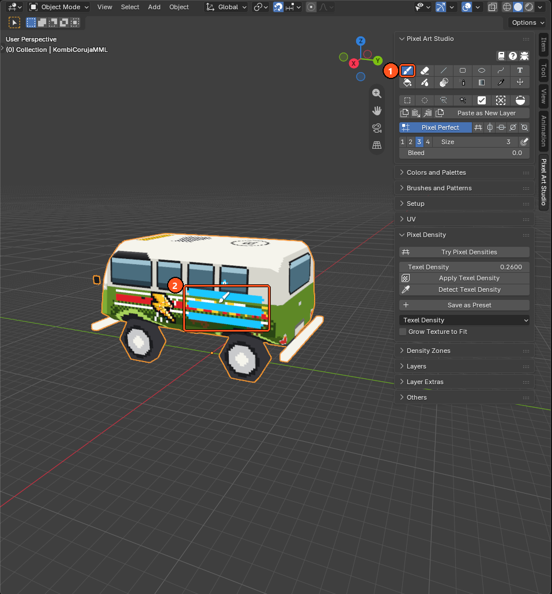
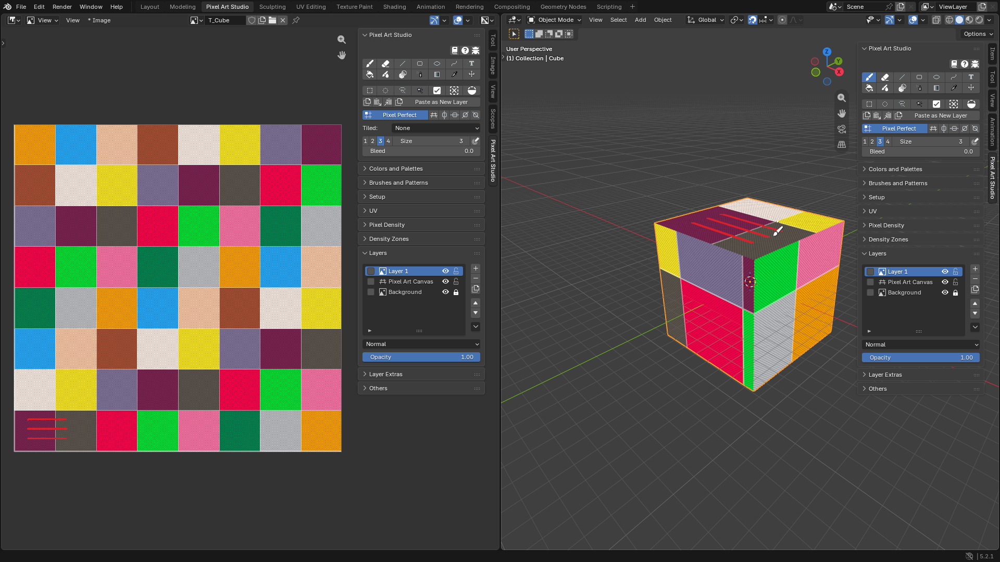
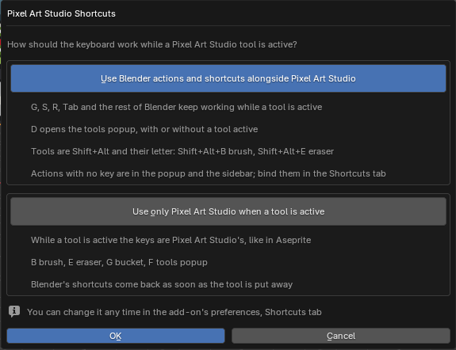
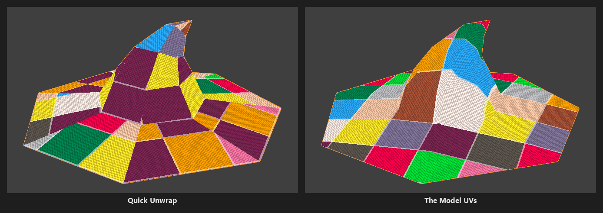
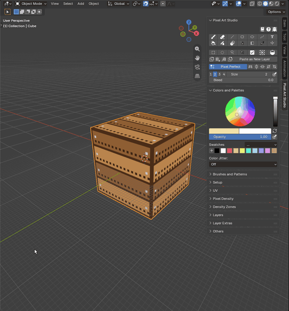

###################
Quickstart Tutorial
###################

This is the quick way to go from a model to painting pixel art on it with Pixel Art Studio, a Blender add-on. For a full walkthrough from scratch see :doc:`tutorial-first-model`, and for a model that already has a texture see :doc:`tutorial-existing-model`.

Not installed yet? See the :doc:`installation` page.

***************************************************
Super quick start
***************************************************

Everything starts in the sidebar: in the 3D Viewport press :kbd:`N`, click the ``Pixel Art Studio`` tab and select your model.

.. _just-paint:

Existing model, with UVs and textures: I just want to paint
===========================================================

1. Click a tool (the ``Brush``, for example).
2. Paint on the model.

That's it, nothing else is needed! **Your UVs and your texture are used as they are**: the first stroke adds Pixel Art Studio's layers to the texture (it becomes ``Layer 1``) and sets it to ``Closest``, so the pixels stay crisp. No pixel density, no ``Setup Viewport``, no density zones.

* :kbd:`Ctrl+Z` takes the stroke back, and a second :kbd:`Ctrl+Z` gives you the texture back exactly as it was.
* Want to try other pixel sizes, or new UVs? See :ref:`existing-textured-unwrap`.

.. warning::
    When you save the ``.blend`` after painting, the canvas is packed inside it **and the texture file on disk is written** with the painted result, in its own format. Keep a copy of the original file if it matters.

Model doesn't have a texture? (or a new model)
==============================================

1. Click the big ``Setup`` button at the top of the ``Pixel Art Studio`` panel (or click on the model with any tool).

   .. image:: _static/images/v2/quickstart-untextured-model.png

2. ``Quick Setup`` opens: select a pixel size and see it on the model, live (:kbd:`Ctrl+Wheel` goes through the sizes).
3. Click ``Next``.

   .. image:: _static/images/v2/quickstart-quick-setup-step1.png

4. Click ``Create Texture``.

   .. image:: _static/images/v2/quickstart-quick-setup-step2.png

Done! You are ready to paint with Pixel Art Studio! The ``Quick Unwrap`` box (ticked) gives the model new pixel perfect UVs at that pixel size: untick it to keep the UVs the model already has.

For more details and to understand the process, see the sections below. Didn't like the pixel size? See the sections below as well.

.. _shortcut-question:

The first tool you click: shortcuts
===================================

The first time you click a tool, Pixel Art Studio asks how the keyboard works while a tool is active:

* ``Alongside Blender`` (default): Blender's shortcuts (:kbd:`G`, :kbd:`S`, :kbd:`R`, :kbd:`Tab`...) keep working while you paint, and Pixel Art Studio uses the keys Blender leaves free. The main keys:

  * :kbd:`D`: the tools popup (every tool, the brush size and the colors, at the pointer), also with no tool active
  * :kbd:`Shift+Alt+B`: ``Brush``
  * :kbd:`Shift+Alt+E`: ``Eraser``
  * :kbd:`Alt+X`: swap the primary and secondary colors
  * Hold :kbd:`Alt` and click: ``Eyedropper``

* ``Pixel Art Studio Only``: while a tool is active the keys are Pixel Art Studio's, like in Aseprite. Blender's shortcuts come back when the tool is put away. The main keys:

  * :kbd:`F`: the tools popup
  * :kbd:`B`: ``Brush``
  * :kbd:`E`: ``Eraser``
  * :kbd:`X`: swap the primary and secondary colors
  * Hold :kbd:`Alt` and click: ``Eyedropper``

Change it any time in ``Edit > Preferences > Add-ons > Pixel Art Studio``, tab ``Shortcuts``. Every shortcut of both modes: :doc:`shortcuts`.

.. _new-project-setup:

***************************************************
1. Setup for new projects
***************************************************

Click the ``Setup`` button at the top, experiment with the texel densities (pixel size), click ``Next``, create the texture, paint! That's it.

.. video:: _static/videos/v2/quickstart-quick-setup.mp4
  :width: 100%

Everything in details
=====================

1. Open the sidebar with :kbd:`N` and click the ``Pixel Art Studio`` tab.

   - If you want the texture and the model side by side, click the ``Pixel Art Studio`` workspace tab at the top of the window first (see :ref:`installation-workspace`).
   - Already have a model or a blend file? Follow along with your mesh selected, then see :ref:`existing-project-setup`.

2. Select the mesh (Blender's default cube is fine) and click the big ``Setup`` button. ``Quick Setup`` opens, with the model framed in a maximized 3D Viewport and the pixel grid drawn on it.
3. Select a pixel size. The pixel density determines the size of the pixels on the mesh. **Lower density: larger pixels, higher density: smaller pixels** (and thus more details, with the cost of requiring more texture space). The sidebar and the text at the top left say what one pixel is, and the texture size it needs.

   .. list-table::
      :widths: 40 30 30
      :header-rows: 1

      * - Preset
        - One pixel on the model
        - 1 m is
      * - ``Low · 16``
        - 6.25 cm
        - 16 pixels
      * - ``Medium · 50``
        - 2 cm
        - 50 pixels
      * - ``High · 110``
        - ~9 mm
        - 110 pixels
      * - ``Very High · 220``
        - ~4.5 mm
        - 220 pixels

   - Your own pixel size: type it in ``Custom px/m``. Your own presets show up beside the others (see :ref:`density-presets`).
   - Orbit and zoom around the model as usual, the grid follows. :kbd:`Ctrl+Z` goes back to the size you tried before.

4. Click ``Next``. Step 2 opens on the ``Texture Size`` this model needs at that pixel size.

   - ``Quick Unwrap`` (ticked): new UVs for the model, every face flat at the pixel size (see :doc:`uv-tools`).
   - ``Base Color`` (or ``Transparent``): what the canvas starts filled with.
   - ``Pixel Grid Layer``: adds a grid layer with one cell per pixel, so you can see and count the pixels on the model.
   - ``Setup Viewport`` (ticked): puts Blender's grid on the pixel size, **one grid square is exactly one pixel**, so you model on the pixel grid (see :ref:`setup-viewport` for what it changes).

5. Click ``Create Texture``. You get the texture with three layers (``Layer 1`` to paint on, the ``Pixel Art Canvas`` grid layer and a locked ``Background``) and an unlit material with crisp pixels, all as one undo step.
6. You are now ready to start painting! Hide the ``Pixel Art Canvas`` layer (its eye in ``Layers``) when you are done checking the pixel sizes.

See :doc:`quick-setup` for every option.

.. tip::

    Want bigger or smaller pixels later, even after painting? Click ``Try Pixel Densities`` (``Pixel Density`` panel): try other sizes on the model, then ``Apply New Density``, and **your painting is kept**, scaled to the new pixel size. See :ref:`quick-setup-try`.

.. note::
    Prefer a dialog? ``Setup Pixel Art Canvas`` (``Setup`` panel) still makes the texture in one go from the preset in ``Setup``, and ``Setup Viewport`` and ``Quick Unwrap Model`` are still buttons of their own. See :doc:`setup-and-canvas`.

.. _existing-project-setup:

***************************************************
2. Setup for existing projects and models
***************************************************

.. _existing-not-uv-unwrapped-model:

2.1. The model is not UV unwrapped and not textured
===================================================

1. Open the ``.blend`` file, select your mesh and click the big ``Setup`` button.
2. Select a pixel size, then ``Next``. ``Quick Unwrap`` is ticked (and held ticked, for a model with no UVs).
3. ``Create Texture``: every face of the model is laid flat at the pixel size and packed on whole pixels, and the texture is made at the size that layout needs.

.. note::
    ``Quick Unwrap`` gives every face an island of its own, which is what you want for low poly and hard surface models. Curved parts can be kept as one island with ``Keep UVs Together (Join)``, and faces that should show the same pixels can be stacked with ``Stack UVs`` (see :doc:`uv-tools`, and the tutorial :doc:`tutorial-uvs-without-the-uv-editor`). Quick Setup's preview shows them the way they're going to be laid out.

    For organic models you may still prefer to UV unwrap by hand before texture painting them with Pixel Art Studio. See :ref:`existing-uv-unwrapped-model`.

.. _existing-uv-unwrapped-model:

2.2. The model is UV unwrapped and doesn't have a texture
=========================================================

1. Open the ``.blend`` file, select your mesh and click the big ``Setup`` button.
2. Click ``The Model UVs`` (``Preview UVs:``): the grid is drawn through your UVs, so you see the pixel size they get, and any stretched pixels (above, right).
3. Select a pixel size and click ``Next``. The ``Quick Unwrap`` box is unticked: **your UV layout is kept**, it's only scaled to the pixel size and its islands are snapped on whole pixels (nothing is unwrapped or packed again).
4. ``Create Texture``, and you are ready to paint.

Didn't like what your UVs look like at that pixel size? Click ``Quick Unwrap`` instead (above, left): the preview shows the UVs Pixel Art Studio would make, and ``Create Texture`` lays them out.

2.3. The model is UV unwrapped and has a texture
================================================

1. Select the model.
2. Click a tool and paint. Nothing else is needed (see :ref:`just-paint`).

.. _existing-textured-unwrap:

Optional: other pixel sizes or new UVs for an existing model
------------------------------------------------------------

Only if you want to change the model's pixel size, or give it new UVs with Pixel Art Studio. For painting, skip this whole part.

**Try Pixel Densities**

Click ``Try Pixel Densities`` (``Pixel Density`` panel), or the eye beside ``Quick Unwrap Model`` (``UV`` panel) to start on new UVs:

* It opens on the density the model already has (``Current Density``). Try others on the model, and ``Current Texture`` shows your own texture at the new pixel size.
* Tick ``Quick Unwrap`` for new UVs (at any density, the model's own included).
* ``Apply New Density``: ``Keep my painting`` (scaled to the new pixel size, or carried onto the new UVs) or ``Start with a blank texture``. One :kbd:`Ctrl+Z` takes it back.

See :ref:`quick-setup-try`.

**Detect Texel Density**

Click ``Detect Texel Density`` (``Pixel Density`` panel): the pixel size the model already uses becomes the scene's, so models and UVs you make next (``Pixel Art Unwrap``, ``Quick Unwrap Model``, ``Apply Texel Density``, ``Add 1m Cube``, ``Quick Setup``) **match the pixels you already have**. See :ref:`detect-texel-density`.

**Detect Density Zones**

Only for a model drawn at several pixel sizes (a detailed head and chunky legs, for example).

1. Expand ``Density Zones`` and click ``Detect Density Zones``. The model is measured island by island and grouped in zones, one per pixel size.

   - Just one zone found? Then it has one pixel size after all: click the trash button (``Clear Zones``) and use ``Detect Texel Density`` instead.

2. Click ``Average`` (under the zone list): the viewport is set up, with the grid on the model's average pixel size.

.. note::
    Once a model has zones, **Blender's grid follows the pixel size of the face under the brush** while you paint in the 3D Viewport (``Grid Follows the Face``). Want to keep your own grid? Skip the zones, or untick ``Grid Follows the Face`` (or the preference ``Automatically configure grid and grid units``). See :doc:`density-zones`.

**Setup Viewport**

Puts Blender on the pixel grid, for modelling and unwrapping. **It changes the scene**:

* the unit system goes to ``None``;
* the ``View Transform`` goes to ``Standard`` (renders change too);
* snapping goes on, to ``Increment``;
* EEVEE's viewport ``Samples`` go to 1;
* every 3D Viewport gets the pixel grid and ``Flat`` ``Texture`` shading;
* every Image Editor gets ``Round to Pixels: Corner``.

The loop icon beside it, ``Restore Viewport``, puts all of that back. See :ref:`setup-viewport`.

See :doc:`tutorial-existing-model` for the whole flow, painting included.

********************************************
Drawing and painting with Pixel Art Studio
********************************************

1. You can use Pixel Art Studio tools in the ``3D Viewport`` (in Object and Edit Mode) and in the ``Image Editor``. Reveal the sidebar with :kbd:`N` and click ``Pixel Art Studio``.

   - If you want a 2D and a 3D view side by side, use the Pixel Art Studio workspace.

2. Click any of the tools in the ``Pixel Art Studio`` panel, or point at the viewport and press :kbd:`;` (semicolon, the activator shortcut, it arms the last tool you used, the Brush the first time).
3. Paint with the left mouse button. :kbd:`Alt+[` :kbd:`Alt+]` change the brush size, :kbd:`Alt+X` swaps the two colors and :kbd:`Alt+click` samples a color (in ``Pixel Art Studio Only``: :kbd:`[` :kbd:`]` and :kbd:`X`).
4. Press :kbd:`Esc` (or :kbd:`;`, or click the armed tool again) to put the tool away. Closing the sidebar or picking another of its tabs puts it away too.

.. tip::
    Press :kbd:`;` **back and forth to toggle between Pixel Art Studio and Blender**, so the workflow can be pretty dynamic without clicking buttons in the sidebar.

.. tip::
    Press :kbd:`D` over the viewport for the tools popup: tools, sizes, colors and patterns right at the mouse position, even with no tool active.

.. tip::
    A model made of several objects sharing one texture (a rig, a vehicle in parts)? Every part takes the brush where you point at it, whichever object is selected. See :ref:`several-parts`.

See :doc:`interface` for how arming works in both editors, :doc:`painting-tools` for every tool and :doc:`shortcuts` for the full list of shortcuts (and how to change them).

Selections
================================

- There are pixel aware selection tools (``Marquee`` :kbd:`Shift+Alt+M`, ``Ellipse Select``, ``Lasso`` :kbd:`Shift+Alt+K` and ``Magic Wand`` :kbd:`Shift+Alt+W`), in the 2D and 3D viewports.
- A selection masks the work area, so the other tools affect only the selected pixels.
- Hold :kbd:`Shift` to add to the selection and :kbd:`Alt` to remove from it.
- Drag inside a selection to move its pixels (:kbd:`Ctrl` duplicates them), even across the faces of the model.
- Copy, cut and paste (:kbd:`Ctrl+Shift+C`, :kbd:`Ctrl+Shift+X`, :kbd:`Ctrl+Shift+V`) to move pixels between layers.

See :doc:`selection-and-transform`.

Layers
================================

- Everything you draw, paint and select happens on the active layer of the ``Layers`` panel.
- ``+`` adds a layer above the active one, and each layer has its own visibility, lock, opacity and blend mode.
- Groups, clipping, masks and adjustments: see :doc:`layers`.

Saving
================================

- Press :kbd:`Ctrl+S`: the texture and its layers are saved inside the ``.blend`` file.
- A texture made by ``Create Texture`` or ``Setup Pixel Art Canvas`` has no file on disk until you save it from the Image Editor (``Image > Save As``) or with ``Export PNG`` > ``Export Texture`` (``Layer Extras``).
- A texture that came with the model (a file on disk) is written back to that file, in its own format, when you save the ``.blend`` after painting.
- Making a game? See :doc:`game-engines`: Godot, Unity and Unreal Engine get the model on every save.
