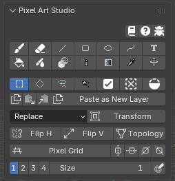
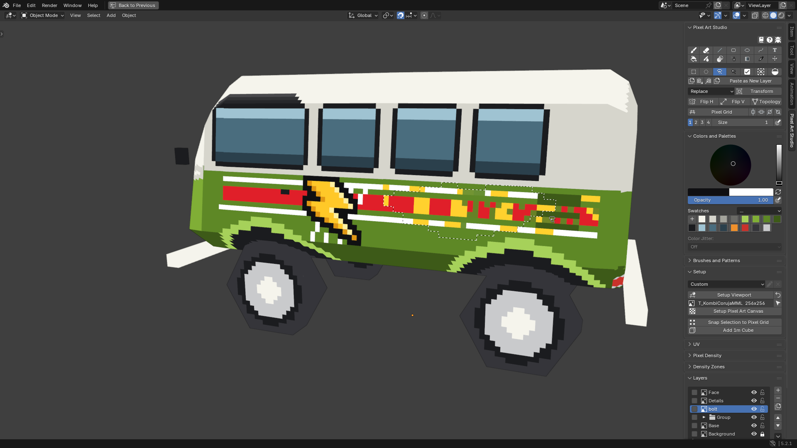
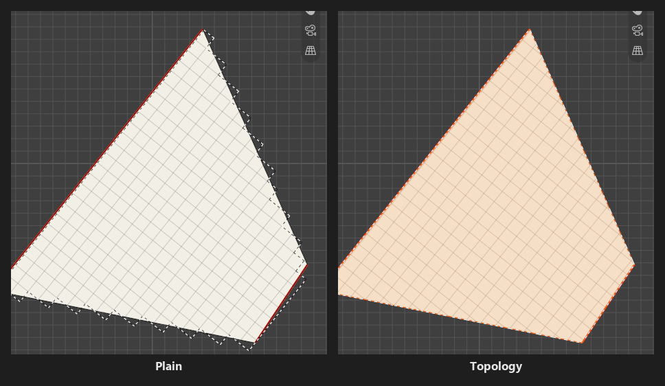
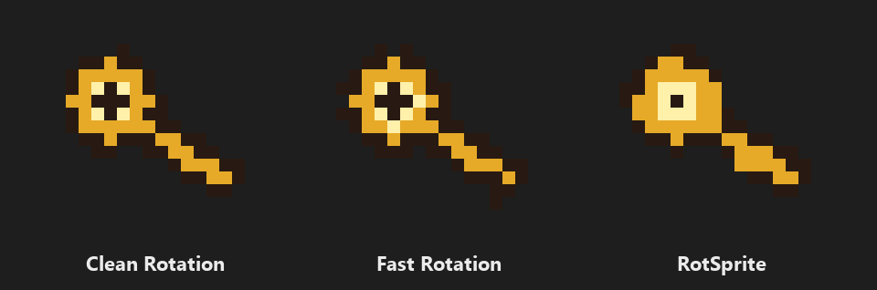

.. _selection-and-transform:

Selection and Transform
=========================================

The selection tools are in the second row of the toolbar, in the sidebar (:kbd:`N`) > ``Pixel Art Studio`` tab > ``Pixel Art Studio`` panel, in the 3D Viewport and in the Image Editor. The row under them has the clipboard.

* **Selections are per texel** in both editors, and both editors share the same selection: what you select on the model shows in the Image Editor, and the other way around.
* While a selection is active, **every tool affects only the selected pixels** (the Bucket doesn't start outside of it).
* A selection is shown by marching ants. Every selection change is one undo step.
* The settings under the toolbar (the mode, ``Transform``, ``Flip H``, ``Flip V``, ``Topology``, and the Magic Wand's own settings) only show while a selection tool is armed.

Selection tools
---------------

* **Marquee** (:kbd:`Shift+Alt+M`): drag a rectangle.
* **Ellipse Select**: drag an ellipse, corner to corner.
* **Lasso** (:kbd:`Shift+Alt+K`): hold and draw a freehand outline, releasing closes it.
* **Magic Wand** (:kbd:`Shift+Alt+W`): click to select the region of similar color. It samples what you see (every visible layer).

  * ``Tolerance``: how far a color may drift and still be selected (``0`` is the exact color).
  * ``Contiguous`` (on by default): selects only the connected area under the click. Off, it selects every matching pixel of the canvas.
  * The Magic Wand has its own ``Tolerance`` and ``Contiguous``, apart from the Bucket's.

Adding and removing
-------------------

* :kbd:`Shift` adds to the selection, :kbd:`Alt` removes from the selection (when starting a new shape, or with a Magic Wand click).
* The mode dropdown under the toolbar sets what a plain drag does: ``Replace`` (default), ``Add`` or ``Remove``. :kbd:`Shift` and :kbd:`Alt` win over it for that one drag.
* The tool icon at the pointer shows a ``+`` or a ``-`` when the next drag adds or removes.
* **Select All** (:kbd:`Ctrl+Shift+A`), **Deselect** (:kbd:`Shift+Alt+A`) and **Invert Selection** (:kbd:`Ctrl+Shift+I`) are the three icons after the selection tools (invert with nothing selected selects everything).
* **Select Pixels** (in the ``Layers`` panel > ``Layer Operations`` menu): selects every pixel the active layer has painted, the way :kbd:`Ctrl+click` on a layer does in Photoshop (on a group, what the group shows).
* **Putting the last tool away deselects the pixels**, and one :kbd:`Ctrl+Z` brings the selection back. To keep it, turn off ``Clear selection when Pixel Art Studio is de-activated`` in the preferences (see :doc:`preferences`).

.. note::
    With a selection tool armed, :kbd:`Alt+click` removes from the selection, it doesn't pick a color. Arm a paint tool, or use :kbd:`Alt+Shift+X`, to pick colors.

Selecting on the model
----------------------

* Only the texels **you can see** are selected: the back of the model, and anything hidden behind another part, stay out (back faces you are looking at are selectable).
* Faces hidden in Edit Mode are never selected.
* In Edit Mode with some faces selected, ``Select All``, ``Invert Selection`` and the Magic Wand only reach those faces.
* The Magic Wand's ``Contiguous`` follows the texture: the region continues where the pixels touch in the texture, and stops where UV islands are apart.
* It works in Object Mode and Edit Mode, in perspective and orthographic views.

.. note::
    A Marquee on the model gives a perfect rectangle of texels only when the UV island is straight to the screen. On a slanted or sheared island, the edges step.

.. _select-by-topology:

Select by Topology
------------------

Along a diagonal UV edge, a plain selection is a staircase of whole texels (a texel belongs to the face that covers its center). **Select by Topology also takes the half covered texels** along the faces' own edges, so the selection follows the real shape of the faces and you can paint or fill those slivers.

* ``Topology`` toggle (3D Viewport only, right of ``Flip V``).
* The Marquee, the Ellipse, the Lasso, the Magic Wand, ``Select All`` and ``Invert Selection`` all follow it.
* A topology selection is drawn in **orange**, on the faces' real outline, in the 3D Viewport only.
* It's tied to the geometry, so **it can't be moved or transformed**. Turn ``Topology`` off and select again to move pixels.

.. _moving-selections:

Moving selections
-----------------

With any selection tool armed, **press inside the selection and drag** to move the selected pixels of the active layer (the pointer turns into the move cursor over a selection).

.. video:: _static/videos/v2/selection-drag-across-faces.mp4
  :width: 100%

* :kbd:`Ctrl` as you press **duplicates**: a copy travels and the original stays.
* :kbd:`Shift` **locks the move to one axis** (pressed before or during the drag): the axis you move further along is taken, and kept while :kbd:`Shift` is held. Release it to move freely, press it again to pick a new axis. :kbd:`Ctrl+Shift` duplicates along one axis.
* :kbd:`Esc` (or :kbd:`Ctrl+Z` with the mouse button still down) cancels the drag, the pixels and the ants go back.
* Each drag is one undo step, and the ants go back with the pixels.
* **Floating selection**, like Aseprite: after a drag the pixels stay lifted while the selection is unchanged. Drag again and the same pixels move, and whatever they had covered shows again underneath. Painting, changing the selection or a :kbd:`Ctrl` duplicate drops them where they are.
* With the Magic Wand, a click inside its selection also moves it (see :ref:`selection-preferences` to make it select again instead).
* With symmetry on, the pixels in the mirror of the selection move too, mirrored.

On the model:

* **Drag a selection across the faces of the model** like a sticker: it folds over each edge like paper and keeps facing the way you push it, even when the faces are separate UV islands far apart in the texture. The ants travel with it.
* It works on curved and irregular UVs (a cylinder cap cut into triangles, for example), across faces with different pixel sizes (the drawing takes the new pixel size), and on faces that share UVs.
* :kbd:`Shift` holds the move to **the pixel rows and columns of the face you grabbed**, not to the screen's axes: on a face seen at an angle, or turned in the texture, the selection still slides along its own rows.
* **The whole drawing or nothing**: if part of it would land off the model, or on a face hidden in Edit Mode, it holds at the last place it fitted and jumps on once it fits again.

.. note::
    Why did my drawing come back turned? A drawing pushed around a corner, through three faces and back, comes back turned a quarter turn (paper can't lie flat around a corner). Dragged straight back over the same edge, it returns exactly.

The **Move** tool (:kbd:`Shift+Alt+V`) drags the whole layer instead, see :doc:`painting-tools`.

Delete
------

:kbd:`Backspace` erases the selected pixels of the active layer. **With nothing selected, it clears the whole active layer** (like Aseprite). One undo step.

.. _copy-cut-paste:

Copy, cut and paste
-------------------

The three icons and the ``Paste as New Layer`` button in the row under the selection tools. Pixel Art Studio has its own pixel clipboard: it keeps the selection's shape (a lasso pastes back lasso shaped), and it survives switching layers and canvases.

* **Copy** (:kbd:`Ctrl+Shift+C`): copies the selected pixels of the **active layer** (not everything you see).
* **Cut** (:kbd:`Ctrl+Shift+X`): copies and clears them from the active layer.
* **Paste** (:kbd:`Ctrl+Shift+V`): pastes onto the active layer, **at the same place the pixels were taken from**. What was pasted becomes the selection, so you can drag it away (or transform it) right after.
* **Paste as New Layer**: the same, on a new layer named ``Pasted`` above the active one.

.. tip::
    To move art to another layer: select it, :kbd:`Ctrl+Shift+X`, pick the other layer in the ``Layers`` panel and :kbd:`Ctrl+Shift+V`. It lands at the same place, still selected. To paste an image copied in another program, use ``Paste Image as Layer`` in :doc:`layers`.

Flip
----

* ``Flip H`` and ``Flip V``: turn the selected pixels over, left to right or top to bottom, inside the selection's own box. Flipping twice gives the picture back.
* **With nothing selected, the whole active layer flips.**
* With a transform box up, it flips the box's contents.
* Flip works in texture space: on the model its direction follows how the UV island is laid out.

.. _transform-box:

Transform
------------------

**Scale, turn, skew and move the selected pixels**, with handles like Aseprite's, in the Image Editor **and on the model**.

.. video:: _static/videos/v2/selection-transform.mp4
  :width: 100%

* Press :kbd:`Shift+Alt+T` (:kbd:`Ctrl+T` in ``Pixel Art Studio Only``), or the ``Transform`` button beside the mode dropdown (it stays pressed while the box is up).
* With nothing selected, the whole layer is taken (on the model, the faces you can see, or the faces selected in Edit Mode).
* The box hugs the painted pixels inside the selection, so a loose marquee around a sprite doesn't add empty margins.
* The pixels are taken once, so dragging out and back never smears them, and turning back to zero gives the exact original.

The handles:

* **Corner squares**: scale from that corner, the opposite corner stays still. :kbd:`Shift` keeps the aspect ratio.
* **Side squares**: scale one side.
* **Diamonds** outside each corner: turn. :kbd:`Shift` snaps to 45 degree steps.
* **Bars** outside the middle of each side: drag along the edge to skew (slant) the box. :kbd:`Shift` snaps the slant.
* **Anchor** (the ring with a cross, in the middle at first): drag it anywhere, the box turns around it.
* Press inside the box to move it.

Finishing:

* :kbd:`Enter`, or a click outside the box, **applies** it (always on whole texels).
* :kbd:`Esc` (or the ``Transform`` button again) cancels it, everything goes back, selection included.
* :kbd:`Ctrl+Z` while the box is up steps back one grab at a time.
* Picking another tool applies it first.
* Applying is one undo step. **One** :kbd:`Ctrl+Z` **after applying puts the box back up** where it was, so you can keep adjusting.

.. _rotation-algorithms:

Rotation algorithms
~~~~~~~~~~~~~~~~~~~

The ``Rotation`` dropdown shows under ``Transform`` while the box is up (with a selection tool armed). None of the three invents colors, so **your palette stays clean**, and quarter turns (90, 180 and 270 degrees) are always exact.

* ``Clean Rotation`` (default): rebuilds the diagonal edges to reduce rotation jaggies, keeping the source colors and favouring dark outlines (adapted from torcado's cleanEdge).
* ``Fast Rotation``: nearest neighbour, every texel keeps its color and the edges keep their stair steps.
* ``RotSprite``: Aseprite's RotSprite, slower, and it keeps a diagonal reading as a diagonal. A skewed box, or a very big one, falls back to ``Fast Rotation``.

.. tip::
    Arm a selection tool before you transform, so you can see the ``Rotation`` dropdown. With the Brush armed the transform still works, but switching to a selection tool applies the box.

On the model and on groups:

* On the model the box lies on the face under it, with the outline and the handles drawn on the model. Dragged past the face's edge, **it folds onto the neighbouring faces** exactly like a dragged selection. Flat neighbouring faces (a cylinder cap cut into triangles, for example) are boxed together.
* A selection that wraps around the model (a whole layer over a cube, for example) is transformed only on the face under the pointer. Transform it in the Image Editor to take all of it.
* With a **group** active, every layer inside it transforms together (locked layers stay put), and layer masks travel with their layer.
* With symmetry on, the transform lands mirrored on the mirror side of the selection too.
* A layer bigger than the canvas is cropped to the canvas first (:kbd:`Ctrl+Z` brings the rest back).

.. _selection-preferences:

Preferences
-----------

In ``Edit > Preferences > Add-ons > Pixel Art Studio`` > ``General`` > ``Selection``:

* ``Selection Marquee Color``: a color washed over the selected texels, and how strongly (its alpha). At ``0`` (default) there is no wash and the marching ants alone show the selection.
* ``Topology Selection Color``: the same for a topology selection (orange by default).
* ``Recompute wand selection on clicks inside the selected region`` (off by default): a click inside a Magic Wand selection samples the region again instead of moving it, which is how you re-apply a changed ``Tolerance``.
