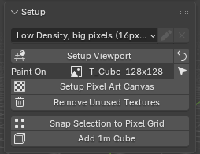
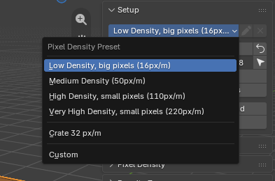
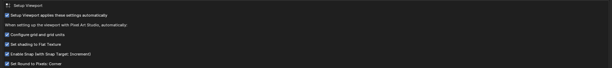
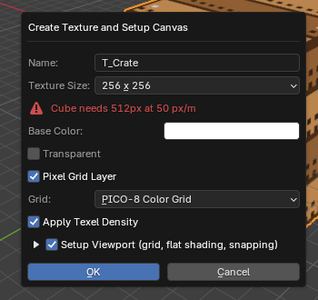
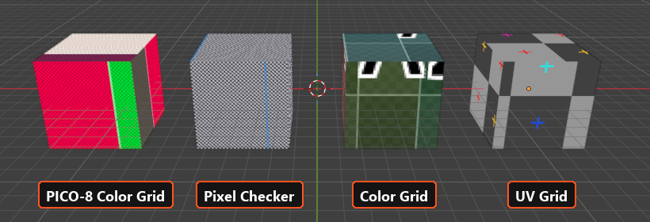
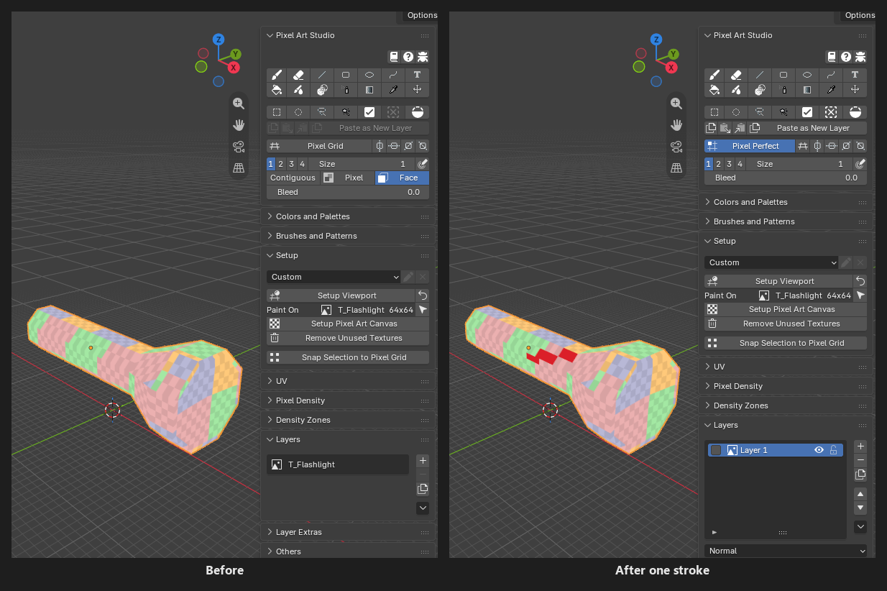
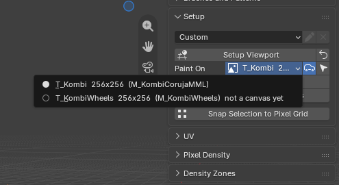

Setup and Canvas
=========================================

The ``Setup`` panel has the pixel size, Blender's viewport on the pixel grid, and the texture the model paints on (the **canvas**).

It's in the sidebar (:kbd:`N`), tab ``Pixel Art Studio``, in the 3D Viewport and in the Image Editor (the same panel in both). It starts collapsed: the quick ways in are elsewhere now.

* **A model that already has a texture**: nothing to set up, click a tool and paint (see :ref:`automatic-canvas`).
* **A model with no texture**: the big ``Setup`` button at the top of the ``Pixel Art Studio`` panel opens ``Quick Setup`` (see :doc:`quick-setup`).

Top to bottom:

* **Pixel density preset**: the dropdown, with a pencil (rename) and an X (remove) for the presets of your own.
* ``Setup Viewport``, plus a loop arrow (``Restore Viewport``) once the viewport is set up.
* ``Paint On``: the texture the selected model paints on, a canvas already or not yet, with its size (a dropdown when the model has several color textures), and an arrow button that shows it in the other editor.
* ``Setup Pixel Art Canvas``.
* ``Remove Unused Textures`` (see :ref:`remove-unused-textures`).
* ``Snap Selection to Pixel Grid`` (see :doc:`pixel-density`).
* ``Add 1m Cube`` (only once ``Setup Viewport`` is ready).
* **Warnings**: coral lines with what went wrong last (click any line or its X to dismiss).

.. tip::
    None of these buttons has a shortcut and Blender's search (:kbd:`F3`) doesn't find them, but you can right click one and ``Add to Quick Favorites`` (:kbd:`Q`).

.. _density-presets:

Pixel density presets
---------------------

A preset is a pixel size picked by name. It sets three things at once: the **texel density** (how many texture pixels cover one meter of the model, see :doc:`pixel-density`), the texture size ``Setup Pixel Art Canvas`` opens with, and Blender's grid, so **one grid square is exactly one texel**.

.. list-table::
   :widths: 46 14 18 22
   :header-rows: 1

   * - Preset
     - Density
     - Texture size
     - One pixel on the model
   * - ``Low Density, big pixels (16px/m)``
     - 16 px/m
     - 64 x 64
     - 6.25 cm
   * - ``Medium Density (50px/m)`` (default)
     - 50 px/m
     - 256 x 256
     - 2 cm
   * - ``High Density, small pixels (110px/m)``
     - 110 px/m
     - 512 x 512
     - ~9 mm
   * - ``Very High Density, small pixels (220px/m)``
     - 220 px/m
     - 512 x 512
     - ~4.5 mm
   * - Your own presets
     - saved
     - saved
     -
   * - ``Custom``
     - your ``Texel Density``
     - unchanged
     -

* ``Low Density`` is MortMort's pixel art setup: chunky pixels, small textures.
* ``Custom`` is picked by itself when you type your own ``Texel Density`` (``Pixel Density`` panel), and when the add-on measures a model (``Detect Texel Density``, ``Detect Density Zones``, or the first ``Setup Viewport`` on a textured model). Painting a textured model never changes the preset.
* **Picking a preset, the model waits**: the grid moves to the new density (once you ran ``Setup Viewport``), but a model that already has a pixel size keeps it: ``Apply Texel Density`` turns red with ``(needed)``, and ``Try Pixel Densities`` turns red above it (``Pixel Density`` panel), until you apply it. Picking the old preset back clears the red.

Presets of your own
~~~~~~~~~~~~~~~~~~~

Found a pixel size you like? Save it once and it's in the dropdown of **every .blend file**.

* ``Save as Preset`` (``Pixel Density`` panel): saves the density, the texture size and the grid the scene is on now, under a name (``50 px/m`` to start with).
* ``Update Preset`` (``Pixel Density`` panel, only while a preset of your own is selected): pick your preset, type a new ``Texel Density``, click ``Update Preset``.
* **Rename and remove**: the pencil and the X beside the dropdown (greyed out for the four presets that ship with the add-on).
* ``Edit > Preferences > Add-ons > Pixel Art Studio``, tab ``Presets``, box ``Pixel Density Presets``: every preset you saved, with an X to remove it, and ``Restore Default Presets`` to remove them all.

.. note::
    Your presets live in the add-on preferences, and every change is written to Blender's preferences right away. :kbd:`Ctrl+Z` doesn't undo a preset you saved, renamed or removed.

.. _setup-viewport:

Setup Viewport
--------------

Optional: one click makes Blender a pixel art viewport, on **every workspace** of the file, for modelling and unwrapping on the pixel grid. Painting doesn't need it, and it never turns red. **It changes the scene**, so know what it does before you click it on an old model of yours:

* **The grid**: the unit system goes to ``None`` and every 3D Viewport's grid is set to one texel per square at the preset's density.
* **Colors**: the ``View Transform`` goes to ``Standard``, so the colors you see are the colors you painted (no Filmic or AgX wash).
* **Shading**: every 3D Viewport goes to ``Solid``, ``Flat`` lighting, ``Texture`` color.
* **Snapping**: on, set to ``Increment`` with ``Absolute Grid Snap``, so a vertex you move lands on a pixel.
* **UVs**: every Image Editor gets ``Round to Pixels: Corner``, so UVs you drag by hand land on texel corners.
* **EEVEE**: the viewport ``Samples`` go to 1, so the texels stay sharp in the viewport.

It does a bit more on the model you have selected:

* **A textured model the add-on never measured**: it first measures the pixel size the model already uses and puts the grid on that (the preset becomes ``Custom``), so the grid matches the art that's already there.
* **A model that isn't at the scene's pixel size** (you picked another preset): it scales the selected models' UVs to the new density, the same way ``Apply Texel Density`` does. A texture with painting on it is asked about first, ``Keep my painting`` or ``Start with a blank texture`` (see :ref:`density-question`).

The loop arrow beside it, ``Restore Viewport``, puts every setting back the way it was before your first click (the UVs and the pixel size stay as they are).

.. _setup-viewport-preferences:

Setup Viewport preferences
~~~~~~~~~~~~~~~~~~~~~~~~~~

``Edit > Preferences > Add-ons > Pixel Art Studio``, tab ``General``, box ``Setup Viewport``:

* ``Setup Viewport applies these settings automatically`` (on): off, the button asks first with a dialog, so you can leave parts out for one click (the dialog remembers your answer until Blender closes).
* ``Configure grid and grid units``, ``Set shading to Flat Texture``, ``Enable Snap (with Snap Target: Increment)`` and ``Set Round to Pixels: Corner`` (all on): what the button changes.

With ``Configure grid and grid units`` off, the button leaves the grid and the units alone, and stops turning red because of them.

.. _setup-pixel-art-canvas:

Setup Pixel Art Canvas
----------------------

The canvas wizard: select a mesh, click ``Setup Pixel Art Canvas``, check the options, ``OK``. It builds the texture, its layers, an unlit material and the right pixel density for the model, as **one undo step** (the dialog's title is ``Create Texture and Setup Canvas``).

.. tip::
    ``Quick Setup`` (the big ``Setup`` button) makes the same texture, after showing you the pixel size on the model, and can give the model new UVs in the same click. See :doc:`quick-setup`.

The options:

* ``Name``: ``T_`` plus the object's name (``T_Crate``).
* ``Texture Size``: from ``16 x 16`` to ``1024 x 1024``, three tall ones (``16 x 32``, ``32 x 64``, ``64 x 128``) and ``Custom`` (type ``Width`` and ``Height``, up to 8192).

  * It opens on the preset's size (or the last one you picked), or on the **size your model needs** at the current density when that's bigger. Measured on the whole mesh, it suggests up to 2048 x 2048 (bigger than that, you type it yourself).
  * A red line says when the size you picked is too small (``Crate needs 512px at 50 px/m``). You can still click ``OK``.

* ``Base Color``: the color of the locked ``Background`` layer (white by default).
* ``Transparent``: the canvas starts fully transparent, with no ``Background`` layer.
* ``Pixel Grid Layer`` (on): adds a layer with a grid on it, **one cell per texel**, so you can count pixels on the model.

  * ``Grid``: ``PICO-8 Color Grid`` (default, eight color blocks with every other texel shaded), ``Pixel Checker`` (one checker square per texel), ``Color Grid`` and ``UV Grid`` (Blender's own).

* ``Apply Texel Density`` (on): scales the model's UVs so every texel has the pixel size you picked. Your UV layout is kept as it is (it doesn't unwrap).

  * ``Keep Density Zones`` (on): only shown on a model with two density zones or more; each face goes to the density of its zone (see :doc:`density-zones`).

* ``Setup Viewport (grid, flat shading, snapping)`` (on): runs ``Setup Viewport`` right after. The arrow left of it (``Viewport Options``) shows its four parts, ``Configure grid and grid units``, ``Set shading to Flat Texture``, ``Enable Snap`` and ``Set Round to Pixels: Corner``, to leave some out for this click. They open on the answer you gave last (here or in ``Setup Viewport``'s own dialog), else on the preferences (``Change default values in the Add-on Preferences``).

What you get:

* **The canvas**, at the size you picked, saved inside the .blend (see :ref:`canvas-saving`).
* **Three layers**, top down: ``Layer 1`` (empty, the one you paint on), ``Pixel Art Canvas`` (the grid) and ``Background`` (locked). See :doc:`layers`.
* **An unlit material**, ``M_Crate``: the model shows the **exact colors you painted whatever the lights**, with hard edged texels and the transparent pixels cut out.
* **The canvas in every open Image Editor** of the screen.

.. warning::
    The wizard doesn't unwrap. It scales the UVs the model already has. A model with no UVs, overlapping UVs or a layout that runs off the texture needs ``Quick Unwrap Model`` afterwards (see :doc:`uv-tools`).

.. note::
    What happens with a model that already has materials?

    * **No material**: the wizard's material is added.
    * **One material**: the wizard's material takes its place.
    * **Several materials**: the wizard adds its material in a new slot and leaves yours alone. Assign it to the faces you want to paint (``Edit Mode > Material > Assign``), the report says so too.

* **Select only the model you're setting up**: the wizard scales the UVs of every selected mesh, and only the active one gets the material.
* **Running it again makes a second texture** and scales the UVs again. To keep painting the texture you already have, select it in ``Paint On``. ``Remove Unused Textures`` cleans up the ones nothing uses any more.
* **Hide the grid layer before exporting**: while ``Pixel Art Canvas`` is visible it's part of the texture, in the saved PNG and in every export.

.. _make-canvas:

.. _automatic-canvas:

Painting a texture the model already has
----------------------------------------

There's no button for it: **the first thing you do on a texture turns it into a canvas**, with layers, and then does what you asked. A model with UVs and a texture is painted right away.

* **Before**: ``Layers`` shows the texture as the one layer it's going to be (``T_Flashlight`` above), and the buttons are ready to use.
* **After**: the texture is ``Layer 1`` of a layer stack, exactly as it was. Your material, UVs and texture size stay as they are.
* **Two undo steps**: the canvas, then what you did. :kbd:`Ctrl+Z` takes the stroke back, a second :kbd:`Ctrl+Z` gives the texture back exactly as it was, and its file on disk too.

What makes the canvas:

* **A tool's click on the texture**: on a face that uses it in the 3D Viewport, inside the image in the Image Editor. Any tool: the brush, the shapes, the bucket, the gradient, the selection tools, the move, the text...
* **A stroke started beside the model** and dragged onto it, and a selection drawn around it (once its shape reaches the texture).
* **The buttons and keys that change the texture**: ``Add Layer``, ``Duplicate Layer``, grouping, ``Select All``, ``Invert``, ``Transform``, the flips, ``Delete Pixels``, a paste (when something was copied), ``Import PNG``, ``Paste Image as Layer``, ``Add Pixel Grid Layer``, the adjustments, ``Texture Dilation``, and selecting a plain texture in ``Paint On``.

What never makes it (your texture stays untouched, and its file byte for byte):

* Arming a tool, hovering, the brush preview, the eyedropper (any way you sample a color).
* ``Pixel Art Unwrap``, ``Quick Unwrap Model``, ``Apply Texel Density``, ``Detect Texel Density``, ``Setup Viewport``.
* Saving the .blend, and every export (glTF, FBX, the game engines). ``Export PNG`` writes the texture's own pixels.
* A selection that only takes pixels away (``Deselect``, a wand click with :kbd:`Alt`).

Which texture:

* **The color texture**: the image on the material's color path (``Base Color`` or ``Emission``, through node groups and ``Mix`` nodes), a canvas first when there is one there.
* **Normal maps, roughness maps and other data textures are never made canvases**, and only the color texture's ``Image Texture`` nodes are set to ``Closest``, in every material that samples it.
* **Your pixel density stays as it is**: the preset in ``Setup`` doesn't change.

A texture that can't be painted says why, in ``Layers`` and in the status bar when you click (nothing is changed):

* ``<image> is a render result, not a texture. Open or create an image to paint on``.
* ``<image> is a sequence image; a canvas has to be one still picture we can write back``: image sequences, movies and UDIMs can't be canvases.
* ``Blender has no pixels for <image>. Check the image's file path, then try again``: fix the path with ``File > External Data > Find Missing Files``.
* ``<image> comes from another file. Open that file to paint on it``: a linked image (or a material linked from another file).

.. note::
    In Edit Mode (and Blender's paint modes), :kbd:`Ctrl+Z` takes your strokes back one by one and the canvas stays. A :kbd:`Ctrl+Z` back in Object Mode gives the plain texture back.

.. note::
    A model with no texture at all? A click on it with any tool opens ``Quick Setup`` (see :doc:`quick-setup`).

Add 1m Cube
-----------

Adds ``PixelCube`` at the 3D cursor: one meter, scale applied, already unwrapped with ``Pixel Art Unwrap``, so **every face is exactly as many texels as the density** (50 by 50 at ``Medium Density``). It's the reference everything in the setup is measured against.

* Only shown once ``Setup Viewport`` is ready (greyed out outside Object Mode).
* It has no texture yet: click the big ``Setup`` button (or ``Setup Pixel Art Canvas``) next.

.. _several-textures:

Models with several textures
----------------------------

When the model's materials carry more than one color texture, the ``Paint On`` row in ``Setup`` becomes a dropdown: every color texture (two images mixed into one ``Base Color`` count as two), its size and the materials using it, with ``not a canvas yet`` on the plain ones.

* **Select one** and the tools paint on that texture (a plain one becomes a canvas on the spot). Only the faces whose material carries it take a stroke.
* ``Auto-select Textures`` (the toggle beside the dropdown, on): painting or selecting on a face in the 3D Viewport switches to the texture that face uses, and a plain one becomes a canvas with that click. Off, only the dropdown changes it.
* **The arrow button** beside it: ``Show in Image Editor`` from the 3D Viewport, ``Show in 3D Viewport`` from the Image Editor.

.. note::
    The eyedropper never switches the texture, and never makes a canvas.

.. _canvas-saving:

How the canvas is saved
-----------------------

You don't have to do anything: **every time you save the .blend**, the layers and the canvas are saved inside it. A .blend with a canvas is self contained, you can move it to another computer and the art comes with it.

* **A canvas from the wizard has no file on disk.** To get a PNG: ``Image > Save As`` in the Image Editor (from then on the file is kept up to date on every save), ``Export PNG`` per layer (see :doc:`layers`), or a game engine integration (see :doc:`game-engines`).
* **A canvas made from a texture file keeps its file**: after you paint, every .blend save also writes the texture file, in **its own format** (PNG, 16 bit PNG, JPEG, Targa, OpenEXR, BMP, TIFF, WebP and the others Blender can write).
* **Undo past the first stroke** and the file is given back as it was before Pixel Art Studio wrote it (unless something else wrote it since, then it's left alone).
* **A file Blender can't write back** (a Photoshop PSD, for example) is left untouched on disk, and ``Setup`` says so. The canvas is still saved inside the .blend.
* **A canvas linked from another .blend** is never written by this file (see :doc:`layers`).

.. _external-changes:

When the texture changes outside the layers
-------------------------------------------

Do you edit the texture in another program too (Aseprite, Photoshop)? Turn on the watch and Blender asks what to do with the changes, instead of painting your layers over them.

``Others`` panel:

* ``Watch for external file changes`` (off): checks the canvas file every few seconds (``Every`` ``2`` ``seconds``). It also catches changes made inside Blender behind the layers (``Image > Reload``, Blender's own Texture Paint).
* **Even with the watch off**, an ``Image > Reload`` of a canvas still asks, and switches the watch on.

.. image:: _static/images/v2/texture-file-changed-dialog.png

The first question, ``Texture File Changed``:

* ``Keep layers and choose where to put the changes...`` (default): asks where they go, next.
* ``Discard layers and create a new layer with the changes``: the whole stack becomes one ``Layer 1`` with the file in it.
* ``Keep layers and ignore the changes``: your layers are painted back over the file.

Then, ``Reloaded Texture``:

* ``As a new layer on top`` (default): the file comes in as a ``Reloaded`` layer above everything, nothing you painted is touched.
* ``Replace the bottom layer``.
* ``Replace the active layer``.

Both have ``Remember choice for this file``, which answers the same way every time this texture changes, without asking. The ``Others`` panel shows the remembered answer, and ``Reset`` makes it ask again.

.. image:: _static/images/v2/watch-external-changes.png

* **Each answer is one undo step.** Closing the dialog keeps the layers as they are.
* **No tool paints while a question is open.**
* **Resized the texture in the other program?** Only ``Discard layers and create a new layer with the changes`` works then, the layers can't be kept at the old size.

Questions when a file opens
~~~~~~~~~~~~~~~~~~~~~~~~~~~

Files from older versions of the add-on can open with one of these (the current version packs every canvas into the .blend, so they show at most once):

* ``Texture File Missing``: the canvas' file is gone, but its layers are still in the .blend. ``OK`` rebuilds the canvas from them and packs it. Closed it? ``Layers`` says the file is gone, with a ``Rebuild From Its Layers`` button.
* ``CONFLICT: Texture Image File (Canvas) and Layers Contents``: the texture file and the layers saved with it are different (another .blend or program wrote the PNG). Keep the texture as a layer, make it the only layer, or keep the layers and paint them over it.
