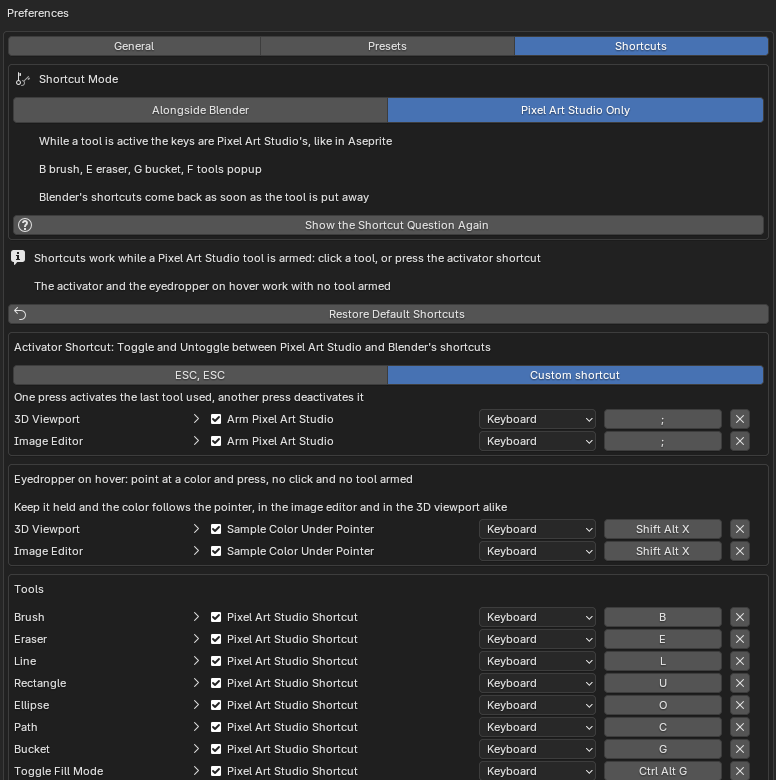
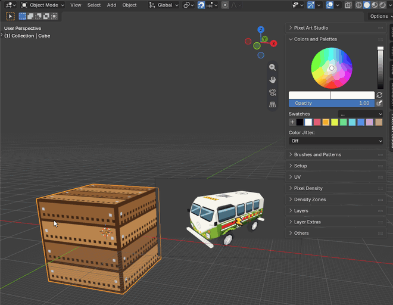
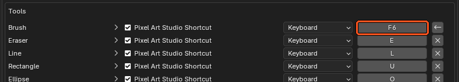

Shortcuts
=========================================

Pixel Art Studio's shortcuts **only work while a Pixel Art Studio tool is armed**. There are two sets of them, one per ``Shortcut Mode`` (below), and every one of them can be rebound, see :ref:`bindable-shortcuts`.

* **Arm a tool**: click a tool button in the sidebar (tab ``Pixel Art Studio``), or press the activator, :kbd:`;` (below).
* **Over the editor**: keys answer only while the pointer is over the 3D Viewport or the Image Editor (the UV Editor too) where the tool is armed. Over the sidebar or a header, every key is Blender's.
* **Keep the sidebar open** on the ``Pixel Art Studio`` tab: closing it, or picking another of its tabs, puts the tool away (on Blender 3.6 and 4.0 only closing it does). Arming a tool brings the sidebar back on our tab.
* Navigation is always Blender's: middle mouse, the wheel, the trackpad, the numpad.

.. note::
    On macOS every :kbd:`Ctrl` shortcut also works with :kbd:`Cmd`.

.. _shortcut-mode:

Shortcut Mode
-------------

How Pixel Art Studio's keys live with Blender's. Pick it in ``Edit > Preferences > Add-ons > Pixel Art Studio > Shortcuts``, box ``Shortcut Mode``.

* ``Alongside Blender`` (default): **Blender's shortcuts keep working while a tool is armed** (:kbd:`G`, :kbd:`S`, :kbd:`R`, :kbd:`Tab`, :kbd:`A` and the rest), and Pixel Art Studio uses the keys Blender leaves free:

  * :kbd:`D` opens the tools popup, **with or without a tool armed**.
  * Tools are :kbd:`Shift+Alt` and their letter: :kbd:`Shift+Alt+B` the ``Brush``, :kbd:`Shift+Alt+E` the ``Eraser``, and so on (the ``Bucket`` is :kbd:`Shift+Alt+F`, Blender uses :kbd:`Shift+Alt+G`).
  * :kbd:`Ctrl` shortcuts get :kbd:`Shift` added: :kbd:`Ctrl+Shift+C` copies, :kbd:`Ctrl+Shift+A` selects all.
  * Actions with no free key have no shortcut. They're in the tools popup and in the sidebar, and you can give them a key in the ``Shortcuts`` tab.

* ``Pixel Art Studio Only``: the classic set, **like in Aseprite**. While a tool is armed the keys are Pixel Art Studio's: :kbd:`B` is the ``Brush``, :kbd:`E` the ``Eraser`` (Blender's Extrude), :kbd:`G` the ``Bucket`` (Blender's Grab), :kbd:`S` the ``Shading`` tool (Scale). Put the tool away (:kbd:`Esc` or :kbd:`;`) and they're Blender's again.

Each mode keeps its own set of shortcuts, so a key you change in one mode doesn't touch the other.

.. image:: _static/images/v2/shortcuts-mode-question.png

**The first time you arm a tool, Pixel Art Studio asks** which mode you want. Select one and click ``OK``. Closing the question without an answer keeps ``Alongside Blender``, and the question comes back the next time you start Blender. To see it again later, click ``Show the Shortcut Question Again`` in the ``Shortcuts`` tab.

.. note::
    Already changed one of the classic shortcuts in an older version? The question offers ``Pixel Art Studio Only`` first, so your keys stay as you left them.

.. _shortcuts-activator:

Activator Shortcut
------------------

.. image:: _static/images/v2/interface-activator.gif

Press :kbd:`;` (semicolon) over the 3D Viewport or the Image Editor and **the last tool you used is armed** (the ``Brush`` the first time), in the editor under the pointer. Press it again and the tool is put away. It works the same in both shortcut modes.

That means you can go back and forth between Pixel Art Studio and Blender from the keyboard:

1. Press :kbd:`;` and paint, with every Pixel Art Studio shortcut.
2. Press :kbd:`;` again and click to select objects, or use any of Blender's own keys.
3. Press :kbd:`;` again and you're back on the same tool.

There are two modes, picked in the ``Shortcuts`` tab of the preferences, box ``Activator Shortcut: Toggle and Untoggle between Pixel Art Studio and Blender's shortcuts``:

* ``Custom shortcut`` (default): one press arms the last tool used, another press puts it away. :kbd:`;` by default, with a row for the ``3D Viewport`` and one for the ``Image Editor`` (each can get a key of its own).
* ``ESC, ESC``: press :kbd:`Esc` twice, quickly, over the viewport to arm the last tool. One :kbd:`Esc` puts the armed tool away, and a single :kbd:`Esc` with nothing armed is still Blender's.

It's one or the other: in ``Custom shortcut`` mode a double :kbd:`Esc` does nothing, in ``ESC, ESC`` mode :kbd:`;` does nothing.

.. tip::
    On many keyboard layouts :kbd:`;` sits somewhere else or needs :kbd:`Shift`. Rebind the two rows to a key that is comfortable on yours.

.. _shortcuts-hover-eyedropper:

Eyedropper on hover
-------------------

**Point at a color and press** :kbd:`Alt+Shift+X`: the color under the pointer becomes the primary color. No click, and no tool armed. The same key in both shortcut modes.

* **Keep it held and the color follows the pointer**, let go to keep the last one.
* In the 3D Viewport it picks what you see (the canvas, another object's texture, a reference image, the background), in the Image Editor it picks from the canvas.
* :kbd:`Esc` also ends it, keeping the color.
* Over the sidebar or a header it does nothing, and the key keeps whatever meaning it has there.

Default shortcuts
-----------------

Grouped the same way as the ``Shortcuts`` tab of the preferences, with the keys of both shortcut modes. "Click" is the left mouse button, and "None" means the action has no key in that mode (use the tools popup or the sidebar, or give it a key, see :ref:`bindable-shortcuts`).

Tools
~~~~~

.. list-table::
   :widths: 50 25 25
   :header-rows: 1

   * - Action
     - Alongside Blender
     - Pixel Art Studio Only
   * - **Brush**
     - :kbd:`Shift+Alt+B`
     - :kbd:`B`
   * - **Eraser**
     - :kbd:`Shift+Alt+E`
     - :kbd:`E`
   * - **Line**
     - :kbd:`Shift+Alt+L`
     - :kbd:`L`
   * - **Rectangle**
     - :kbd:`Shift+Alt+U`
     - :kbd:`U`
   * - **Ellipse**
     - :kbd:`Shift+Alt+O`
     - :kbd:`O`
   * - **Path** (``Path and Polygon``)
     - :kbd:`Shift+Alt+C`
     - :kbd:`C`
   * - **Bucket**
     - :kbd:`Shift+Alt+F`
     - :kbd:`G`
   * - **Toggle Fill Mode** (the ``Bucket`` between ``Pixel`` and ``Face``)
     - None
     - :kbd:`Ctrl+Alt+G`
   * - **Gradient**
     - :kbd:`Shift+Alt+D`
     - :kbd:`D`
   * - **Blur**
     - :kbd:`Shift+Alt+H`
     - :kbd:`H`
   * - **Shading**
     - None
     - :kbd:`S`
   * - **Pixel Spray**
     - None
     - :kbd:`Shift+B`
   * - **Eyedropper**
     - :kbd:`Shift+Alt+I`
     - :kbd:`I`
   * - **Text**
     - None
     - :kbd:`T`
   * - **Move**
     - :kbd:`Shift+Alt+V`
     - :kbd:`V`
   * - **Eyedropper (hold and click)**: picks a color with any tool but the selection tools, keep the button down and drag to keep picking
     - :kbd:`Alt` + click
     - :kbd:`Alt` + click
   * - **Line from last dab (hold and click)**: a straight line from the last dab (``Brush``, ``Eraser`` and ``Shading``)
     - :kbd:`Ctrl+Shift` + click
     - :kbd:`Ctrl+Shift` + click
   * - **Angled line from last dab (hold and click)**: the same line, snapped to a perfect angle (straight, 45 degrees or 2:1 isometric)
     - :kbd:`Ctrl+Shift+Alt` + click
     - :kbd:`Ctrl+Shift+Alt` + click

Selection tools
~~~~~~~~~~~~~~~

.. list-table::
   :widths: 50 25 25
   :header-rows: 1

   * - Action
     - Alongside Blender
     - Pixel Art Studio Only
   * - **Marquee**
     - :kbd:`Shift+Alt+M`
     - :kbd:`M`
   * - **Ellipse Select**
     - None
     - :kbd:`Shift+M`
   * - **Lasso**
     - :kbd:`Shift+Alt+K`
     - :kbd:`K`
   * - **Magic Wand**
     - :kbd:`Shift+Alt+W`
     - :kbd:`W`

Brush
~~~~~

.. list-table::
   :widths: 50 25 25
   :header-rows: 1

   * - Action
     - Alongside Blender
     - Pixel Art Studio Only
   * - **Size Down**
     - :kbd:`Alt+[`
     - :kbd:`[`
   * - **Size Up**
     - :kbd:`Alt+]`
     - :kbd:`]`
   * - **Swap Colors** (primary and secondary)
     - :kbd:`Alt+X`
     - :kbd:`X`
   * - **Next Swatch** (walks the palette)
     - None
     - :kbd:`Alt+X`
   * - **Pixel Perfect** on and off (held off above size 12)
     - :kbd:`Shift+Alt+P`
     - :kbd:`P`

Selection
~~~~~~~~~

.. list-table::
   :widths: 50 25 25
   :header-rows: 1

   * - Action
     - Alongside Blender
     - Pixel Art Studio Only
   * - **Select All**
     - :kbd:`Ctrl+Shift+A`
     - :kbd:`Ctrl+A`
   * - **Deselect**
     - :kbd:`Shift+Alt+A`
     - :kbd:`Alt+A`
   * - **Invert Selection**
     - :kbd:`Ctrl+Shift+I`
     - :kbd:`Ctrl+I`
   * - **Paste as New Layer**
     - None
     - :kbd:`Ctrl+Shift+V`
   * - **Transform Selection** (the whole drawing with nothing selected)
     - :kbd:`Shift+Alt+T`
     - :kbd:`Ctrl+T`
   * - **Flip Horizontal**
     - None
     - :kbd:`Shift+H`
   * - **Flip Vertical**
     - None
     - :kbd:`Shift+V`
   * - **Topology Selection** on and off (3D Viewport)
     - None
     - :kbd:`Ctrl+Shift+T`
   * - **Delete Pixels**: the selected pixels of the active layer, or **the whole layer's pixels** with nothing selected
     - :kbd:`Backspace`
     - :kbd:`Backspace` or :kbd:`Delete`

UV
~~

In the UV Editor, with the mesh in Edit Mode and a UV island selected:

.. list-table::
   :widths: 50 25 25
   :header-rows: 1

   * - Action
     - Alongside Blender
     - Pixel Art Studio Only
   * - **Flip UV Islands Horizontal**
     - :kbd:`Shift+F`
     - :kbd:`Shift+F`
   * - **Flip UV Islands Vertical** (in ``Pixel Art Studio Only``, anywhere else :kbd:`Shift+V` flips the pixels)
     - :kbd:`Shift+V`
     - :kbd:`Shift+V`

.. note::
    In ``Pixel Art Studio Only``, in the UV Editor with the mesh in Edit Mode and a UV selection, plain :kbd:`G`, :kbd:`R` and :kbd:`S` stay Blender's (grab, rotate and scale the islands), even with a tool armed. In ``Alongside Blender`` they're always Blender's.

Clipboard
~~~~~~~~~

.. list-table::
   :widths: 50 25 25
   :header-rows: 1

   * - Action
     - Alongside Blender
     - Pixel Art Studio Only
   * - **Copy**
     - :kbd:`Ctrl+Shift+C`
     - :kbd:`Ctrl+C`
   * - **Cut**
     - :kbd:`Ctrl+Shift+X`
     - :kbd:`Ctrl+X`
   * - **Paste**
     - :kbd:`Ctrl+Shift+V`
     - :kbd:`Ctrl+V`

Paste writes into whatever layer is **active**, which is how you move pixels from one layer to another: select on one layer, cut, pick another layer, paste.

Layers
~~~~~~

.. list-table::
   :widths: 50 25 25
   :header-rows: 1

   * - Action
     - Alongside Blender
     - Pixel Art Studio Only
   * - **New Layer**
     - :kbd:`Shift+Alt+N`
     - :kbd:`Ctrl+Shift+N`
   * - **Duplicate Layer**
     - :kbd:`Ctrl+Shift+J`
     - :kbd:`Ctrl+J`
   * - **Merge Down**
     - :kbd:`Ctrl+Shift+E`
     - :kbd:`Ctrl+E`
   * - **Group Layers**
     - None
     - :kbd:`Ctrl+G`
   * - **Ungroup**
     - None
     - :kbd:`Ctrl+Shift+G`
   * - **Delete Layer**
     - :kbd:`Ctrl+Backspace`
     - :kbd:`Ctrl+Delete` or :kbd:`Ctrl+Backspace`

Path tool
~~~~~~~~~

While a path is being placed:

.. list-table::
   :widths: 50 25 25
   :header-rows: 1

   * - Action
     - Alongside Blender
     - Pixel Art Studio Only
   * - **Finish Path** (lays it down as drawn, left open)
     - :kbd:`Enter` or :kbd:`Numpad Enter`
     - :kbd:`Enter`, :kbd:`Numpad Enter` or :kbd:`Space`
   * - **Drop Path** (throws it away, the tool stays armed)
     - :kbd:`Esc` or :kbd:`Backspace`
     - :kbd:`Esc`, :kbd:`Backspace` or :kbd:`Delete`
   * - **Take the last point back**
     - :kbd:`Ctrl+Z`
     - :kbd:`Ctrl+Z`

View
~~~~

.. list-table::
   :widths: 50 25 25
   :header-rows: 1

   * - Action
     - Alongside Blender
     - Pixel Art Studio Only
   * - **Pixel Grid** overlay on and off
     - :kbd:`\\`
     - :kbd:`\\` or :kbd:`Shift+3`
   * - **Floating Panel** (the tools popup, see :ref:`shortcuts-floating-panel`)
     - :kbd:`D`
     - :kbd:`F`
   * - **Cancel or Leave**: cancels the stroke you're drawing, then puts the tool away
     - :kbd:`Esc`
     - :kbd:`Esc`

No tool armed
~~~~~~~~~~~~~

.. list-table::
   :widths: 50 25 25
   :header-rows: 1

   * - Action
     - Alongside Blender
     - Pixel Art Studio Only
   * - **Arm the last tool**, or put it away (:ref:`shortcuts-activator`)
     - :kbd:`;` (or :kbd:`Esc` twice)
     - :kbd:`;` (or :kbd:`Esc` twice)
   * - **Eyedropper on hover** (:ref:`shortcuts-hover-eyedropper`)
     - :kbd:`Alt+Shift+X` (hold)
     - :kbd:`Alt+Shift+X` (hold)
   * - **Tools popup** (:ref:`shortcuts-floating-panel`)
     - :kbd:`D`
     - None

Modifiers while drawing
-----------------------

These are fixed (they can't be rebound), and the same in both shortcut modes:

.. list-table::
   :widths: 65 35
   :header-rows: 1

   * - Action
     - Modifier
   * - **Line**: snap to a perfect angle (straight, 45 degrees or 2:1 isometric)
     - :kbd:`Shift` while dragging
   * - **Rectangle** and **Ellipse**: a square or a circle
     - :kbd:`Shift` while dragging
   * - **Gradient**: snap the drag to a perfect angle
     - :kbd:`Shift` while dragging
   * - **Path and Polygon**: a hard corner / a smooth corner / close the polygon
     - Click / click and drag / click the first point
   * - **Path and Polygon**: snap the segment to a perfect angle
     - :kbd:`Shift`
   * - **Shading**: swap lighten and darken for that stroke
     - :kbd:`Ctrl` as you press
   * - **Selection tools**: add to / remove from the selection
     - :kbd:`Shift` / :kbd:`Alt` while dragging
   * - **Move the selected pixels**
     - Drag from inside the selection
   * - **Duplicate the selected pixels** instead of moving them (with the ``Move`` tool too)
     - :kbd:`Ctrl` as you press
   * - **Hold the move to one axis** (selection drag and the ``Move`` tool)
     - :kbd:`Shift`
   * - **Transform box**: keep the proportions (corner), turn in 45 degree steps (turn handle), lean in steps (lean handle)
     - :kbd:`Shift` while dragging a handle
   * - **Drag a symmetry ruler** (Image Editor)
     - Click and drag the ruler
   * - **Remove a swatch**
     - :kbd:`Ctrl` + click the swatch

Other keys
----------

These are fixed too, in both shortcut modes:

* **Transform box** (:kbd:`Shift+Alt+T`, or :kbd:`Ctrl+T` in ``Pixel Art Studio Only``): :kbd:`Enter` lands it, :kbd:`Esc` drops it (wherever the pointer is), and :kbd:`Ctrl+Z` takes its drags back one at a time.
* **Text tool**, once the text is placed: every key types into the text (tool keys don't switch tools), :kbd:`Backspace` deletes the last letter, :kbd:`Enter` confirms, :kbd:`Esc` cancels.
* **Undo and redo** are Blender's own: :kbd:`Ctrl+Z` and :kbd:`Ctrl+Shift+Z`. Strokes are steps in Blender's undo history. In Edit Mode with a tool armed, :kbd:`Ctrl+Z` undoes the drawing, one stroke per press, and leaves your mesh edits alone.
* :kbd:`Ctrl+Z` with the mouse button still down cancels that drag.

What :kbd:`Esc` does, in order:

1. A transform box is up: drops it.
2. A path is being placed: drops the path (the tool stays armed).
3. You're in the middle of a drag (stroke, shape, selection move): cancels it and puts the pixels back.
4. Otherwise: puts the tool away.

.. _bindable-shortcuts:

Custom shortcuts
----------------

Every shortcut can be rebound in ``Edit > Preferences > Add-ons > Pixel Art Studio > Shortcuts``, with Blender's own key editor. The tab lists the shortcuts of the ``Shortcut Mode`` you're on.

1. Find the row (for example ``Brush``, in ``Tools``).
2. Click its key button and press the new key, with its modifiers.
3. Done. The tool button's tooltip in the sidebar now shows the new key.

On each row:

* **The back arrow** at the end (it shows up once you changed the row) puts that one row back to its default.
* ``X`` removes the row, and **the checkbox** turns it off without removing it.
* **The input type** (``Keyboard``, ``Mouse``): the three "hold and click" rows can be moved to a key. Switch the row to ``Keyboard``, pick a key, then hold that key and click.
* Only the key and :kbd:`Ctrl`, :kbd:`Shift`, :kbd:`Alt` (:kbd:`Cmd` on a Mac) are read. Leave the other fields of an expanded row as they are, and don't edit its operator name (the row stops working).

**In** ``Alongside Blender`` **Blender always wins**: give an action a key Blender uses in that editor and Blender's action runs. The tab says so under the row, in red, with what Blender does with that key (``Blender: Move in Object Mode``, for example).

``Restore Default Shortcuts`` (top of the tab) puts **every** shortcut of the mode you're on back to its default, the activator and the hover eyedropper included, and brings back rows that were deleted. The other mode's shortcuts are left as they are. When a row went missing the tab says so in red: ``N shortcuts were removed from the keymap.``

.. warning::
    ``Restore Default Shortcuts`` also resets every shortcut you changed yourself in that mode.

.. note::
    Does your keymap orbit with :kbd:`Alt+click` (the ``Industry Compatible`` keymap, or ``Emulate 3 Button Mouse``)? That click stays Blender's, even with a tool armed, so :kbd:`Alt+click` picks no color and :kbd:`Alt` no longer removes from a selection. Rebind ``Eyedropper (hold and click)`` to a key (or use :kbd:`Alt+Shift+X`), and use the selection ``Mode`` dropdown to remove.

.. _shortcuts-floating-panel:

Tools popup
-----------

Press :kbd:`D` over the editor (:kbd:`F` in ``Pixel Art Studio Only``, with a tool armed) and a panel opens at the pointer, with the tools, the armed tool's settings, ``Colors and Palettes`` (without the big color picker) and ``Brushes and Patterns``. Move the pointer away from it to close it.

* In ``Alongside Blender`` it opens **with no tool armed too**: click a tool in it and that tool is armed in the editor under the pointer.
* Its row in the ``Shortcuts`` tab is ``Floating Panel``.

.. image:: _static/images/v2/interface-floating-panel.png
