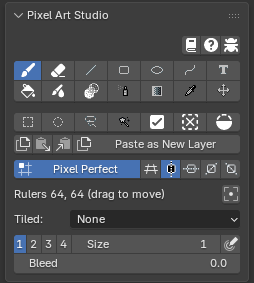
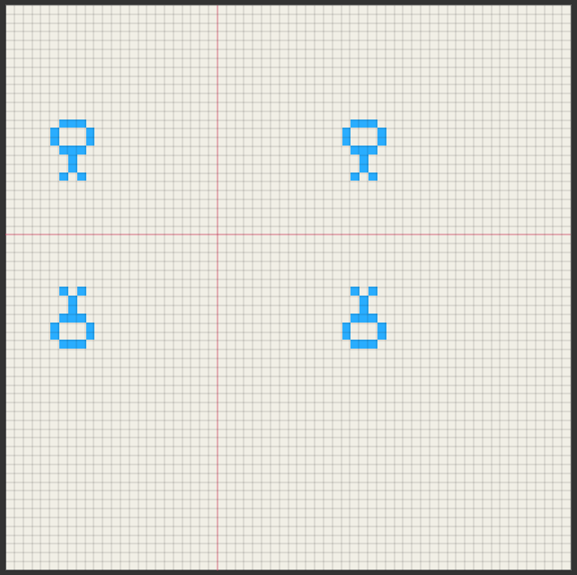
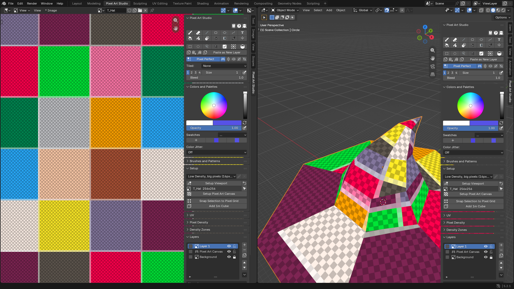

.. _symmetry-tiled-mode-and-grid:

Symmetry, Tiled Mode and Pixel Grid
=========================================

The three live in the row under the toolbar, in the sidebar (:kbd:`N`) > ``Pixel Art Studio`` tab > ``Pixel Art Studio`` panel: ``Pixel Grid``, then the four symmetry toggles, and ``Tiled`` under them in the Image Editor.

.. _symmetry:

Symmetry
--------

**Mirror and symmetry drawing**, in the Image Editor and on the model in the 3D Viewport. Four toggles, all off by default:

* **Horizontal Symmetry**: mirrors left to right.
* **Vertical Symmetry**: mirrors top to bottom.
* **45 Symmetry** and **-45 Symmetry**: mirror about the two diagonals.

They combine: two toggles on paint four copies, three paint eight.

* **Mirrored**: the Brush, the Eraser, Blur and Scramble, Shading, Pixel Spray, the Line, the Rectangle, the Ellipse, the Path, the Bucket (it fills from each mirrored click), the Gradient (the ramp itself is mirrored), the brush preview, the lines from the last dab, and moving or transforming a selection (the pixels in the mirror of the selection move mirrored too).
* **Not mirrored**: the selection shapes themselves (the marquee stays where you drew it), the Move tool and the Text tool.
* With a selection, the drawn side is clipped by the selection and the mirrored side by the selection's mirror, so painting inside a selection on one side also paints the mirrored area.
* The symmetry settings and the rulers are tool settings, so :kbd:`Ctrl+Z` leaves them alone.

In the Image Editor
~~~~~~~~~~~~~~~~~~~

The canvas is mirrored about **pink rulers** drawn on it.

* The rulers start in the middle of the canvas.
* **Drag a ruler to move it** (press right on it, with any tool armed). Near the point where the rulers cross, the press moves both. A dragged ruler lands on a texel edge.
* While a mirror is on, the row under the toggles says where the rulers are (``Rulers x, y (drag to move)``), and the ``Center Rulers`` button puts them back in the middle.

In the 3D Viewport
~~~~~~~~~~~~~~~~~~

The model is mirrored through planes, **onto its own texels** (each face copied exactly), like a Mirror modifier. Mirrored strokes reach faces the view can't see, like the far side of the model.

.. video:: _static/videos/v2/symmetry-3d-object.mp4
  :width: 100%

While a mirror is on, the row under the toggles says which way the planes face and where they go through:

* ``Object`` (default): mirrors across **the model's own X and Z axes**, like a Mirror modifier. Turning the viewport leaves the mirror where it is. ``Horizontal Symmetry`` mirrors across the model's X, ``Vertical Symmetry`` across its Z, and the diagonals between them (as seen in the front view).
* ``View``: mirrors across **the view's own** left and right, up and down. Turning the viewport turns the mirror with it.
* ``Mirror at 3D Cursor`` (the 3D cursor icon): puts the mirror through the 3D cursor. It takes the cursor where it is at the click, so move the 3D cursor and click it again to update.
* ``Center Rulers`` (the bounding box icon): puts the mirror back through the middle of the model.

The mirror is drawn where it is: a line across the view with ``View``, and a square in each mirror plane with ``Object``.

.. note::
    ``Object`` expects the model's front to face Blender's front view (-Y). For a model built facing another way, use ``View``, or ``Mirror at 3D Cursor``.

.. _tiled-mode:

Tiled Mode
----------

**Paint seamless textures and see them repeat as you draw**. ``Tiled`` (Image Editor only) shows the canvas repeated around itself, and what you paint wraps around its edges.

.. video:: _static/videos/v2/tiled-mode.mp4
  :width: 100%

* ``None`` (default): one canvas, edges are edges.
* ``Both Axes``: repeats the canvas sideways and up and down. Strokes that leave one edge come back in at the opposite one.
* ``X Axis``: repeats sideways only.
* ``Y Axis``: repeats up and down only.

While it's on:

* You can paint directly on a repeat.
* **Wraps**: the Brush, the Eraser, the Line, the Rectangle, the Ellipse, the Path and its fill, the Bucket (it walks off one edge and back in), Blur, Scramble, Shading, Pixel Spray, ``Bleed``, the brush preview, the Marquee, Ellipse and Lasso selections, the eyedropper and grabbing a selection on a repeat.
* **Doesn't wrap**: the Gradient, the Text tool, the Move tool, and anything in the 3D Viewport (the model's texture edges stay edges).
* A stroke that crossed an edge is one undo step, both sides together.
* The repeats draw with no tool armed, and a thin line marks the real canvas. Zoomed far out, they stop being drawn.

.. _pixel-grid-overlay:

Pixel Grid overlay
------------------

**See every pixel on the model**: the ``Pixel Grid`` overlay draws a line on every texel boundary, in the Image Editor and on the model in the 3D Viewport.

* ``Pixel Grid`` (the grid icon in the row under the toolbar), or :kbd:`\\` while a tool is armed (also :kbd:`Shift+3` in ``Pixel Art Studio Only``). It's icon only while the Brush or the Eraser is armed.
* **One switch for both editors**: it lights up the Image Editor and the model at the same time, and it draws with no tool armed.
* **Viewport only**: it's never written into the texture, rendered or exported.
* In the Image Editor it draws once each texel is a few screen pixels wide. Zoomed out further it stays off, and the panel says ``Zoom in to see the pixel grid``.
* In the 3D Viewport it draws on the **active object** (a mesh with a canvas texture). The lines follow the UVs over the surface, so **stretched cells and half pixels show on the model before you paint**. The far side of the model stays hidden behind the near side.

Its look is in ``Edit > Preferences > Add-ons > Pixel Art Studio`` > ``General`` > ``Pixel Grid``:

* ``Custom`` (default): the grid in ``Color``, at its opacity (black at 35% by default).
* ``Adaptive``: a light line with a dark halo under it, **so the grid reads over dark art and light art alike**. It uses only the opacity of ``Color`` (switch to ``Custom`` to change the opacity, then back).
* ``Thickness``: the line width, in pixels.

.. image:: _static/images/v2/pixel-grid-custom-adaptive.png

.. note::
    Three grids, three things: the ``Pixel Grid`` overlay draws in the viewport only. The pixel grid layer (:ref:`pixel-grid-layer`) is a real layer painted in the texture. Blender's own floor grid is set to one cell per texel by ``Setup Viewport`` (:doc:`setup-and-canvas`).
