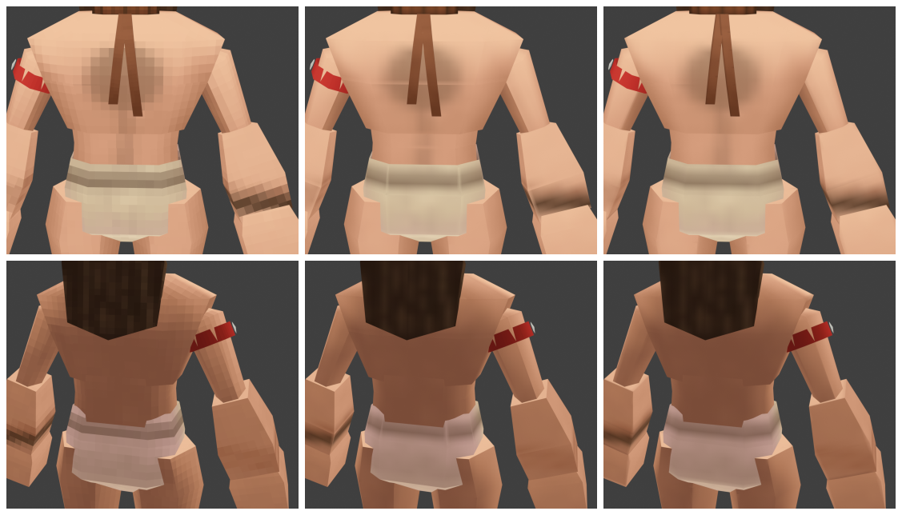
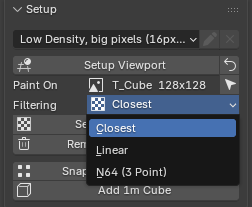
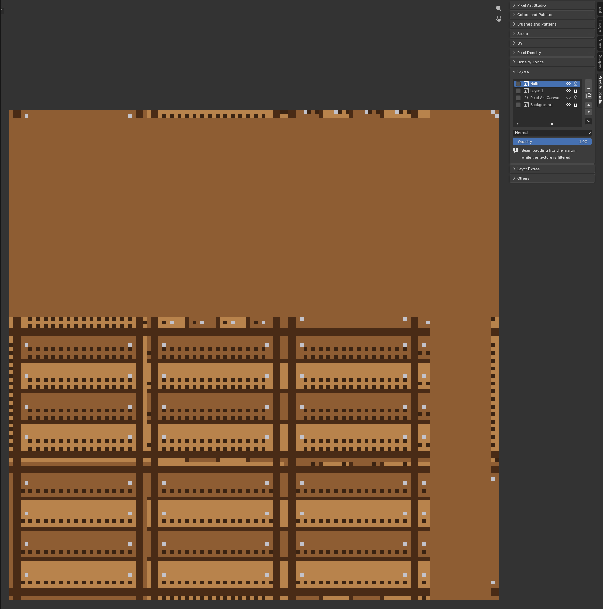

.. _texture-filtering:

Texture Filtering and Seam Padding
=========================================

A canvas is ``Closest`` by default: **every texel a sharp square**, the pixel art look. Want the texture smooth, or the N64 look? ``Texture Filtering`` switches it to ``Linear`` or ``N64 (3 Point)``, and **Seam Padding** keeps the UV seams from showing a step at every face, in Blender and in the game engines.

Left to right: ``Closest``, ``Linear`` before Seam Padding (a step at every seam) and ``Linear`` with Seam Padding.

.. _texture-filtering-row:

Texture Filtering
-----------------

The ``Filtering`` row under ``Paint On``, in ``Setup`` (3D Viewport and Image Editor), for the texture ``Paint On`` names (a greyed out ``Closest`` when the model has no texture):

* ``Closest`` (default): every texel a sharp square, the pixel art look.
* ``Linear``: texels blended into each other. **Nothing else to set up**, in Blender or in the game engines.
* ``N64 (3 Point)`` (*optional*): the N64's own filter, three texels blended a sample, through a node group in the material. In Blender only: the exports carry it as ``Linear`` (see :ref:`filtering-exports`).

How it works:

* **Every material that samples the texture follows**, in this .blend (a material linked from another .blend is that file's).
* **It reads the** ``Image Texture`` **nodes**, so a node you set to ``Linear`` by hand in the Shader Editor shows ``Linear`` here too (``Cubic`` and ``Smart`` too).
* **One undo step**.
* **Picking** ``Linear`` **or** ``N64 (3 Point)`` **raises** ``Margin (px)`` **to** ``4`` (``Unwrap Options``) when it's lower, for the next unwrap (see :ref:`filtered-margin`). ``Closest`` leaves it as it is.
* **A painted texture whose UV islands sit too close** asks first, see :ref:`lay-out-again`.
* **It stays**: the first stroke on a texture that isn't a canvas yet sets it to ``Closest`` (every import comes in on Blender's ``Linear``, see :ref:`automatic-canvas`), unless you picked its filtering here. Pick it before or after the first stroke and it's kept.

.. _seam-padding:

Seam Padding
------------

Why did ``Linear`` show the seams? ``Quick Unwrap Model`` gives every face an island of its own, and a filtered texture blends each texel with its neighbours. At the edge of an island the neighbour is a margin texel, and it holds the background, transparent texels or the face's own colors, never what the model shows across the seam. That's the step at every seam in the middle picture above.

**Seam Padding fills the margin with what the model shows across the seam**, so the blend at the edge of an island reads the right color:

* **Automatic**, while the texture is filtered (``Linear``, ``N64 (3 Point)`` or a node set by hand). Nothing to click.
* **A** ``Closest`` **texture is never touched**: back on ``Closest``, the texture is exactly what your layers make.
* **It's in the texture**: the Image Editor shows it (copies of the island colors around every island), and so do the saved PNG, ``Export Texture``, ``Image > Save As`` and every export.
* **It never becomes paint**: it isn't in your layers, the eyedropper on a padded texel picks the color it was copied from, and the texture brought back in as a layer (``Import PNG``, ``Paste Image as Layer``) leaves it out.
* **The Layers panel says so** while it's on: ``Seam padding fills the margin`` / ``while the texture is filtered``.
* **It follows the UVs**: after an unwrap or UVs moved by hand it's laid again (on a big texture it takes a moment, the seams show until it's there). UVs edited in Edit Mode get it when you leave Edit Mode.

Above: the crate after ``Lay Out Again``, on ``Linear``. Every island is ringed with the colors from across its seams, and ``Layers`` ends with the note.

.. note::
    Painted in the margin while the texture is filtered? Your layers keep it, but the texture shows the padding there. Back on ``Closest``, your painting shows again.

.. note::
    ``Texture Dilation`` grows each island's own colors into the empty texels around it (see :ref:`texture-dilation`). While the texture is filtered, the margin next to the islands is Seam Padding's, and the dilation fills what's farther out.

What it can't do:

* **A seam on a texel line is hidden exactly**. A diagonal seam (a face edge that cuts through texels) can keep a faint step, much less than without the padding.
* **The islands need 2 texels between them**. Closer, a margin texel sits between two islands and both read it, so no fill is right for both (see below).
* **UVs that run past the texture** (a texture repeated over the model) get no padding, and the report says so: ``No seam padding on T_Cube: the UVs run past the canvas``.

.. _filtered-margin:

The margin for a filtered texture
---------------------------------

* **At least 2 texels between the islands** for a filtered texture: each island needs a ring of its own. ``1`` (the default) is plenty for ``Closest``.
* **Picking** ``Linear`` **or** ``N64 (3 Point)`` **raises** ``Margin (px)`` **to** ``4``, so the seams stay hidden from far away too (a filtered texture is mipmapped, in Blender and in the game engines). It never lowers it, and you can still type your own.
* **Under 2, the unwrap lays out at 2 anyway** while the texture is filtered, and ``Unwrap Options`` says so under ``Margin (px)``: ``Laid out at 2 while the texture is filtered``. The report too (``Cube: 16 px/m on the 64x64 texture T_Cube (margin 2 for Linear filtering)``).

  .. image:: _static/images/v2/unwrap-options-filtered-margin.png

* **A bigger margin takes texture space**: a model that just fit may need the next texture size (``Grow Texture to Fit``, see :ref:`grow-texture-to-fit`).

.. _lay-out-again:

UV islands too close for filtering
----------------------------------

The new margin is for the next unwrap. UVs laid out before (at ``1``, or your own layout) stay where they are, so Pixel Art Studio tells you when they're too close:

* **The question**: picking ``Linear`` or ``N64 (3 Point)`` on a texture with painting on it, with the islands closer than 2 texels, asks ``The UV islands are 1 texel apart: seams show under Linear filtering`` / ``Lay the UVs out again 4 texels apart? Your painting is kept``.

  * ``Lay Out Again``: new UVs at the margin (``Quick Unwrap Model``'s layout, at the model's own pixel size), and **every layer is carried onto them**. One undo step.
  * ``Not Now`` (or :kbd:`Esc`): the texture stays filtered and the UVs stay as they are.

  .. image:: _static/images/v2/texture-filtering-question.png

* **The note in** ``Setup``, under the ``Filtering`` row, for as long as the texture is filtered and the islands are too close: ``UV islands 1 texel apart:`` / ``seams show while filtered`` (``UV islands touch:`` when there's no margin at all), with ``Lay Out Again`` under it, the same as the question's.

  .. image:: _static/images/v2/texture-filtering-setup-note.png

* **Object Mode only**: from Edit Mode it says ``Leave Edit Mode first: the UVs are laid out again in Object Mode``.
* **A texture with nothing painted yet** asks nothing: click ``Quick Unwrap Model`` and it's laid out at the new margin.

.. note::
    ``Lay Out Again`` works like ``Apply New Density`` in ``Try Pixel Densities`` (see :ref:`quick-setup-try`): the scene's pixel density goes to the model's own too, and a texture that isn't a canvas yet becomes one first (its own undo step).

.. _filtering-exports:

In the game engines and the exports
-----------------------------------

**A filtered texture leaves filtered, with mipmaps and with the padding in it**. Nothing to set up in the engine, the integrations write it for you:

* **glTF and GLB** (``Unlit Pixel Art in glTF``, your own ``File > Export > glTF 2.0`` included): linear filtering with mipmaps.
* **Godot**: linear filtering with mipmaps.
* **Unity**: trilinear filtering with mipmaps.
* **Unreal Engine**: the ``Default`` filter, with mipmaps.
* **Generic Exporter**: GLB and glTF as above. FBX writes the same two files as always: FBX has no word for filtering, so the PNG carries the padding and the tool you import into does the filtering.
* **A** ``Closest`` **texture exports exactly as before**: nearest filtering, no mipmaps. Back on ``Closest``, the next save puts the engine's texture back to nearest.

.. warning::
    ``N64 (3 Point)`` exports as ``Linear`` through glTF, the game engine integrations and the ``Generic Exporter``. **Blender's own FBX and OBJ export find no texture while it's on** (the node group hides it from them): switch to ``Linear`` before a ``File > Export > FBX`` or ``OBJ``.

Troubleshooting
---------------

* **Seams still show under** ``Linear``: the ``Setup`` note says when the islands are too close, click ``Lay Out Again``. A faint step on a diagonal seam is expected.
* **Seams show from far away** with a margin of 2 or 3: type ``4`` in ``Margin (px)`` and lay the UVs out again.
* **The Image Editor shows color around every island**: that's the padding, it goes away on ``Closest``.
* **The FBX or OBJ came out with no texture**: the texture is on ``N64 (3 Point)``, see the warning above.
