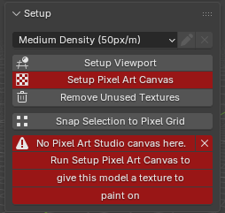
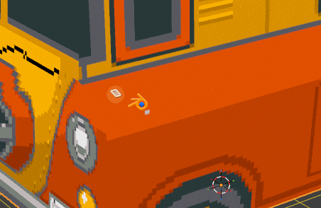
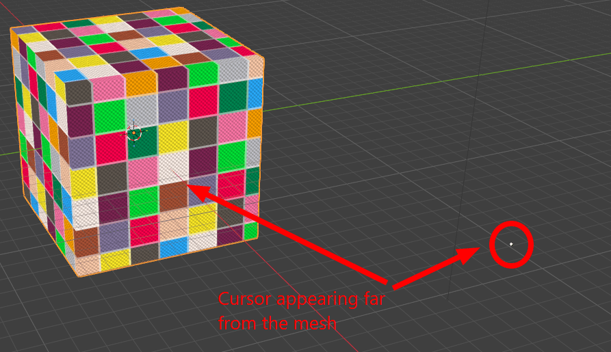
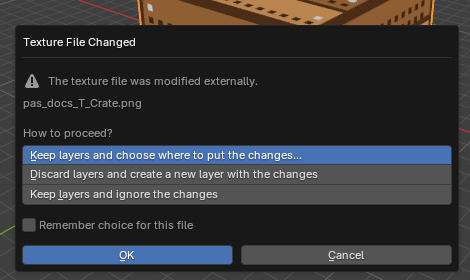
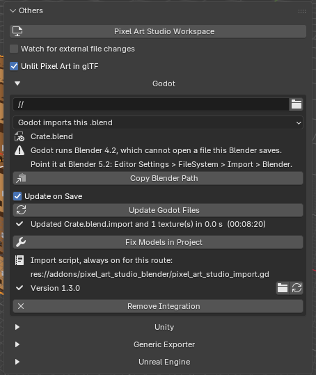

Troubleshooting
=========================================

Pixel Art Studio tells you what's wrong in a few places, so look there first:

* **Blender's status bar**, at the bottom of the window: every message, for a few seconds.
* **The warning in the** ``Setup`` **panel**: coral lines under its buttons, for the things you must not miss (a click on a model with no texture, an unwrap that didn't fit, a canvas file that couldn't be written). Click any line or its ``X`` to dismiss it.
* **Red buttons**: ``Apply Texel Density (needed)`` and ``Try Pixel Densities``, both in the ``Pixel Density`` panel.
* **A popup at the pointer**: ``Nothing was applied`` and why, when ``Apply New Density`` can't do it (see :doc:`quick-setup`).
* **Greyed buttons**: hover them and the tooltip says why.
* **The game engine sections** in the ``Others`` panel: a red line under what's wrong, and the last result line.

**************************************************
Painting and selecting
**************************************************

When I paint or select, nothing happens
---------------------------------------

Go through these, the first one is the most common:

* **A selection is active somewhere**: while there's a selection, every tool paints only inside it, and in 3D it can be on a face you're not looking at. Press :kbd:`Shift+Alt+A` (with a tool armed) or click ``Deselect`` beside the selection tools.

  .. image:: _static/images/v2/trouble-deselect.png

* **The layer is locked or hidden**: the status bar says ``Layer 'Name' is locked`` or ``Layer 'Name' is hidden`` (a hidden group hides its layers too). Unlock it, show it, or pick another layer. The wizard's ``Background`` layer starts locked.

  .. image:: _static/images/v2/trouble-layer-locked-hidden.png

* **The model has no texture**: ``No Pixel Art Studio canvas here. Run Setup Pixel Art Canvas to give this model a texture to paint on`` (after a key, or a click beside the model). Click the big ``Setup`` button (see :doc:`quick-setup`), or ``Setup Pixel Art Canvas`` (coral). A click on the model itself opens ``Quick Setup``. A model **with** a texture never needs any of this: the first stroke makes its canvas (see :ref:`automatic-canvas`).
* **The texture can't be painted**: ``Layers`` and the status bar say why (a sequence, a movie, a UDIM, a file Blender can't find, an image from another file). See :ref:`automatic-canvas`.
* **The object uses another texture**: in the 3D Viewport you paint the texture of the **active** object (on every object that uses it). Put the tool away, click the model, arm the tool again.
* ``Leave Quick Setup to use the tools``: ``Quick Setup`` or ``Try Pixel Densities`` is open. Close it (:kbd:`Esc`) first.
* ``Active layer is not paintable``: the active row in ``Layers`` is a group, pick a layer inside it.
* ``Material preview is finishing. Try painting again in a moment.``: a material preview is rendering in the Properties editor, wait a second and click again.
* **Faces hidden in Edit Mode** are left out of every tool on purpose. Unhide them (:kbd:`Alt+H`).

Blender's keys do Pixel Art Studio things, or the other way around
------------------------------------------------------------------

* Pixel Art Studio's shortcuts only work **while a tool is armed**, with the pointer over the editor where it's armed. Arm one with a tool button or the activator, :kbd:`;`.
* In ``Pixel Art Studio Only``, while a tool is armed, keys like :kbd:`G`, :kbd:`E`, :kbd:`S` and :kbd:`X` are Pixel Art Studio's. Press :kbd:`Esc` or :kbd:`;` to get Blender's back, or switch the ``Shortcut Mode`` to ``Alongside Blender`` (see :ref:`shortcut-mode`).
* In ``Alongside Blender``, a key you bound that Blender also uses in that editor runs Blender's action. The ``Shortcuts`` tab says so under the row.
* **The tool keeps going away**: the sidebar has to stay open on the ``Pixel Art Studio`` tab, closing it (or bringing another tab to the front) puts the tool away, and clears the selection with ``Clear selection when Pixel Art Studio is de-activated`` on (:kbd:`Ctrl+Z` brings it back). On Blender 3.6 and 4.0 only closing it does.
* **I can't click to select another object**: while a tool is armed in the 3D Viewport, a click is the tool's. Put the tool away first (or select in the Outliner).

See :doc:`shortcuts` for the whole list.

Alt+click orbits the view instead of sampling a color
-----------------------------------------------------

Your keymap orbits with :kbd:`Alt+click` (the ``Industry Compatible`` keymap, or ``Emulate 3 Button Mouse``), and Pixel Art Studio leaves that click to Blender. Rebind ``Eyedropper (hold and click)`` to a key (see :ref:`bindable-shortcuts`), or use the hover eyedropper, :kbd:`Alt+Shift+X`.

When I paint with the brush or eraser, some pixels are not painted where the cursor is
---------------------------------------------------------------------------------------

* That's ``Pixel Perfect`` (on by default, :kbd:`Shift+Alt+P` toggles it, only for the ``Brush`` and the ``Eraser``): it removes the doubled corner of every "L" in a freehand stroke, so one pixel lines come out clean. Turn it off for blocky strokes. It's held off for brushes bigger than 12.
* In 3D, it can also mean the texel density is off or the UVs are distorted (see :ref:`bad-uvs-troubleshooting`).

When I paint, the strokes appear in multiple places
---------------------------------------------------

The faces showing the stroke share the same pixels:

* **Overlapping UVs**: faces laid over each other in UV paint the same texels. Give each face its own pixels with ``Quick Unwrap Model`` (``UV`` panel), see :doc:`uv-tools`.
* **Stacked faces** (``Stack UVs``, listed under ``Stacked Faces`` in the ``UV`` panel): the same, on purpose. Unstack them with the ``X`` beside ``Stack UVs``.
* **A Mirror modifier**: both halves wear the same texels.
* **Symmetry** is on: the four mirror toggles right of ``Pixel Grid``.
* ``Tiled`` (Image Editor): a stroke over the canvas edge comes back in on the opposite edge.

.. _bad-uvs-troubleshooting:

The brush cursor floats far from the mesh, or pixels land away from where I clicked
------------------------------------------------------------------------------------

The UVs are not set up for painting (degenerate, overlapping or stretched far), or the texture is too small.

1. In the ``UV`` panel click ``Quick Unwrap Model`` (it works from any mode, and lays out the whole model). Or, in Edit Mode, select faces and click ``Pixel Art Unwrap``.
2. Read the status bar: it says the density and the texture size the model landed on.
3. Paint again.

Prefer your own UV layout? Keep it, and put it on the pixel size with ``Apply Texel Density`` (``Pixel Density`` panel). See :doc:`uv-tools` and :doc:`pixel-density`.

.. note::
    UVs past the edge of the texture repeat it, so a texel painted there shows up on every repeat. Unwrap again with ``Grow Texture to Fit`` on (``Pixel Density`` panel) or use a bigger texture.

The texture is too small for the model
--------------------------------------

* The canvas wizard says it with a red line: ``Cube needs 512px at 50 px/m``. Pick the size it names.
* An unwrap says ``Cube: does not fit the 256x256 texture T_Cube at 50 px/m, needs 512px``. Turn ``Grow Texture to Fit`` on (``Pixel Density`` panel, it grows the canvas and its layers), pick a lower density, or use ``Fit Texture``.

The pixels along a diagonal UV edge stay empty
----------------------------------------------

The brush doesn't paint the texels a face only partly covers (the stair steps along a diagonal edge). Set ``Bleed`` to ``0.5`` on the ``Brush``, the ``Eraser`` or the ``Line``: it reaches exactly those texels. ``1`` or more also grows rings into the empty texture around the island. For selections, turn ``Topology`` on (3D Viewport).

.. image:: _static/images/v2/painting-tools-bleed.png

When I move a selection from one face to another, the pixels get distorted or duplicated
-----------------------------------------------------------------------------------------

* **Pixels distorted, stretched or resized**: expected when the faces have different texel densities, the pixels land on an island of another density and are resampled to it.
* **Pixels duplicated**: expected when you land the selection on faces that share their UVs with other faces (stacked or overlapping).
* ``A topology selection is tied to the geometry and cannot be moved. Turn Match Topology off and select again to move these pixels``: a ``Topology`` selection (orange) never moves. Turn ``Topology`` off and select again.

**************************************************
Setup and pixel size
**************************************************

Setup Viewport changed my grid, units or renders
------------------------------------------------

``Setup Viewport`` is optional, painting never needs it. It sets the unit system to ``None``, the view transform to ``Standard``, increment snapping, EEVEE's viewport samples to 1, the grid and ``Flat`` ``Texture`` shading in every 3D Viewport, and ``Round to Pixels`` in the Image Editor. Click the loop icon beside it, ``Restore Viewport``, to put all of that back. See :ref:`setup-viewport`.

Apply Texel Density (needed) is red
-----------------------------------

The model was put on one density and you selected another (a preset, or a typed ``Texel Density``). Click it (or ``Setup Viewport``, which does it too), select the old preset back, or click ``Try Pixel Densities`` (red, at the top of the same panel) to see the new density on the model first. A texture with painting on it is asked about before anything changes. See :doc:`pixel-density`.

Pixel Art Unwrap is greyed out
------------------------------

It works in Edit Mode, on the selected faces. ``Quick Unwrap Model`` works from any mode, on the whole model.

The pixel grid button does nothing
----------------------------------

* **Image Editor**: zoomed out too far, each texel is about one screen pixel and the grid stays off (the panel says ``Zoom in to see the pixel grid``). Zoom in.
* **3D Viewport**: the grid draws on the **active** object only, when it has a texture (a canvas or not yet). Select the model.

The canvas went into an empty material slot
-------------------------------------------

On a mesh with several materials, ``Setup Pixel Art Canvas`` keeps them all and puts its canvas in a **new** slot, with no faces in it (the status bar says so). In Edit Mode, select the faces you want to paint and assign that slot.

**************************************************
Files and textures
**************************************************

I edited the texture outside Blender and my changes are gone
------------------------------------------------------------

Your layers are the source of the picture: the canvas image is what they add up to, so the next stroke repaints it from the layers. Turn on ``Watch for external file changes`` (``Others`` panel) and Pixel Art Studio asks what to do when the file changes (in Aseprite, in Photoshop, or with Blender's own ``Image > Reload``):

* ``Keep layers and choose where to put the changes...``: then pick ``As a new layer on top`` (nothing you painted is touched), ``Replace the bottom layer`` or ``Replace the active layer``.
* ``Discard layers and create a new layer with the changes``.
* ``Keep layers and ignore the changes``.
* ``Remember choice for this file``: the next changes do the same with no question. The ``Others`` panel shows the remembered choice, with ``Reset`` to be asked again.

.. note::
    With the watch off, an ``Image > Reload`` is still caught (the question comes up the next time you arm a tool or paint), and the watch is turned on for you.

Texture File Missing, when opening a file
-----------------------------------------

The canvas image file is gone (moved, renamed, or the .blend is on another computer), but the layers are inside the .blend. Click ``OK`` and the canvas is rebuilt from them. Every save also keeps the canvas packed inside the .blend, so it can't get lost this way again.

CONFLICT: Texture Image File (Canvas) and Layers Contents
---------------------------------------------------------

The texture file and the layers saved in the .blend are different (usually another .blend wrote over the same image file). Pick what to keep:

* ``Keep the texture and choose where to put it...`` (as a new layer, or replacing one).
* ``Discard the layers and make the texture the only layer``.
* ``Keep the layers and replace the texture``.

Did not write my texture file on save
-------------------------------------

``Did not write <file>: Blender cannot save it as the same kind of file; the canvas is still saved inside the .blend``: the canvas came from a file Blender can read and can't write (a PSD). Nothing is lost. To get a file out, use ``Export PNG`` in ``Layer Extras`` (see :doc:`layers`).

A texture can't be painted
--------------------------

The first click on a texture makes it a canvas (see :ref:`automatic-canvas`), unless it can't be one. Then nothing changes, and ``Layers`` and the status bar say why:

* ``<image> is a sequence image; a canvas has to be one still picture we can write back``: image sequences, movies and UDIMs can't be canvases.
* ``Blender has no pixels for <image>. Check the image's file path, then try again``: the image file wasn't found (``File > External Data > Find Missing Files``).
* ``<image> is a render result, not a texture. Open or create an image to paint on``.
* ``<image> comes from another file. Open that file to paint on it``: the image (or its material) is linked from another .blend.
* ``Material preview is finishing. Try painting again in a moment.``: a material preview is rendering, click again in a second.

Ctrl+Z took my texture back to how it was
-----------------------------------------

The first stroke on a texture is two undo steps: the canvas, then the stroke. A second :kbd:`Ctrl+Z` gives the texture back exactly as it was, its file on disk too. :kbd:`Ctrl+Shift+Z` twice brings both back.

My shortcuts are gone from the preferences
------------------------------------------

The ``Shortcuts`` tab says ``N shortcuts were removed from the keymap.`` when a row was deleted (or edited into something else in Blender's keymap). Click ``Restore Default Shortcuts``. It brings them back, and it also resets every shortcut you changed.

**************************************************
Game engines
**************************************************

When I save my .blend inside a Godot project and use the Godot integration, I get "not a blend file"
-----------------------------------------------------------------------------------------------------

With ``Godot imports this .blend``, Godot opens the .blend with the Blender set in **its own** editor settings, and an older Blender can't open a file a newer one saved. Make sure Godot points at the same Blender version you save with, or a newer one.

1. Look at the ``Godot`` section in the ``Others`` panel: it names the version Godot runs, ``Godot runs Blender X, which cannot open a file this Blender saves.`` (or ``Godot has no Blender path set.``).
2. Click ``Copy Blender Path``.
3. In Godot, go to ``Editor > Editor Settings > FileSystem > Import > Blender`` and paste it in ``Blender Path``.

Or switch the section to ``Export a model``, and Godot gets a GLB instead (no Blender needed on Godot's side).

Unity says "Blender could not convert the .blend file to FBX file."
-------------------------------------------------------------------

The same thing on Unity's side: with ``Unity imports this .blend``, Unity opens the .blend with the Blender your system opens .blend files with, and it's older than the one you save with. On Windows the ``Unity`` section names it (``Unity opens .blend files with Blender X.Y.``). Change it in Windows (``Open with``), or switch the section to ``Export a model``.

When I export to a game engine such as Godot or Unity, the model is darker (or black) in the engine
---------------------------------------------------------------------------------------------------

Pixel Art Studio's own canvas material is unlit in Blender, and an engine has to be told to show it unlit too:

* **glTF and GLB** (your own ``File > Export > glTF 2.0``, Godot, Unreal's GLB, the ``Generic Exporter``): keep ``Unlit Pixel Art in glTF`` on (``Others`` panel, above the engine sections, on by default) and export again.
* **Godot, Unity and Unreal**: use their integration (``Integrate with Godot``, ``Integrate with Unity``, ``Integrate with Unreal Engine``), the model arrives unlit. For a model you imported before, click ``Fix Models in Project``.
* **An FBX exported by hand** comes out black (Blender's FBX writes no texture for this material). Use the integration, or the ``Generic Exporter``'s FBX, which writes the PNG beside it.
* **A material of your own** (a ``Principled BSDF`` sampling the canvas) stays lit on purpose. If it's darker or looks like it's in shadow, set its ``Metallic`` to 0 and ``Roughness`` to 1, or light it in the engine.

See :doc:`game-engines`.

Nothing is exported when I save
-------------------------------

* Check the section's ``Export on Save`` (``Update on Save``, ``Export on Every Save``) checkbox.
* Check that the engine is ticked in the preferences, ``General`` tab, ``Game Engines``: unticked, the section is hidden and nothing is written.
* ``Re-export`` writes right away, without saving.

The project or the folder is gone
---------------------------------

* ``This folder is not there any more.`` under the project: the project moved, or the .blend was saved somewhere else with ``Save As`` (the paths are relative to the .blend). Fix the path in the field, or move the .blend and the project together.
* ``The export folder is gone`` (or ``The source folder is gone.``): click the refresh button beside the red line, it makes the folder again at the same path and exports.

Unreal doesn't show the model
-----------------------------

* After the first integration, **restart the Unreal editor once** so it loads the plugin (the panel says ``Restart Unreal once to load the plugin.``).
* ``The .uproject turns the plugin off.``: the project disabled the plugin. Turn ``Pixel Art Studio for Blender`` back on in Unreal's ``Plugins`` window.
* Saves don't arrive by themselves: ``Update Unreal Automatically`` is off for the project, or you turned ``Update From Blender Automatically`` off in Unreal's ``Tools`` menu. Reimport by hand, or restart the editor.
