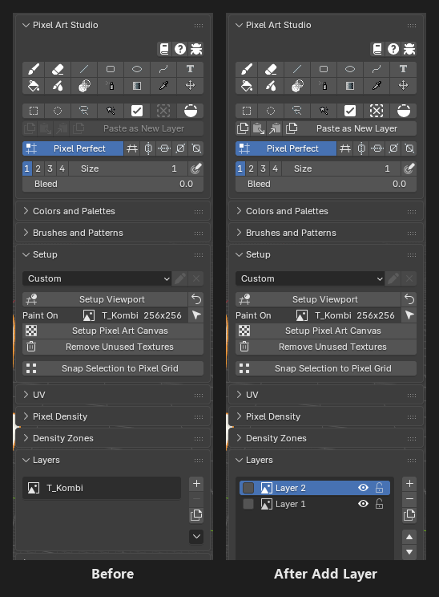
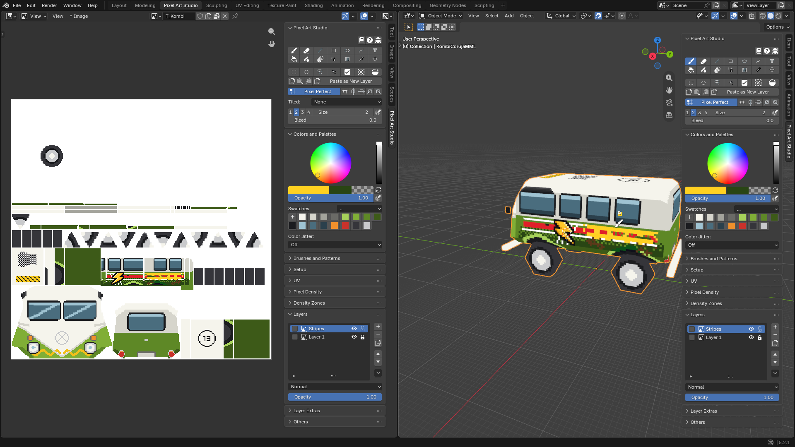
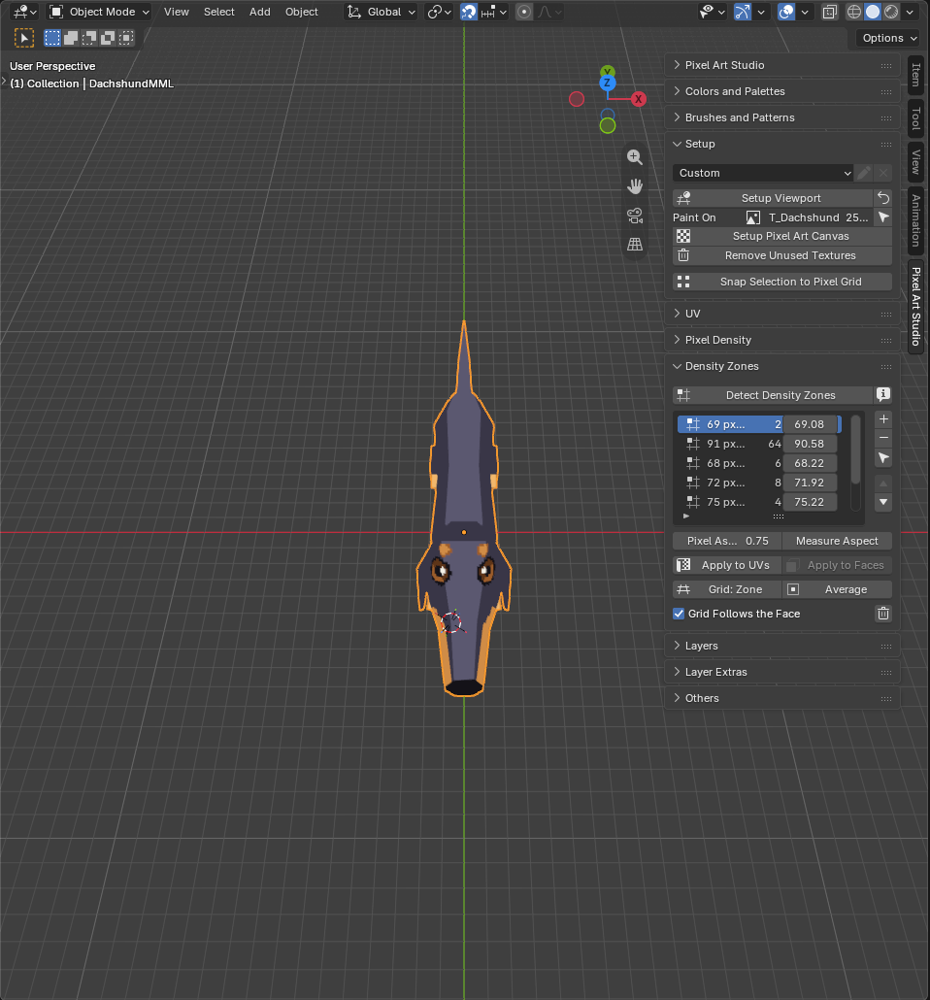

A Model That Already Has a Texture
=========================================

Let's take a model that already has UVs and a texture (made by you, or by somebody else, in any program) and paint on top of it with Pixel Art Studio, without losing the original art. **There's nothing to set up: click a tool and paint.** The tools work from the model's UVs and the texture's own texels, so they line up with the pixels you already have.

.. warning::
    When you save the ``.blend`` after painting, the canvas is packed inside it **and the texture file on disk is written** with the painted result (in its own format). **Keep a copy of the original file** if you want to go back to it.

1. Open the model
-----------------

1. Open the ``.blend`` file with the model (or import the model into a new file).
2. Click the ``Pixel Art Studio`` workspace tab at the top of the window: the texture on the left, the model on the right.
3. Select the model in the 3D Viewport.

2. Add a layer for your paint
-----------------------------

1. In ``Layers``, click ``+`` (``Add Layer``). Before your first action the panel shows the texture as the one layer it's going to be (``T_Kombi`` above): the first action, a click on ``+`` here, turns the texture into ``Layer 1`` of a layer stack, exactly as it was, and the new layer goes above it as the active one.
2. Double-click the new layer's name to rename it.
3. Click the padlock of ``Layer 1``: the original art can't be touched by accident.

Your material, your UVs and the texture size are kept as they are. Only the texture's interpolation is set to ``Closest``, so the pixels stay crisp (want it smooth? see :doc:`texture-filtering`). If the material has other textures (a normal map, a roughness map), they are left alone: Pixel Art Studio paints the color texture.

That's all the setup painting needs: no pixel density, no ``Setup Viewport``, no density zones. :kbd:`Ctrl+Z` takes the new layer back, and a second :kbd:`Ctrl+Z` gives you the texture back exactly as it was.

.. note::
    A mesh with several color textures (the body and the windows on separate materials, for example)? ``Paint On``, in ``Setup``, lists them all: select the one you paint on. A click on a face in the 3D Viewport paints that face's texture.

.. note::
    The texture can't be painted? ``Layers`` says why: the image is a sequence, a movie, a UDIM or a render result, it comes from another .blend file (linked), or Blender can't find its file. Fix the image path (``File > External Data > Find Missing Files``), or give the model a new texture with ``Quick Setup`` (see :doc:`quickstart-tutorial`).

3. Paint on top
---------------

1. Arm the ``Brush`` and sample colors straight from the art with :kbd:`Alt+click`, so the new paint matches the palette.
2. Paint. The original art stays as it was on ``Layer 1``: hide your layer (its eye) to compare, lower its ``Opacity``, or erase without fear.

.. tip::
    Press :kbd:`\\` (with a tool armed) to toggle the pixel grid over the model, to see where each pixel of the texture is.

.. tip::
    You don't have to add a layer first: a stroke right away paints on the texture itself (``Layer 1``).

4. Save
-------

* Press :kbd:`Ctrl+S`. The layers are saved inside the ``.blend``, and the texture file is written with the painted result, in its own format (PNG, JPEG, TGA and others).
* A format Blender can't write back (a Photoshop PSD, for example) is left untouched on disk, and a warning in ``Setup`` says so. Your painting is still saved inside the ``.blend``.
* Still editing the texture in another program too (Aseprite, for example)? Tick ``Watch for external file changes`` in the ``Others`` panel, and Blender asks how to bring the changes into your layers. See :doc:`setup-and-canvas`.

Optional: other pixel sizes or new UVs with Pixel Art Studio
-------------------------------------------------------------

Only if you want to change the model's pixel size, give it new UVs, or model more on it, with Pixel Art Studio. For painting, skip this whole part.

**Other pixel sizes, new UVs**: ``Try Pixel Densities`` (``Pixel Density`` panel) shows other pixel sizes on the model, live, and ``Current Texture`` shows your texture at each of them. ``Apply New Density`` keeps your painting, scaled to the new pixel size; tick ``Quick Unwrap`` and the model gets new UVs, with every layer carried onto them. The eye beside ``Quick Unwrap Model`` (``UV`` panel) opens it on new UVs right away. See :doc:`quick-setup`.

**One pixel size**: ``Detect Texel Density`` (``Pixel Density`` panel) makes the pixel size the model already uses the scene's, so new models and UVs (``Pixel Art Unwrap``, ``Quick Unwrap Model``, ``Apply Texel Density``, ``Add 1m Cube``, ``Quick Setup``) **match the pixels you already have**. See :ref:`detect-texel-density`.

**Several pixel sizes** (a character's head drawn with finer pixels than the body, which is common in PS1 era models):

1. Expand ``Density Zones`` and click ``Detect Density Zones``. The status bar says how many zones it found and the range of pixel densities.

   * One zone: the model has one pixel size after all. Click the trash button (``Clear Zones``) and ``OK``, and use ``Detect Texel Density`` instead.
   * Several zones: keep them. Double-click a zone's name to rename it (``Head``, ``Body``...).

2. Click ``Average`` under the zone list: the viewport is set up, with the grid on the model's average pixel size.

.. note::
    Once the model has zones, **Blender's grid follows the pixel size of the face under the brush** while you paint in the 3D Viewport (``Grid Follows the Face``, on by default). Want to keep your own grid? Skip the zones, or untick ``Grid Follows the Face`` (or the preference ``Automatically configure grid and grid units``). See :doc:`density-zones`.

.. video:: _static/videos/v2/grid-follows-the-face.mp4
  :width: 100%

**The grid**: ``Setup Viewport`` puts Blender's grid on the pixel size (one grid square per pixel), for modelling and unwrapping on it. It changes the scene, see :ref:`setup-viewport` for the whole list, and the loop icon beside it (``Restore Viewport``) puts it all back.

Where to go next
----------------

* Change the pixel size of the model, or match the pixel size of other models: :doc:`pixel-density`.
* Manage and create zones: :doc:`density-zones`.
* Layers, blend modes, masks and adjustments: :doc:`layers`.
* Send the model to Godot, Unity or Unreal Engine on every save: :doc:`game-engines`.
