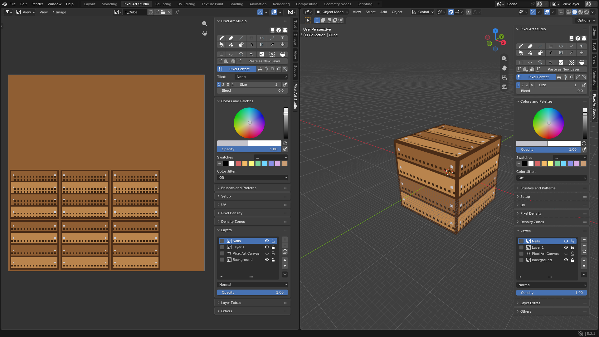
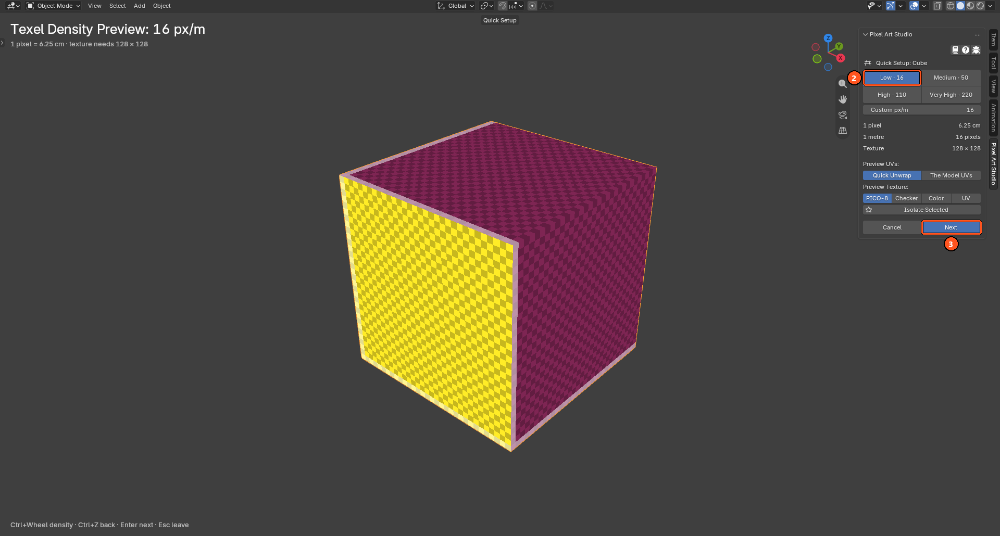
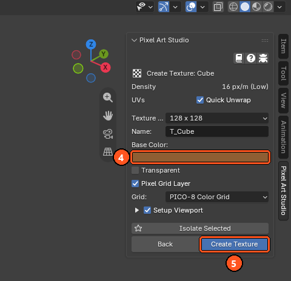
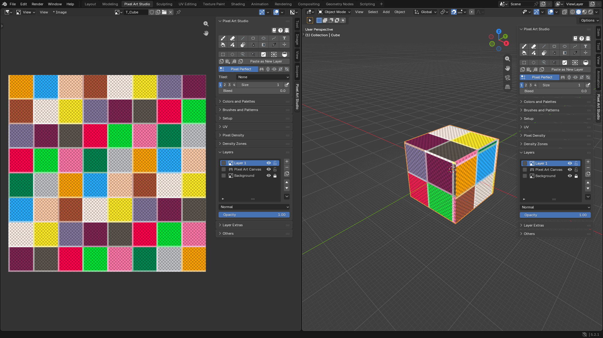
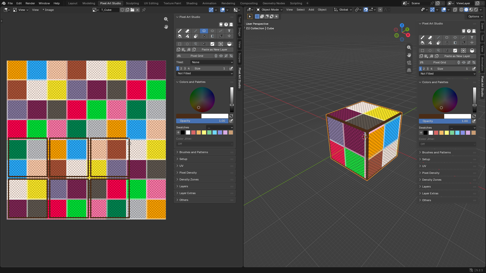
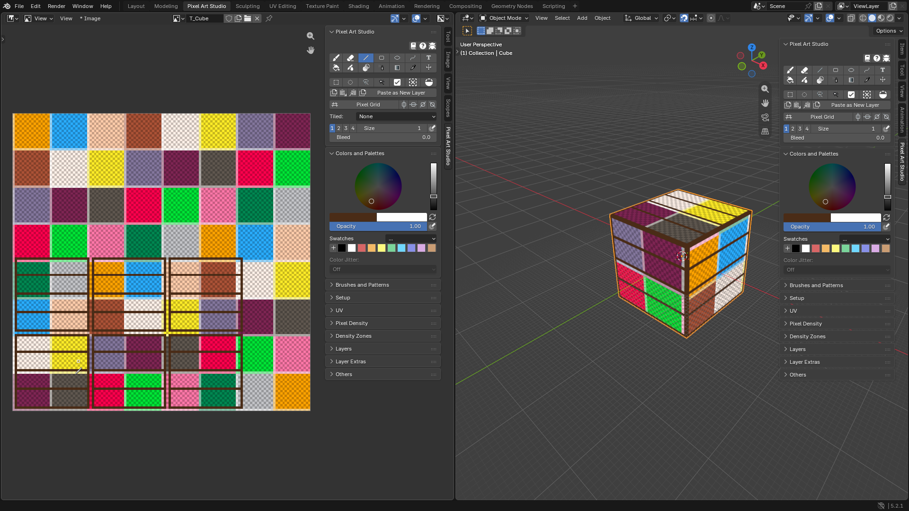
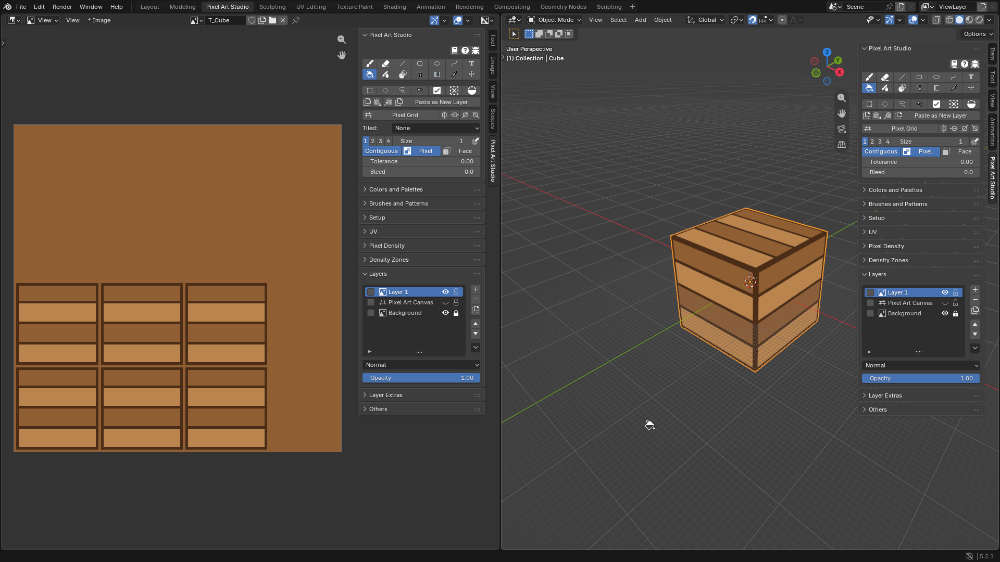
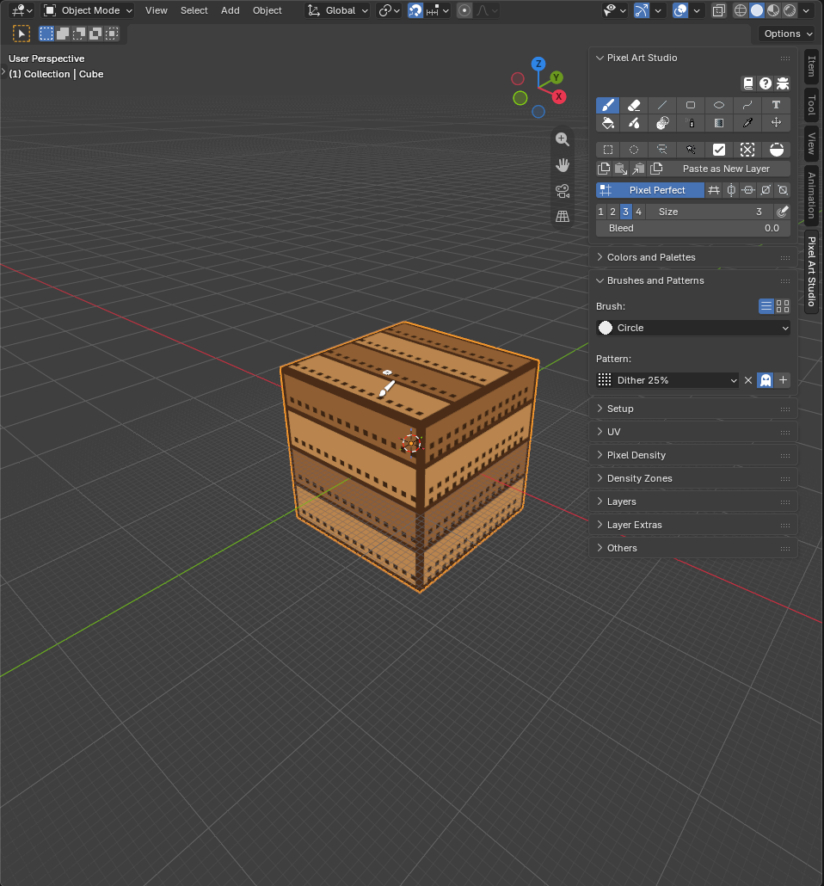
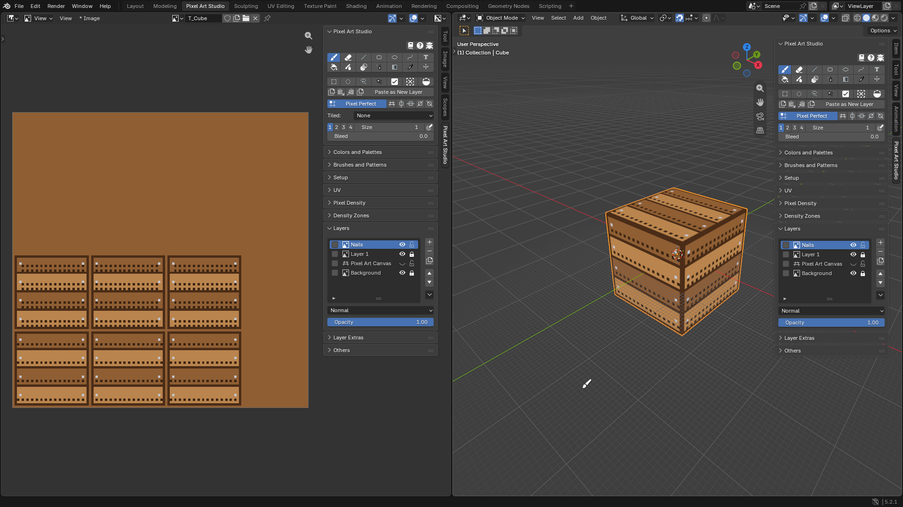

Your First Model: a Crate
=========================================

Let's make a wooden crate out of Blender's default cube, from a new file to a painted and saved model. On the way you are going to try the pixel size on the cube, create the texture and the UVs in one click, paint planks with the Line and the Bucket, add grime with a dither pattern and put the nails on a layer of their own.

What you need: Pixel Art Studio installed (see :doc:`installation`).

1. Open the workspace
---------------------

1. Start a new file with ``File > New > General``.
2. Click the ``Pixel Art Studio`` workspace tab at the top of the window. The texture goes on the left (Image Editor) and the model on the right (3D Viewport), both with the ``Pixel Art Studio`` sidebar open.
3. Click the cube in the 3D Viewport to select it.

2. Choose the pixel size
------------------------

1. In the ``Pixel Art Studio`` panel, click the big ``Setup`` button (it shows because the cube has no texture yet).

   .. image:: _static/images/v2/tutorial-crate-setup-button.png

2. ``Quick Setup`` opens: the 3D Viewport fills the window and the cube wears a grid, one cell per pixel. Click ``Low · 16``. Blender's default cube is 2 m wide, so every face is going to be 32 by 32 pixels: chunky pixels, great for a crate. The text at the top left says it too: ``1 pixel = 6.25 cm``, and the texture it needs.

   - Try the other sizes on the cube first if you like (:kbd:`Ctrl+Wheel` goes through them), nothing is made until the next step.

3. Click ``Next``.

3. Create the texture
---------------------

1. Keep the ``Texture Size`` it opens on (``128 x 128``, the size this cube needs at 16 px/m) and the ``Name`` (``T_Cube``).
2. Set ``Base Color`` to a medium wood brown. It fills the ``Background`` layer, at the bottom of the layer stack.
3. Leave ``Quick Unwrap``, ``Pixel Grid Layer`` (with ``PICO-8 Color Grid``) and ``Setup Viewport`` ticked.
4. Click ``Create Texture``.

4. What you got
---------------

``Create Texture`` did everything at once, as one undo step:

* **The UVs**: every face is laid flat on its own island, 32 by 32 pixels, packed on whole pixels with a pixel of margin around it (``Quick Unwrap``). You can see the six squares in the Image Editor.
* **The texture**, with three layers: ``Layer 1`` (you paint on it), the ``Pixel Art Canvas`` grid (it lets you count the pixels on the model) and the locked wood brown ``Background``.
* **The viewport**: Blender's grid shrank, **one grid square is now one pixel** (1/16 m), and the shading shows the texture's real colors (``Setup Viewport``).

5. Frame every face
-------------------

The frame is easiest on the flat texture, where every face is a square.

1. In ``Colors and Palettes``, pick a dark brown as the primary color.
2. In the Image Editor's sidebar, click the ``Rectangle`` tool. Under the toolbar, leave the fill on ``Not Filled`` and the ``Size`` on ``1`` (or ``2`` for a thicker frame).
3. On each of the six squares, drag from its bottom left pixel to its top right pixel. The frame shows up on the model while you draw.

6. Planks with the Line tool
----------------------------

1. With the pointer over the Image Editor, press :kbd:`Shift+Alt+L` for the ``Line`` tool (or click it), same dark brown, ``Size`` ``1``.
2. Hold :kbd:`Shift` and drag across each face, from frame to frame, to draw the seams between the planks (three seams make four planks). :kbd:`Shift` keeps the line perfectly straight.

You can draw the seams on the flat texture or right on the model in the 3D Viewport: click the ``Line`` tool in the 3D Viewport's sidebar too (or point at the model and press :kbd:`;`). The color and the tool settings are the same in both editors.

7. Shade the planks with the Bucket
-----------------------------------

1. In ``Layers``, hide the ``Pixel Art Canvas`` layer (click its eye). The grid goes away and the wood color of the ``Background`` shows through.
2. In the 3D Viewport's sidebar, click the ``Bucket`` (or, with a tool already armed there, point at the model and press :kbd:`Shift+Alt+F`). Under the toolbar, make sure ``Pixel`` and ``Contiguous`` are on.
3. Pick a slightly lighter (or darker) brown and click inside every other plank, right on the model. The fill stops at the frame and at the seams.

.. note::
    The Bucket reads only the active layer: the frames and the seams you drew on ``Layer 1`` are what hold the fill. A fill that leaked through a gap? :kbd:`Ctrl+Z`, close the gap with the ``Line`` and fill again.

8. Grime with a dither pattern
------------------------------

1. With the pointer over the model, press :kbd:`Shift+Alt+B` for the ``Brush``, pick a dark brown and set ``Size`` to ``3``.
2. Expand ``Brushes and Patterns`` and, under ``Pattern:``, choose ``Dither 25%``.
3. Turn on the ``Transparent`` toggle (the ghost icon) right of the pattern. The gaps of the pattern are left untouched, instead of being painted with the secondary color.
4. Paint along the bottom of the planks and into the corners of the frame. The preview under the pointer shows the exact pixels before you click.
5. When you are done, set the pattern back to ``No Pattern``.

.. tip::
    Patterns are locked to the pixel grid, so overlapping strokes and fills never show a seam.

9. Nails on their own layer
---------------------------

1. In ``Layers``, click ``+`` (``Add Layer``). A new layer shows up above ``Layer 1``. Double-click its name and call it ``Nails``.
2. Pick a light grey, set the brush ``Size`` to ``1`` and click a nail at both ends of every plank.
3. Toggle the eye of ``Nails`` to compare with and without, or lower its ``Opacity``.

.. tip::
    Click the padlock of ``Layer 1`` to lock it, and stray clicks can't touch the planks anymore.

10. Save
--------

1. Press :kbd:`Ctrl+S`. The texture and all its layers are saved inside the ``.blend`` file.
2. Need a PNG? In the Image Editor, ``Image > Save As``, or ``Export PNG`` > ``Export Texture`` in ``Layer Extras``. The visible layers are what goes in the PNG (that's why the ``Pixel Art Canvas`` grid layer is hidden).
3. Making a game? See :doc:`game-engines`: Godot, Unity and Unreal Engine can get the crate on every save.

Where to go next
----------------

* Bigger or smaller pixels for the crate, keeping what you painted: ``Try Pixel Densities``, see :doc:`quick-setup`.
* A model that already has a texture: :doc:`tutorial-existing-model`.
* Paint one plank face and see it on all of them with ``Stack UVs``: :doc:`uv-tools`.
* Everything about layers (blend modes, masks, adjustments): :doc:`layers`.
* More patterns, custom brushes, ``Noise`` and ``Color Jitter``: :doc:`brushes-and-patterns`.
