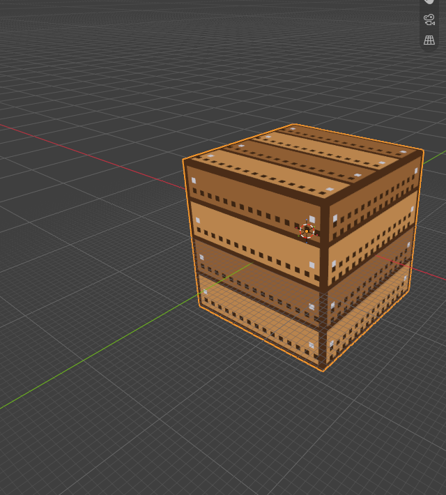
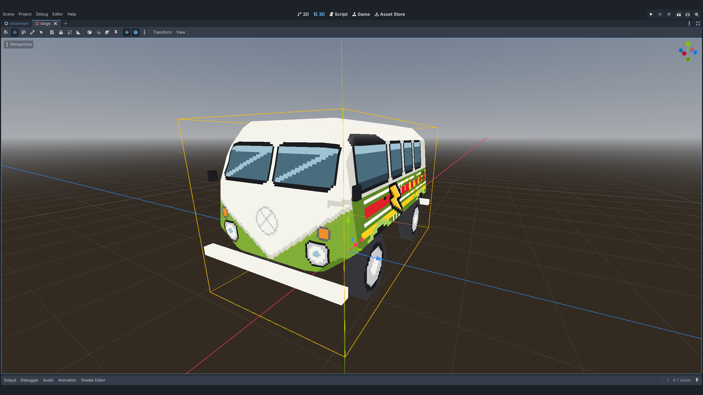
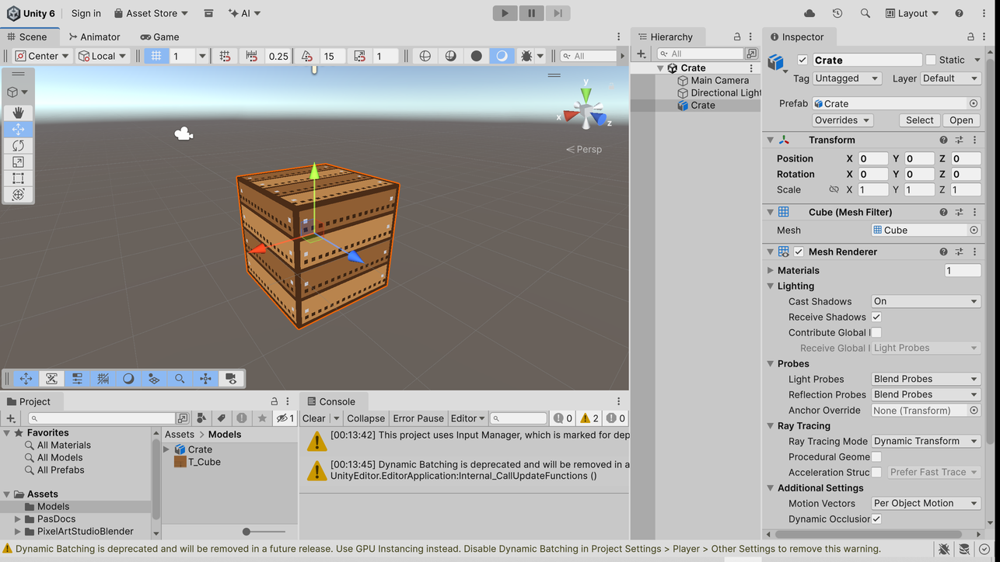
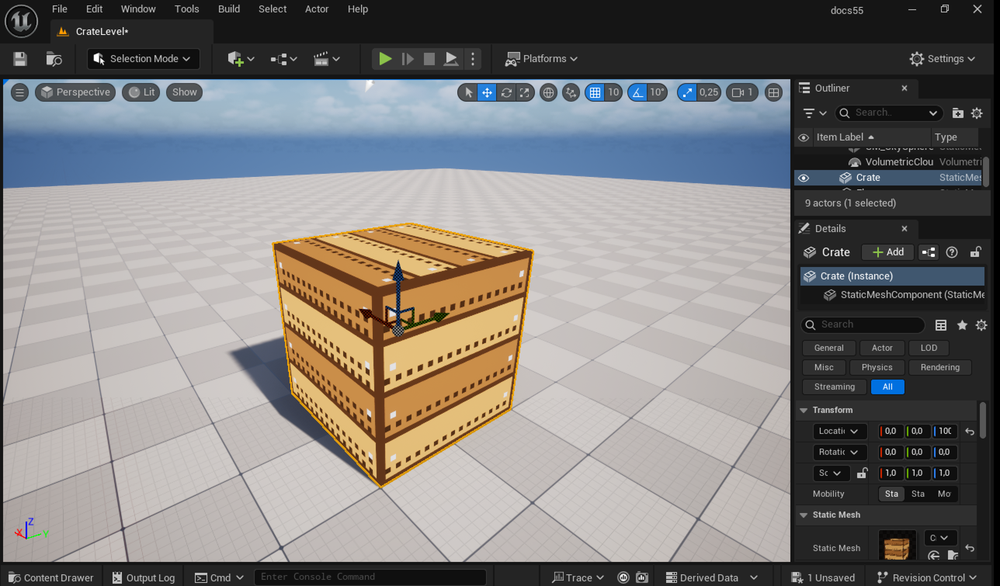

#############################################
From Blender to the Game Engine on Every Save
#############################################

In this tutorial we take a painted model into Godot, with the model **updated in Godot every time you save the .blend**, unlit and with crisp pixels. Then we see what changes for Unity and Unreal Engine.

.. video:: _static/videos/v2/tutorial-engines-save-to-godot.mp4
  :width: 100%

What you need:

* A model with a Pixel Art Studio canvas, painted (see :doc:`tutorial-first-model` or :doc:`tutorial-existing-model`). I'm using a wooden crate here.
* A **Godot 4** project (an empty one made in Godot's Project Manager is fine).

*****************************************
Godot: export a model on every save
*****************************************

Let's start with the most common setup: the .blend lives **outside** the Godot project, and Pixel Art Studio writes a GLB model into it.

1. Save the .blend (:kbd:`Ctrl+S`), somewhere outside the Godot project. Every integration needs a saved file.
2. Open the sidebar (:kbd:`N`), tab ``Pixel Art Studio``, and open the ``Others`` panel at the bottom (it's closed by default).
3. Click the ``Godot`` header to open its section, then click ``Integrate with Godot``.

   .. image:: _static/images/v2/engines-others-panel.png

4. A file browser opens. Go to your Godot project folder (the one with ``project.godot`` in it, a subfolder of it is fine too) and click ``Select Project``.

   .. image:: _static/images/v2/tutorial-engines-godot-picker.png

5. The ``Integrate with Godot`` dialog opens. Keep ``Export on Every Save`` ticked and ``The project's models folder`` picked, then click ``OK``.

   .. image:: _static/images/v2/engines-godot-dialog.png

6. The first export runs right away. The last line of the ``Godot`` section says what was written, for example ``Exported Crate.glb in 0.1 s``.

Now switch to Godot: the model is in ``res://models/``, named after the .blend. Drag it into a scene. **It's unshaded, the pixels are crisp at any distance, and transparent texels are cut out** (only when the canvas has them).

Paint, save, and it's in Godot
==============================

1. Back in Blender, paint something on the model.
2. Press :kbd:`Ctrl+S`.
3. Switch to Godot. It sees the new file and reimports it by itself.

That's it, from now on it's paint and save. Good to know:

* ``Re-export`` writes the model into the project **without saving** the .blend (strokes you haven't saved yet go along).
* The model's name, its folder, ``GLB`` or ``glTF`` and whether the texture goes inside the model or as a PNG beside it are all in the ``Godot`` section, any time. See :doc:`game-engines` for each setting.
* Already imported this model into Godot by hand before? Click ``Fix Models in Project``: it lists what Godot is reading wrongly and fixes it.
* Your own ``File > Export > glTF 2.0`` gives you the same unlit, crisp model too, as long as ``Unlit Pixel Art in glTF`` (``Others`` panel, above the engine sections) stays on.

Let Godot import the .blend itself
==================================

Godot can also open a .blend that lives **inside** the project, by running Blender itself. Pixel Art Studio then keeps Godot's import settings and the texture up to date on every save.

1. Save the .blend inside the Godot project.
2. In Godot, point ``Editor > Editor Settings > FileSystem > Import > Blender`` at your Blender. **It has to be the same version you use, or newer**: an older Blender can't open the file, and Godot then only says "not a blend file".
3. In Blender, click ``Integrate with Godot``, pick the project, ``Select Project``.
4. In the dialog pick ``Godot imports this .blend`` and click ``OK``.

.. tip::
    The ``Godot`` section tells you when Godot's Blender is missing or too old, and its ``Copy Blender Path`` button copies this Blender's path, ready to paste into Godot's editor settings.

*****************************************
Unity: what changes
*****************************************

The steps are the same, from ``Others`` > ``Unity`` > ``Integrate with Unity``. The differences:

* Pick the Unity project folder, the one with ``Assets`` and ``ProjectSettings`` in it.
* The model is an **FBX**, with a PNG per canvas beside it. ``The project's Models folder`` is ``Assets/Models``.
* A small editor script goes into ``Assets/PixelArtStudioBlender/Editor/``. Switch to Unity and it compiles first, then imports the model: **unlit, point filtered, transparent texels cut out**.
* A rigged model? ``Keep Armature Safe`` is picked for you when the scene has an armature.
* With the .blend saved inside ``Assets``, you can pick ``Unity imports this .blend`` instead. Unity then opens the .blend with the Blender your system opens .blend files with, so that one has to be your version or newer.

*****************************************
Unreal Engine: what changes
*****************************************

Unreal can't open a .blend, so this one always exports a model, and a small plugin goes into your project to make it pixel art inside Unreal.

1. Save the .blend, then ``Others`` > ``Unreal Engine`` > ``Integrate with Unreal Engine``.
2. Pick the Unreal project folder (the one with the ``.uproject``) and click ``Select Project``.
3. In the dialog, pick ``FBX`` or ``GLB``, keep ``Export on Every Save``, ``The project's PixelArtSource folder`` and the ``Unreal Folder`` ``/Game/PixelArt``, then click ``OK``.
4. **Start (or restart) the Unreal editor once**, so it loads the plugin. The model shows up in ``/Game/PixelArt``, sharp and unlit.
5. Paint and save in Blender: with ``Update Unreal Automatically`` on, the open Unreal editor brings the new model in a few seconds later, with no prompt.

.. note::
    The model file goes in a folder **outside** ``Content`` on purpose: Unreal imports everything in ``Content`` by itself and asks to reimport on every save. From outside, the plugin brings it in quietly.

*****************************************
Any other engine
*****************************************

Not using one of these three? ``Others`` > ``Generic Exporter`` > ``Export to a Folder`` writes GLB, glTF or FBX into any folder you pick, on every save. See :doc:`game-engines`.
