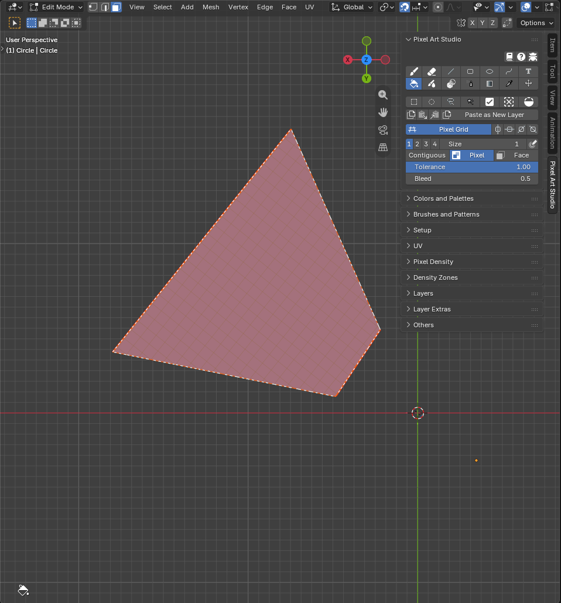
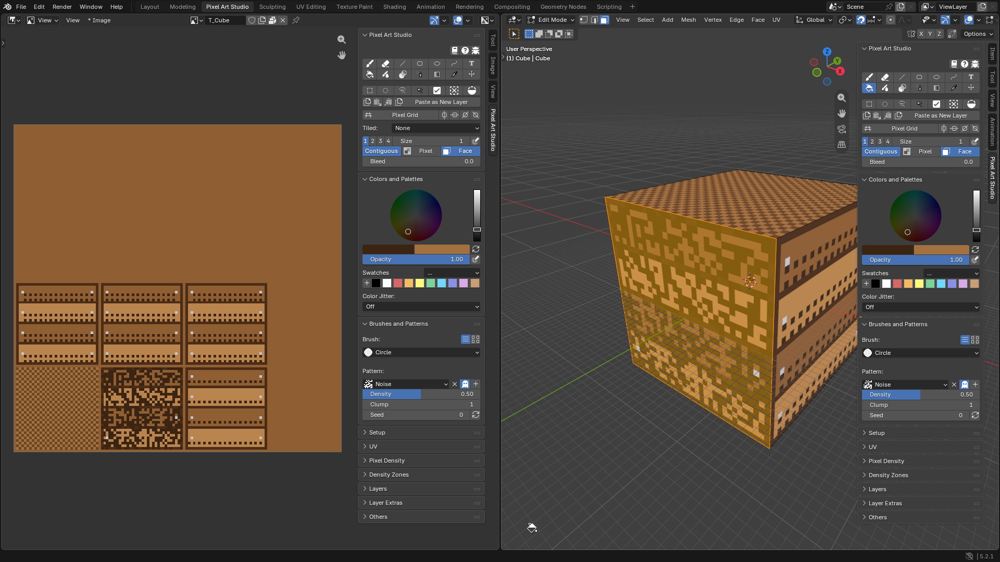

####################################
How to Blockout Colors Quickly
####################################

================================================
Fill by Face Selection in Edit Mode
================================================

.. video:: _static/videos/v2/blockout-fill-faces.mp4
  :width: 100%

If you want to block out colors quickly, filling big areas of the mesh with a single color, you can use the ``Bucket`` tool in ``Face`` mode:

1. Select the ``Bucket`` tool (:kbd:`Shift+Alt+F`)
2. Click ``Face`` to fill by faces instead of by pixels
3. Go to Edit Mode, select the faces you want to fill with a single color

    - Also make sure you are in the correct Pixel Art Studio layer or create a new one

4. Choose a color and fill the faces with a single click on the model with the bucket tool!

- With no face selected (or in Object Mode), it fills every face of the model.
- The texels the edges of the faces only partly cover are filled too, so **diagonal edges are filled all the way to the geometry**, with no stair step of empty texels to clean up later.
- If you made a pixel selection before, the fill stays inside it.

================================================
Fill by using Pixel Selection
================================================

.. video:: _static/videos/v2/blockout-fill-selection.mp4
  :width: 100%

You can also fill areas of the mesh with a single color by using the pixel selection tools, using the ``Bucket`` tool in ``Pixel`` mode and then unchecking ``Contiguous`` and increasing the ``Tolerance`` to fill more pixels at once:

1. Make selections with any of the selection tools

    - Hold :kbd:`Shift` to add to the selection

2. Select the ``Bucket`` tool (:kbd:`Shift+Alt+F`) and make sure ``Pixel`` is on
3. Untoggle ``Contiguous`` to fill every matching pixel in the selection
4. Increase the ``Tolerance``, so it doesn't filter by the color underneath (``1.00`` fills everything inside the selection)
5. Choose a color and fill the pixels with a single click inside the selection with the bucket tool

.. note::
    ``Pixel`` mode reads the active layer only. On an empty layer every texel has the same color (transparent), so even with a low ``Tolerance`` the whole selection gets filled.

================================================
Fill the Half Pixels Along Diagonal Edges
================================================

Along a diagonal UV edge, a selection made on the model is a staircase of whole texels, and the half covered texels along the edge stay empty (they show as a jagged line of the color underneath). Three ways to fill them:

- **Bucket in** ``Face`` **mode** (first section above): it fills them already.
- **Bucket** ``Bleed`` **at** ``0.5``: in ``Pixel`` mode, the fill also reaches the half covered texels next to it, and nothing else (see :ref:`bleed`).
- **Select by Topology**, to fill exactly the area you select:

  1. In the 3D Viewport, arm a selection tool and turn ``Topology`` on
  2. Select over the faces: the selection turns orange and takes the half covered texels too
  3. Select the ``Bucket`` tool (:kbd:`Shift+Alt+F`) in ``Pixel`` mode, untoggle ``Contiguous`` and increase the ``Tolerance`` to ``1.00``
  4. Choose a color and click inside the selection
  5. Turn ``Topology`` off again before you move pixels (a topology selection can't be moved)

See :ref:`select-by-topology` for more details.

================================================
Blockout with Patterns and Texture
================================================

The ``Bucket`` works with fill patterns and ``Color Jitter`` too, so a whole face can get a dither, a noise or a hand placed looking texture in one click:

1. Open the ``Brushes and Patterns`` panel and pick a pattern under ``Pattern:`` (``Checker 50%``, ``Dither 25%``, ``Noise``, or one of your own)
2. Set the primary color (the pattern's set texels) and the secondary color (the gaps)

    - Toggle ``Transparent`` (the ghost icon) to leave the gaps untouched, and lay the pattern over a color you already filled

3. Fill with the ``Bucket``, in ``Face`` or in ``Pixel`` mode

- ``Noise`` with a low ``Density`` and a higher ``Clump`` is great for grass, grime and rust.
- ``Color Jitter`` (in ``Colors and Palettes``) scatters shades of the color, or a few of your swatches, over the fill: set it to ``Shades`` and fill the planks of a crate, for example.
- The patterns are locked to the pixel grid, so two fills next to each other meet without a seam.

See :doc:`brushes-and-patterns` for every pattern setting.
