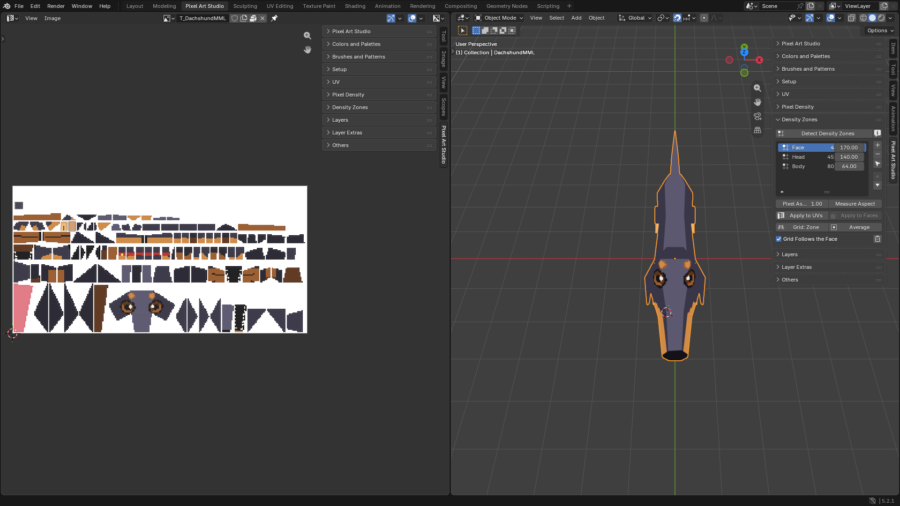
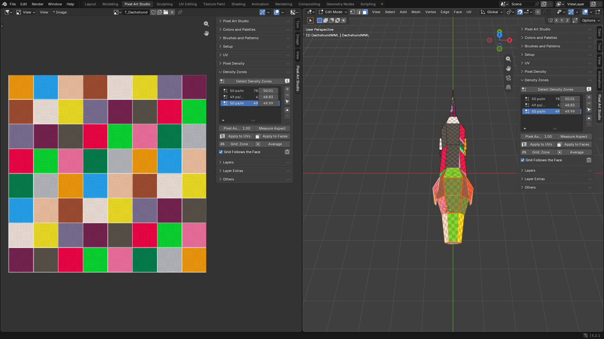
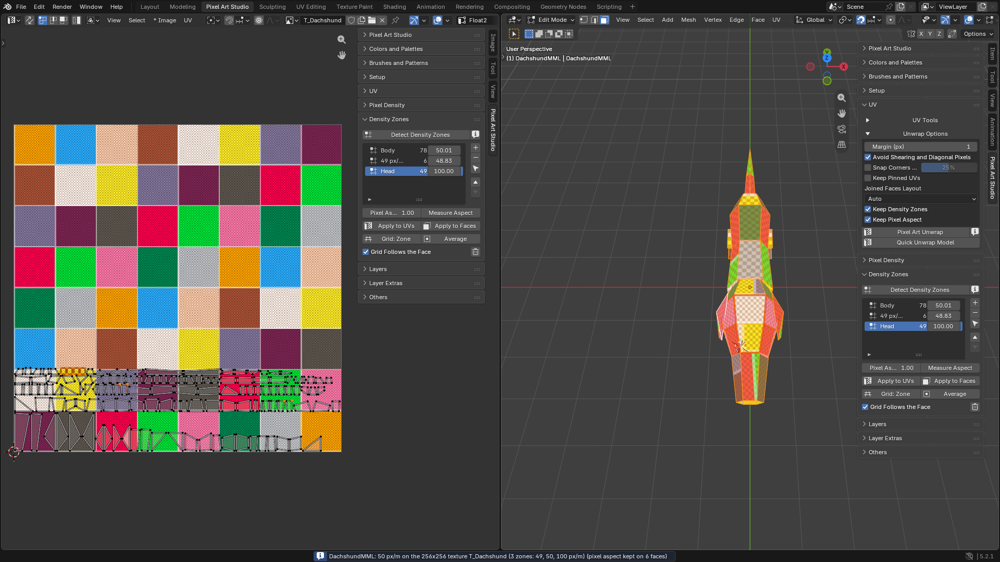

Multiple Pixel Sizes on One Model
=========================================

Let's give the dachshund's head **twice the density of its body**: smaller and more pixels on the head, for the eyes and the snout, and chunky pixels on the body. One model, two pixel sizes, with :doc:`density-zones`.

* **A finished model**: sections 1 to 4, the dachshund.
* **A model you're still building**: section 5, try pixel sizes face by face with ``Apply to Faces`` while you model.

Before you start
----------------

You need the model with a canvas, at one pixel size, unwrapped by Pixel Art Studio (see :doc:`tutorial-first-model` and :doc:`tutorial-uvs-without-the-uv-editor`). This tutorial uses ``Medium Density (50px/m)``, so the head goes to 100 px/m.

.. warning::
    Set the zones up before you paint: the unwrap at the end gives the faces new places in the texture, and the pixels you already painted stay where they were.

1. Measure the model
--------------------

1. Let's select the dachshund and open the ``Density Zones`` panel in the sidebar (:kbd:`N`, tab ``Pixel Art Studio``).
2. Click ``Detect Density Zones``.

The model is at one pixel size, so you get one zone, ``50 px/m``, with the faces in it. The preset in ``Setup`` reads ``Custom`` now (same density, the model just has zones of its own).

2. Make a zone for the head
---------------------------

1. Press :kbd:`Tab` for Edit Mode and select the faces of the head.
2. Click ``+`` beside the list (``Zone from Selection``).

The head's faces are in a zone of their own now, still at 50 px/m (the density they measure).

3. Double click the new zone's ``Density`` and type ``100``.
4. Double click the names and rename them: ``Head`` and ``Body``.

Nothing moved on the model yet: a zone's density counts at the next unwrap.

3. Unwrap with the zones
------------------------

1. Open the ``UV`` panel, then ``Unwrap Options``: ``Keep Density Zones`` shows up now that the model has two zones, and it's on.
2. Click ``Quick Unwrap Model``.

* The report lists both: ``(2 zones: 50, 100 px/m)``.
* **The head takes four times the texels** it had (twice across, twice up).
* When the layout doesn't fit the texture anymore, ``Grow Texture to Fit`` (``Pixel Density`` panel, on) grows the canvas.

Turn on the ``Pixel Grid`` overlay (:kbd:`\\` while a tool is armed, see :ref:`pixel-grid-overlay`) to see the texels on the model: small squares on the head, big ones on the body.

4. Paint with the grid following the face
-----------------------------------------

1. Arm the **Brush** in the 3D Viewport.
2. Hover the body, then the head.

.. video:: _static/videos/v2/tutorial-zones-grid-follow.mp4
  :width: 100%

**Blender's grid changes on the fly**: one grid square is one pixel of the face under the pointer, on the body and on the head (``Grid Follows the Face``, on by default). Put the tool away and the grid goes back.

Now paint. The head takes the detail, the body stays chunky.

5. While you model: try pixel sizes with Apply to Faces
-------------------------------------------------------

No need to finish the model first. While you're still modeling, **give any face its own pixel size, see it on the model right away, change your mind**, and unwrap only at the end. Here with the cube from ``Add 1m Cube`` (``Setup`` panel) at ``Low Density, big pixels (16px/m)``, with its canvas and the ``Pixel Art Canvas`` grid layer on, so you can count the pixels:

1. Press :kbd:`Tab` for Edit Mode, :kbd:`3` for face select, and click the top face.
2. In ``Density Zones``, click ``Detect Density Zones`` (one zone, the cube's 16 px/m), then ``+`` (``Zone from Selection``): a zone for the top face.
3. Double click the new zone's ``Density`` and type ``48``.
4. Click ``Apply to Faces``. **The top face gets the new pixel size right away**: pixels three times smaller than on the sides.

.. video:: _static/videos/v2/tutorial-zones-apply-to-faces.mp4
  :width: 100%

* **Not what you wanted?** Type another ``Density`` and click ``Apply to Faces`` again, or :kbd:`Ctrl+Z`.
* **Another face, another size**: select it, ``+``, a density, ``Apply to Faces``.
* **Back to the size of the rest**: select the face, pick the other zone in the list, ``Apply to Faces``.
* **Faces you add later** (an extrude, a loop cut): select them, pick their zone, ``Apply to Faces``.

When the model is done, click ``Quick Unwrap Model`` (``Keep Density Zones`` on). ``Apply to Faces`` doesn't repack, it only grows or shrinks the islands where they are, so a grown island can land on another one (``Apply to Faces`` warns you when it does). The unwrap packs everything clean, every face at its zone's pixel size.

Going further
-------------

* **Faces you add to the dachshund**: the same as section 5, select them, pick their zone, ``Apply to Faces``, then ``Quick Unwrap Model``.
* **Model a detail on the head's grid**: pick ``Head`` and click ``Grid: Zone``. Pick your preset again in ``Setup`` when you're done.
* **More than two**: as many zones as you want (the eyes at 200 px/m, for example).

Every button is explained in :doc:`density-zones`.
