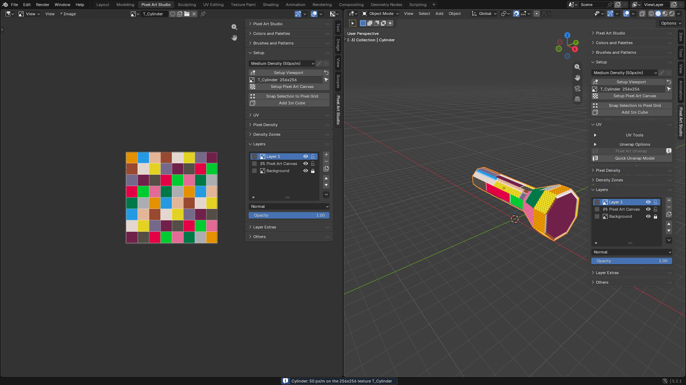
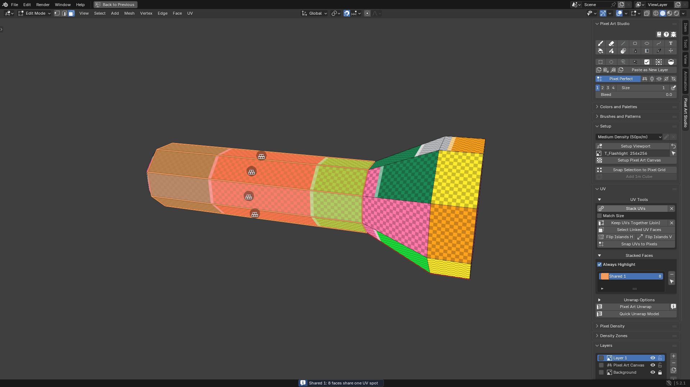
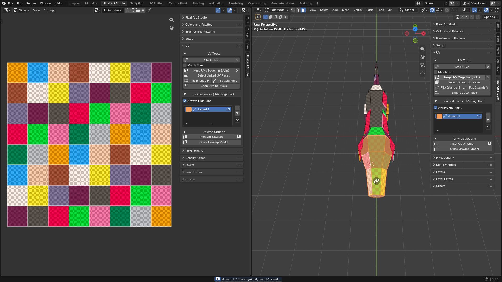
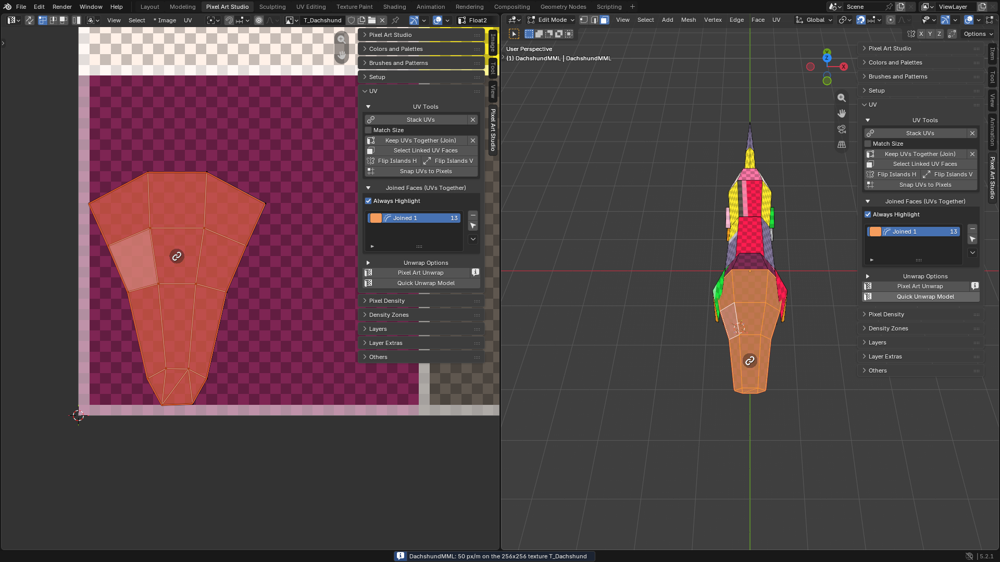

UVs Without the UV Editor
=========================================

Are you worried about UVs? Don't be. With Pixel Art Studio you can unwrap a model for pixel art, paint the same pixels on many faces, and keep a face in one piece, **without ever opening the UV Editor**.

In this tutorial:

* **The flashlight**: one click unwrap, then the handle's sides painted once for all of them.
* **The dachshund's head**: the face kept as one piece of the texture.

.. video:: _static/videos/v2/tutorial-uvs-overview.mp4
  :width: 100%

Before you start
----------------

You need a model with a canvas, and the viewport set up (see :doc:`tutorial-first-model`, or :doc:`setup-and-canvas`). This tutorial uses ``Medium Density (50px/m)`` and the ``Pixel Grid Layer`` of the canvas wizard, so you can see the pixel sizes on the model.

Everything happens in the 3D Viewport sidebar (:kbd:`N`), tab ``Pixel Art Studio``, panel ``UV``.

.. warning::
    Unwrap before you paint: an unwrap gives the faces new places in the texture, and the pixels you already painted stay where they were.

Part 1: the flashlight
----------------------

One click unwrap
~~~~~~~~~~~~~~~~

1. Let's select the flashlight, in Object Mode.
2. Click ``Quick Unwrap Model``.

That's it. **Every face is laid flat at the same pixel size** and packed on the texture: the head, the caps and the handle. The status bar says the density and the texture it used (``Flashlight: 50 px/m on the 256x256 texture T_Flashlight``).

Look at the grid layer on the model: every square is one texel, and they're the same size on every face, slanted or flat.

.. tip::
    ``Quick Unwrap Model`` works from any mode, and puts you back in the mode and the selection you had. One :kbd:`Ctrl+Z` takes it back.

Paint the handle once
~~~~~~~~~~~~~~~~~~~~~

The handle has eight side strips, all the same. Let's put them on one UV spot, so painting one paints all of them.

1. Press :kbd:`Tab` for Edit Mode and :kbd:`3` for face select.
2. Click the first strip, then :kbd:`Shift+click` the others one by one. **The strip you click last** is the one the others follow.
3. Open ``UV Tools`` and click ``Stack UVs``.

* The status bar says ``Shared 1: 8 faces share one UV spot``.
* A ``Stacked Faces`` list shows up with ``Shared 1`` in it.
* Hover any strip: the whole stack lights up in its color, with a stack icon on every strip.

4. Click ``Quick Unwrap Model`` again. The eight strips are one spot now, so they take the room of one strip in the texture.
5. Arm the **Brush** (its icon in the ``Pixel Art Studio`` panel) and paint a stripe on any strip.

.. video:: _static/videos/v2/tutorial-uvs-paint-stacked.mp4
  :width: 100%

**Every strip shows it.** And every unwrap from now on keeps them stacked.

.. tip::
    Faces of different sizes (the quads and the tip triangles of a cone, for example)? Tick ``Match Size`` before ``Stack UVs``, and they're all resized onto the last one.

Part 2: the dachshund's head
----------------------------

A face is a picture: you want it in one piece of the texture, the snout next to the eyes next to the ears. By default ``Quick Unwrap Model`` gives every face its own island, so let's join the head.

1. Let's select the dachshund and press :kbd:`Tab` for Edit Mode.
2. Select the faces of the head (the snout, the cheeks, the forehead).
3. ``UV Tools`` > ``Keep UVs Together (Join)``.

* The status bar reports ``Joined 1``, one UV island.
* A ``Joined Faces (UVs Together)`` list shows up with ``Joined 1`` in it.
* **No UV moved yet**: the group is recorded on the model, the unwrap does the rest.

4. Click ``Quick Unwrap Model``.

The head comes out as **one island**. ``Joined Faces Layout`` (in ``Unwrap Options``) is ``Auto``: it unfolds the group when it can lie flat, and relaxes it when it's curved, like a head.

5. Paint the face on the model, or open the canvas in the Image Editor (the arrow button beside the canvas name in ``Setup``) and paint it there, as a picture.

.. tip::
    Want the head cut open somewhere else? Mark a seam inside the group (``Edge > Mark Seam``) and unwrap again: the unwrap opens it there.

.. tip::
    Did you lay out the head's UVs by hand and like them? Pick ``Joined 1`` in the list, open the arrow beside it and choose ``Keep Shape``. Every unwrap from then on keeps that shape, only scaled to the density.

Find your groups again
----------------------

Still no UV Editor:

* **Hover the model** in Edit Mode: a stack or a joined group lights up in its color.
* **Click a row** in ``Stacked Faces`` or ``Joined Faces (UVs Together)``: its faces are selected.
* ``Select Linked UV Faces``: select one face, click it, and the rest of its stack or group is selected too.
* **Change your mind**: the X beside ``Stack UVs`` or ``Keep UVs Together (Join)``, or the ``-`` beside the list, and the next unwrap gives each face its own island again.

Every button is explained in :doc:`uv-tools`. Next, give the dachshund's head smaller pixels than its body: :doc:`tutorial-multiple-pixel-sizes`.
