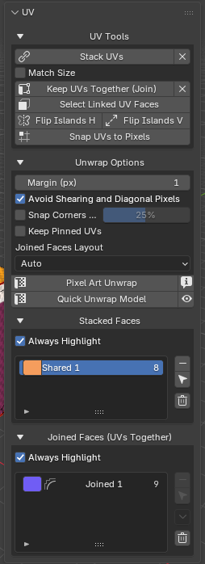
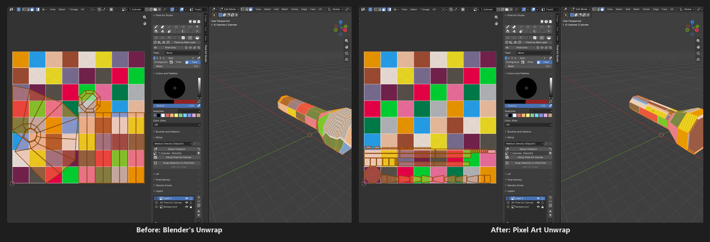
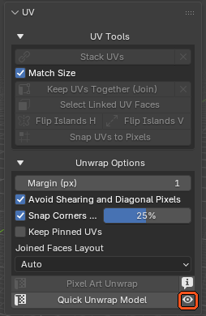
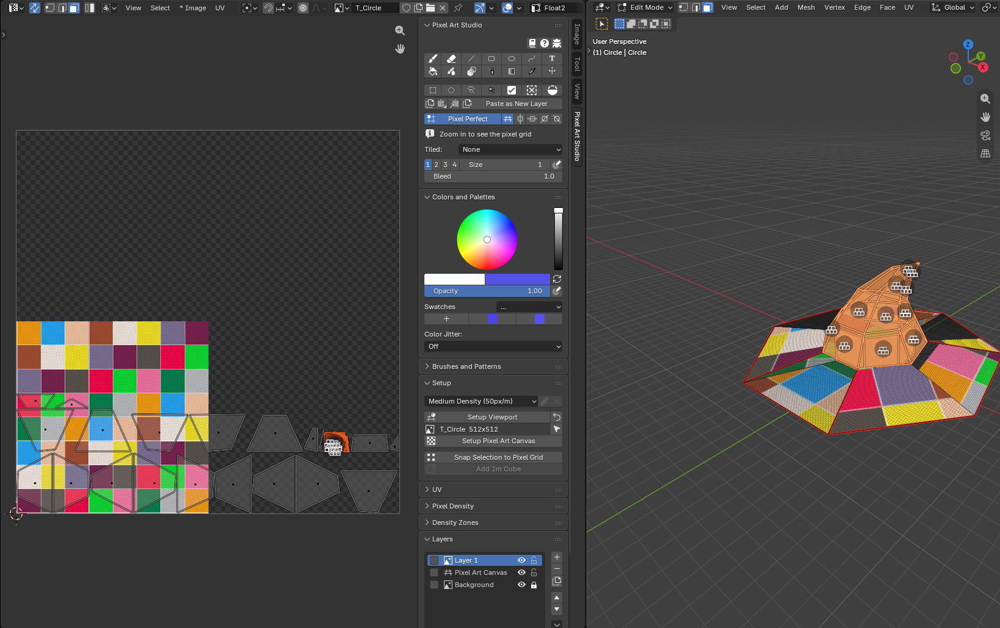
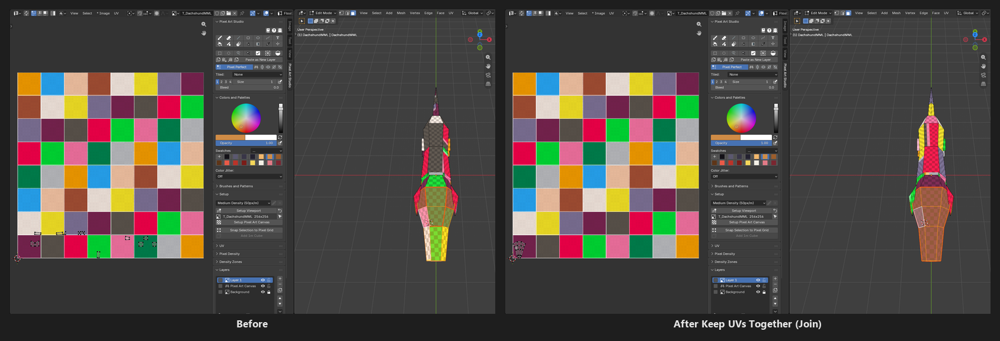
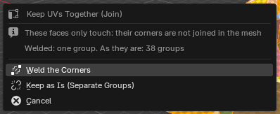
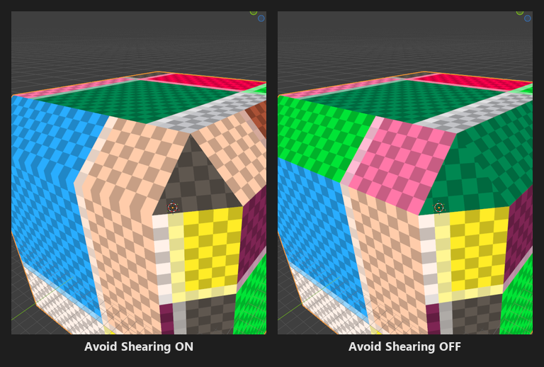
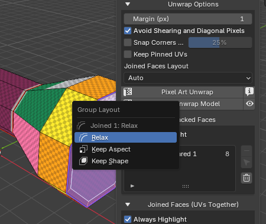
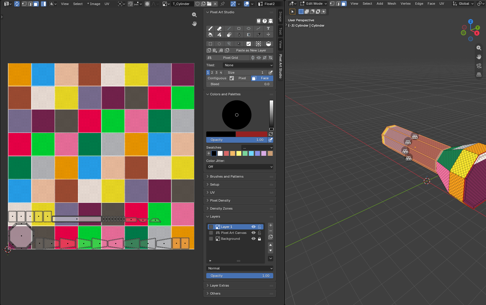

UV Tools
=========================================

Pixel art needs UVs where **every face has the same pixel size**: no stretched pixels, no half pixels, no mixed pixel sizes. The ``UV`` panel does that for you, and you can do all of it from the 3D Viewport, **without ever opening the UV Editor** (see :doc:`tutorial-uvs-without-the-uv-editor`).

It's in the sidebar (:kbd:`N`), tab ``Pixel Art Studio``, panel ``UV`` (closed by default), in the 3D Viewport and in the Image Editor / UV Editor (the same panel in both).

Top to bottom:

* ``UV Tools``: what you do to the selected faces (``Stack UVs``, ``Keep UVs Together (Join)`` and the rest).
* ``Unwrap Options``: what the unwrap does.
* ``Pixel Art Unwrap``, with an info button beside it.
* ``Quick Unwrap Model``, with the eye beside it (3D Viewport): the preview of the UVs it would make (see :ref:`quick-unwrap-preview`).
* ``Stacked Faces`` and ``Joined Faces (UVs Together)``: the lists of groups the UV Tools made (only when the model has one), last, so they never push the buttons down as they grow.

The section headers fold and unfold with a click anywhere on them.

.. _pixel-art-unwrap:

Pixel Art Unwrap
----------------

A UV unwrap made for pixel art, of the **selected faces**, in Edit Mode:

* **Every face laid flat** at its true size, so a slanted face gets as many pixels as a flat one.
* **One pixel size** for the whole model (or for every model on that texture), the scene's density (see :doc:`pixel-density`).
* **One island per face**, except the faces you stacked (one spot) and the faces you joined (one island).
* **Packed on whole texels**, with a margin between islands.
* **The canvas grows** when the layout doesn't fit (``Grow Texture to Fit``, ``Pixel Density`` panel).

* **Also in the** ``UV`` **menu** of the 3D Viewport (:kbd:`U` in Edit Mode), at the bottom, with ``Quick Unwrap Model``.
* **The info button** says the density it's going to use (``Unwraps the selected faces at 50 px/m``).
* **The report** in the status bar says the density and the texture (``Crate: 50 px/m on the 256x256 texture T_Crate``), and when a smaller texture would do (``using 30%, 128px would do, or Fit Texture``). Anything that needs your attention also shows in coral at the bottom of the ``Setup`` panel.
* :kbd:`F9` after the click: every option of the run, to tweak it (what you change goes back into ``Unwrap Options``).
* **The paint tools stay armed** through it, the next stroke paints on the new layout.

.. warning::
    It lays out only the selected faces, and doesn't pack around the ones you left out, so a partial selection can land on top of them. Use ``Quick Unwrap Model`` for the whole model, or pin the faces you want to keep (see ``Keep Pinned UVs`` below).

.. _quick-unwrap-model:

Quick Unwrap Model
------------------

``Pixel Art Unwrap`` of the **whole model, from any mode** (Object Mode, Edit Mode, Sculpt, the paint modes), and then you're back in the mode and the selection you had. **One click, one** :kbd:`Ctrl+Z`.

* **Every visible face**: faces hidden in Edit Mode stay out.
* **The other selected models on the same texture** come along (from Object Mode), and are packed together as one layout. Selected models on another texture are left alone, and the report names them.

.. video:: _static/videos/v2/quick-unwrap-model.mp4
  :width: 100%

.. _quick-unwrap-preview:

The eye: preview before you unwrap
~~~~~~~~~~~~~~~~~~~~~~~~~~~~~~~~~~

The eye beside ``Quick Unwrap Model`` shows **the UVs it would make, on the model, before anything changes**: it opens ``Try Pixel Densities`` (or ``Quick Setup``, for a model with no texture) on ``Preview UVs: Quick Unwrap``, with the grid drawn through the new layout at any pixel size you try.

* ``Apply New Density`` (or ``Create Texture``) lays those UVs out, at the model's own pixel size too, and **your painting is carried onto them** with ``Keep my painting``.
* ``Close`` (or :kbd:`Esc`) and nothing changed.

See :doc:`quick-setup`.

Several models on one texture
~~~~~~~~~~~~~~~~~~~~~~~~~~~~~

A character split in several meshes (body, arms, a hat) sharing one texture is **one layout**: select them all in Object Mode and click ``Quick Unwrap Model`` (or put them in Edit Mode together and ``Pixel Art Unwrap``).

* One density for all of them, one pack, no part on top of another, and the canvas grows once for the group.
* One report line: ``arms, body and hat together: 50 px/m on the 256x256 texture T_Char``.
* The layout is the same whichever of them is the active one.
* A linked duplicate is one mesh: laid out once, and both copies wear it.
* Meshes in Edit Mode on **another texture** are unwrapped by the same click, one layout per texture (``Quick Unwrap Model`` from Object Mode leaves them alone instead).

.. _uv-tools-section:

UV Tools
--------

What you do to the **selected faces**, in Edit Mode. A greyed out button says why when you hover it (``Select two faces or more``, for example). Every button is one undo step.

.. _stack-uvs:

Stack UVs
~~~~~~~~~

**Paint it once, see it everywhere**: puts the selected faces on one UV spot, so they share the same pixels (the eight sides of a barrel, the strips of a flashlight handle, the spokes of a wheel).

.. video:: _static/videos/v2/stack-uvs.mp4
  :width: 100%

* **The face you select last** is the one the others land on (in the UV Editor, the active face).
* **The others** take its place, its turn and its flip, and keep their own size (unless ``Match Size`` is on). The turn and the flip are picked so the picture reads the same way round on the model: a line painted across one side lands at the same end on every side.
* **Faces with a different number of corners** are matched too (a triangle onto a quad).
* **It's kept on the model**: every later ``Pixel Art Unwrap`` and ``Quick Unwrap Model`` stacks them again, packed as one spot.
* **After the click**, every face of the stack is selected, in the 3D Viewport and in the UV Editor, so a :kbd:`G` in the UV Editor moves the whole stack.
* A new row in ``Stacked Faces``: ``Shared 1``, ``Shared 2``... each with its own color.
* **The X beside it** (``Unshare UVs``): the selected faces stop sharing. Their UVs stay where they are, the next unwrap gives each face its own spot again.

``Match Size`` (off): the stacked faces also take the **size** of the last selected face, so a bigger or smaller face is resized onto it (and takes its pixel size). Remembered per stack, so later unwraps resize them again.

.. note::
    UVs already joined into islands of several faces (after Blender's ``Smart UV Project``, for example) are moved as whole islands, and the report says so. Click ``Pixel Art Unwrap`` first to stack face by face.

.. _keep-uvs-together:

Keep UVs Together (Join)
~~~~~~~~~~~~~~~~~~~~~~~~

Lays the selected faces out as **one UV island** instead of one island per face: a face, a curved hood, the side of a cylinder. One piece in the texture, so you can paint it as a picture in the Image Editor too.

* **It changes no UVs by itself**: the island comes at the next ``Pixel Art Unwrap`` or ``Quick Unwrap Model``, and every unwrap after that keeps it.
* **Neighboring faces** (sharing an edge). Two separate blocks selected make two groups, and a face touching none of the others is left out.
* **One face alone is a group of one**, so that face can get a layout choice of its own (``Keep Shape``, below).
* **Seams**: it marks seams on the group's outline and clears the ones inside. A seam you mark inside the group afterwards is where the unwrap cuts it open.
* A new row in ``Joined Faces (UVs Together)``: ``Joined 1``, ``Joined 2``... each with its own color.
* **The X beside it** (``Release``): the selected faces leave their group. The seams stay, the next unwrap gives each face its own island again.

.. note::
    A face is in one group only: stacking a face takes it out of its joined group, and joining a face takes it out of its stack (the report says so).

.. _keep-together-weld:

Faces that only touch (glTF imports)
^^^^^^^^^^^^^^^^^^^^^^^^^^^^^^^^^^^^

A model imported from glTF often comes with its faces split: they **only touch**, their corners aren't joined in the mesh, so every face would be a group of its own. ``Keep UVs Together (Join)`` notices it and asks first:

* The question says how many groups you'd get each way (``Welded: one group. As they are: 38 groups``).
* ``Weld the Corners``: the corners that only touch are joined (the selected faces only), then the faces become one group. The shading stays the same: the joins between smooth faces are marked sharp.
* ``Keep as Is (Separate Groups)``: one group per piece, as before.
* ``Cancel`` (or :kbd:`Esc`): nothing changes.
* The click takes no undo step, each answer takes one.

.. tip::
    A welded model that's closed all round (a hat, a ball) can't be unfolded flat as one piece: mark a seam on it so the unwrap can cut it open.

Select Linked UV Faces
~~~~~~~~~~~~~~~~~~~~~~

Adds to the selection every face linked to the selected ones: the faces stacked with them and the rest of their joined group, in the 3D Viewport and in the UV Editor. Then a :kbd:`G` in the UV Editor drags the whole stack or group.

Flip Islands H and Flip Islands V
~~~~~~~~~~~~~~~~~~~~~~~~~~~~~~~~~

Mirrors each selected UV island in place, so the picture on those faces reads the other way round (text that reads backwards, for example). An island on whole texels stays on whole texels.

* :kbd:`Shift+F` and :kbd:`Shift+V` do the same in the UV Editor, while a tool is armed there.
* Select the whole island: flipping part of it tears it apart.

Snap UVs to Pixels
~~~~~~~~~~~~~~~~~~

Moves every UV corner of the selected faces to the nearest texel corner. A quick fix for UVs you moved by hand, with a catch: each corner is rounded on its own, so a face that isn't a rectangle can come out slanted. An unwrap or ``Apply Texel Density`` never does that.

.. _unwrap-options:

Unwrap Options
--------------

What ``Pixel Art Unwrap`` and ``Quick Unwrap Model`` do (also followed by ``Apply Texel Density``, ``Add 1m Cube`` and the canvas wizard). Saved with the .blend.

* ``Margin (px)`` (``1``): texels between islands, whatever the texture size. **A filtered texture needs at least 2**: picking ``Linear`` or ``N64 (3 Point)`` raises it to ``4``, and under 2 it says ``Filtered: laid out at 2`` (see :ref:`filtered-margin`).

  .. image:: _static/images/v2/unwrap-options-filtered-margin.png

* ``Avoid Shearing and Diagonal Pixels`` (on): **every face keeps its exact shape and pixel size**, and an edge that isn't on a whole texel shows a partial texel there. Off, every corner goes on a texel corner (no partial texels), but a face that isn't a rectangle is bent a little and its pixel size drifts. Rectangles come out the same either way.

  * ``Snap Corners Within`` (off, ``25%``): faces that are already nearly on the pixel grid go onto it, the rest keep their exact shape. The number is how far a corner may move, as a fraction of a pixel (``0`` snaps nothing, ``50`` snaps every face). Only shown while ``Avoid Shearing and Diagonal Pixels`` is on.

* ``Keep Pinned UVs`` (off): pinned UVs (:kbd:`P` in the UV Editor) stay exactly where they are, and the other faces are packed around them. A face with one pinned corner counts as pinned.
* ``Joined Faces Layout`` (``Auto``, only when the model has joined faces): how a joined group becomes one island.

  * ``Auto``: unfolds the group when it can lie flat without stretching, relaxes it when it's curved.
  * ``Unfold``: every face keeps its exact shape. The group is cut where it can't close, and a curved one may overlap itself.
  * ``Relax``: one piece, every face as near its own shape and pixel size as the curve allows. A ring (the side of a cylinder) is cut open once.
  * ``Project``: the group seen from one direction. Faces turned away from it get fewer pixels.

* ``Keep Density Zones`` (on, only on a model with two density zones or more): each face at the density of its zone.
* ``Keep Pixel Aspect`` (on, only when a zone has a pixel aspect): each face stretched by its zone's pixel aspect (see :doc:`density-zones`).

Two more settings live in the ``Pixel Density`` panel: the unwrap density (``Texel Density`` or ``Fit Texture``, see :ref:`fit-texture`) and ``Grow Texture to Fit`` (see :ref:`grow-texture-to-fit`).

.. _group-layout:

A layout per joined group: Relax, Keep Aspect, Keep Shape
---------------------------------------------------------

Did you lay out a group's UVs by hand, or did the model come with UVs you like? Each joined group can keep them through every unwrap. Pick the group in ``Joined Faces (UVs Together)`` and open the arrow under the buttons beside the list (``Group Layout``):

* ``Relax`` (default): laid out from the model, the way ``Joined Faces Layout`` says.
* ``Keep Aspect``: laid out from the model, stretched by the proportions its UVs have now. It follows the model when you edit it.
* ``Keep Shape``: **the UVs it has now**, scaled evenly to the density, so every face keeps its drawn proportions. The unwrap only scales it, puts it on the pixel grid and packs it.

The size always comes from the density, the choice only decides the proportions.

* **Choosing records the group's UVs as they are now**: choose again to record them again.
* **Edited the model after** ``Keep Shape``? The group keeps its aspect instead and the report says so. Choose ``Keep Shape`` again to record the new shape.
* Each row of the list wears the icon of its choice.

.. _uv-groups-lists:

Stacked Faces and Joined Faces
------------------------------

Every stack and every joined group of the selected model, in two lists (each one only when the model has a group of its kind).

* **A row**: its color, its name and how many faces it has.

  * Click the color to change it.
  * Click a row, then double click its name to rename it.

* **Click a row's name** to select the group: in Edit Mode its faces become the selection (in the 3D Viewport and in the UV Editor), in Object Mode it's lit on the model.
* **The buttons beside the list** act on the selected row:

  * ``-`` takes the group apart (the same as ``Unshare UVs`` or ``Release`` on all of its faces), UVs are unaffected. The list moves to the next row, so pressing ``-`` again takes that one apart.
  * **The arrow cursor** selects its faces (Edit Mode). :kbd:`Shift+click` adds them to the selection.
  * **The arrow** (Joined Faces only): the ``Group Layout`` menu.
  * **The trash** (last): removes **every** group of that list, after asking (``Remove all Joined Faces?``), as one undo step. UVs are unaffected, and the other list stays as it is.

* **The lists follow your selection**: in Edit Mode, click a face and each list jumps to that face's group (and it never changes your selection back).
* The groups are kept on the mesh: a duplicate carries a copy, the .blend keeps them.

.. _uv-groups-highlight:

The highlight
~~~~~~~~~~~~~

In Edit Mode, **hover a face and its group lights up** in its color, with a stack icon on stacked faces and a chain icon on a joined group, in the 3D Viewport and in the UV Editor. The group you picked in a list stays lit until you do something else.

* ``Always Highlight`` (on, at the top of each list): the groups light up even while a paint tool is armed. Off, only with no tool armed.
* The plain Image Editor shows no highlight: switch it to the UV Editor.
* With ``Backface Culling`` on, the back of a face isn't lit.

.. _uv-editor-or-not:

With or without the UV Editor
-----------------------------

Everything above works from the 3D Viewport sidebar: select faces on the model, click the button. The same panel is in the UV Editor sidebar too.

* **What "the selected faces" are**:

  * In the 3D Viewport, and in the UV Editor with ``UV Sync Selection`` on: the faces selected on the mesh.
  * In the UV Editor with ``UV Sync Selection`` off: every face with a UV selected (with none, the faces selected on the mesh).

* **The last selected face** for ``Stack UVs``: the last face you clicked in the 3D Viewport, the active face in the UV Editor.
* **A stack is one island** in the UV Editor: clicking it picks one of its faces. Use ``Select Linked UV Faces`` (or the list's select button) before you move it.
* **Moving UVs by hand**: with a tool armed in the UV Editor and a mesh in Edit Mode, :kbd:`G`, :kbd:`R` and :kbd:`S` are still Blender's own grab, rotate and scale of the selected islands, in both shortcut modes.
* ``Setup Viewport`` sets ``Round to Pixels: Corner`` in every Image Editor, so the UVs you drag land on texel corners.

.. note::
    Why are the UV buttons greyed out while I drag UVs?

    On purpose: they come back as soon as the drag ends. Reading the mesh during a UV drag can crash Blender.

Troubleshooting
---------------

* **A button is greyed out**: hover it, the red line says why. Most need Edit Mode and a selection, ``Stack UVs`` needs two faces.
* **Keep UVs Together did nothing**: it changes no UVs by itself, click ``Pixel Art Unwrap`` or ``Quick Unwrap Model`` afterwards.
* **The report says** ``does not fit``: the texture is too small at this density. Turn on ``Grow Texture to Fit``, lower the density, or use ``Fit Texture`` (see :doc:`pixel-density`).
* **The report says** ``texture size setting``: the model has no texture, so the layout is measured against the size set for the next canvas. Make a canvas first (see :doc:`setup-and-canvas`).
* **A joined group came out projected**: a group closed all round (with no border) can't be opened; mark a seam on it. A group that would fold over itself when relaxed: split it in two.
* ``Keep Pinned UVs`` **on and nothing moved**: every face carries a pin.
* **Typing in a list's filter field finds nothing**: the ``Stacked Faces`` and ``Joined Faces (UVs Together)`` lists always show every group. Hover the model to find one.
